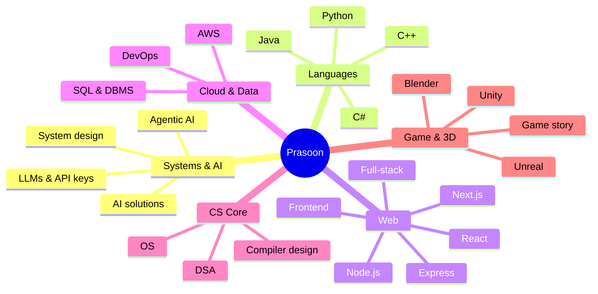
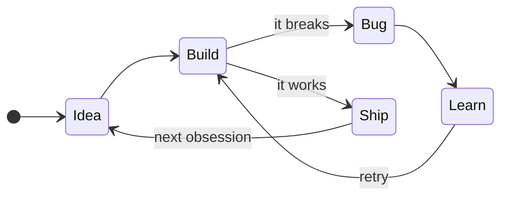
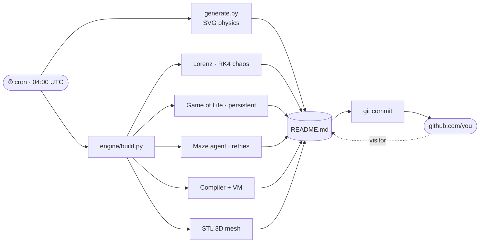

<div align="center">



<sub><code>build 01702d6 · rebuilt 6× · alive 3 days · 2026-10-25 09:01 UTC</code></sub>



<a href="https://iprsnmsra.vercel.app/"></a>
<a href="https://www.linkedin.com/in/iprsnmsra"></a>
<a href="mailto:prasoonmishra9c@gmail.com"></a>

<a href="https://github.com/iprsnmsra/vigil"></a>
<a href="https://kestrel-ai-threat-analyzer.vercel.app/"></a>
<a href="https://github.com/iprsnmsra/AnimeBill"></a>

</div>

## Engineering lab · nothing below is typed, all of it is computed

<details open>
<summary><b>🦋 Chaos</b> · a fresh Lorenz attractor every day, RK4-integrated</summary>

```
⠀⠀⠀⠀⠀⠀⠀⠀⠀⠀⠀⠀⠀⠀⠀⠀⠀⠀⠀⠀⠀⠀⠀⠀⠀⠀⠀⠀⠀⠀⠀⠀⠀⠀⠀⠀⠀⠀⠀⠀⠀⠀⠀⠀⠀⠀⠀⠀⠀⠀⠀⠀⠀⠀⠀⠀⠀⠀⠀⠀⠀⠀⠀⠀⠀⠀⠀⠀⠀⠀
⠀⠀⠀⠀⠀⠀⠀⠀⠀⠀⠀⠀⠀⠀⠀⠀⠀⠀⠀⠀⠀⠀⠀⠀⠀⠀⠀⠀⠀⠀⠀⠀⠀⠀⠀⠀⠀⠀⠀⠀⠀⠀⠀⠀⠀⠀⠀⠀⠀⠀⠀⠀⠀⠀⠀⠀⠀⠀⠀⠀⠀⠀⠀⠀⠀⠀⠀⠀⠀⠀
⠀⠀⠀⠀⠀⠀⠀⠀⢀⡠⠄⣀⢀⠀⠀⠀⠀⠀⠀⠀⠀⠀⠀⠀⠀⠀⠀⠀⠀⠀⠀⠀⠀⠀⠀⠀⠀⠀⠀⠀⠀⠀⠀⠀⠀⠀⠀⠀⠀⠀⠀⠀⠀⠀⠀⠀⠀⠀⠀⠀⠀⠀⠀⠀⠀⠀⠀⠀⠀⠀
⠀⠀⠀⠀⠀⠀⠀⢠⢣⢒⡩⣍⣥⣷⣡⡢⣄⠀⠀⠀⠀⠀⠀⠀⠀⠀⠀⠀⠀⠀⠀⠀⠀⠀⠀⠀⠀⠀⠀⠀⠀⠀⠀⠀⠀⠀⠀⠀⠀⠀⠀⠀⠀⠀⡀⡠⠄⠤⠤⡄⠀⠀⠀⠀⠀⠀⠀⠀⠀⠀
⠀⠀⠀⠀⠀⠀⠀⠨⡊⣮⡎⠁⢀⣀⣈⣉⡓⠽⣶⣠⢀⠀⠀⠀⠀⠀⠀⠀⠀⠀⠀⠀⠀⠀⠀⠀⠀⠀⠀⠀⠀⠀⠀⠀⠀⠀⠀⠀⠀⢀⢀⣄⣪⢾⣖⣛⡛⢯⣢⠈⡂⠀⠀⠀⠀⠀⠀⠀⠀⠀
⠀⠀⠀⠀⠀⠀⠀⠘⣨⢽⡄⠀⡟⢁⡤⢬⣬⠵⣢⢬⣓⠾⣆⣆⠄⡀⠀⠀⠀⠀⠀⠀⠀⠀⠀⠀⠀⠀⠀⠀⠀⠀⠀⠀⠀⠀⢀⢄⣦⣗⣾⣿⠮⠽⠿⣭⢻⡆⡧⢃⠃⠀⠀⠀⠀⠀⠀⠀⠀⠀
⠀⠀⠀⠀⠀⠀⠀⠀⢐⢒⣇⠀⣇⢸⡼⣕⣶⣿⣿⣿⣾⣷⡢⣙⡸⣮⢔⢄⡀⠀⠀⠀⠀⠀⠀⠀⠀⠀⠀⠀⠀⠀⠀⣠⣐⣵⡷⣯⣞⠿⠛⠉⠉⠉⢹⢸⣾⣇⡽⡨⠀⠀⠀⠀⠀⠀⠀⠀⠀⠀
⠀⠀⠀⠀⠀⠀⠀⠀⠀⠔⡩⡂⠸⡼⣱⣿⣿⣿⣿⣿⣿⣿⣿⣷⣯⡲⣝⠳⢽⣆⢢⡀⠀⠀⠀⠀⠀⠀⠀⢀⡠⣢⢾⣯⣿⡷⠟⠉⠀⠀⠀⠀⠀⠀⡸⡾⡾⣭⡓⠀⠀⠀⠀⠀⠀⠀⠀⠀⠀⠀
⠀⠀⠀⠀⠀⠀⠀⠀⠀⠈⠔⡹⡄⢱⡙⣿⢿⣿⣿⡀⠈⠙⠿⣿⣿⣿⣾⣵⢦⡉⠷⣽⣕⡤⣀⠀⠀⣀⢔⣵⣽⣵⣿⠟⠋⠀⠀⠀⠀⠀⠀⠀⠀⡰⡻⡽⡽⠡⠂⠀⠀⠀⠀⠀⠀⠀⠀⠀⠀⠀
⠀⠀⠀⠀⠀⠀⠀⠀⠀⠀⠈⠰⡘⣆⠙⡜⢿⣿⣿⣷⣄⡀⠀⠘⣿⣿⣿⣷⡧⡙⢦⠈⠻⣮⡪⡲⣾⣴⢿⡿⡷⡻⠃⠀⠀⠀⠀⠀⠀⠀⠀⠀⣴⠽⣾⠴⠢⠁⠀⠀⠀⠀⠀⠀⠀⠀⠀⠀⠀⠀
⠀⠀⠀⠀⠀⠀⠀⠀⠀⠀⠀⠀⠡⠲⠧⡘⢦⡫⣻⣿⣿⣿⣶⣶⣿⣿⣿⣿⡟⡝⡌⢳⡀⢨⢿⣾⡿⣵⣟⡾⡹⠁⠀⠀⠀⠀⠀⠀⠀⠀⣠⡻⡫⡪⣚⠃⠁⠀⠀⠀⠀⠀⠀⠀⠀⠀⠀⠀⠀⠀
⠀⠀⠀⠀⠀⠀⠀⠀⠀⠀⠀⠀⠀⠈⠭⢓⣤⠙⢮⡪⣯⢿⣿⣿⣿⣿⣿⡝⡇⡇⢹⠀⣿⠃⣜⡿⣵⡟⢾⡗⣧⡀⠀⠀⠀⠀⠀⣀⢔⡿⣫⣯⠞⡡⠁⠀⠀⠀⠀⠀⠀⠀⠀⠀⠀⠀⠀⠀⠀⠀
⠀⠀⠀⠀⠀⠀⠀⠀⠀⠀⠀⠀⠀⠀⠈⠐⡪⢛⢄⠉⠢⣝⠻⢿⣛⣛⣓⣋⠴⠁⣜⡼⢹⡿⣽⠁⡿⡟⢾⣷⠾⣯⣓⣒⣒⣮⢽⣚⡵⣻⡿⡫⠈⠀⠀⠀⠀⠀⠀⠀⠀⠀⠀⠀⠀⠀⠀⠀⠀⠀
⠀⠀⠀⠀⠀⠀⠀⠀⠀⠀⠀⠀⠀⠀⠀⠀⠀⠩⡣⡻⣦⣀⠙⠓⠦⣤⣤⣤⡴⠾⠋⠀⣼⣧⡟⠀⢣⢻⣦⡑⠷⣶⣭⣭⠷⣾⣻⡷⠟⡩⠊⠀⠀⠀⠀⠀⠀⠀⠀⠀⠀⠀⠀⠀⠀⠀⠀⠀⠀⠀
⠀⠀⠀⠀⠀⠀⠀⠀⠀⠀⠀⠀⠀⠀⠀⠀⠀⠀⠀⠑⢕⠽⡵⣢⣄⣀⡀⠀⠀⢀⣠⢞⡟⣞⠇⠀⠘⢦⡑⠿⢗⣒⡲⠾⠟⣛⡡⠂⠉⠀⠀⠀⠀⠀⠀⠀⠀⠀⠀⠀⠀⠀⠀⠀⠀⠀⠀⠀⠀⠀
⠀⠀⠀⠀⠀⠀⠀⠀⠀⠀⠀⠀⠀⠀⠀⠀⠀⠀⠀⠀⠀⠁⠚⢕⣪⢵⣛⣫⠭⠟⣒⡩⢞⡜⠀⠀⠀⠀⠉⠒⠒⠒⠒⠚⠉⠀⠀⠀⠀⠀⠀⠀⠀⠀⠀⠀⠀⠀⠀⠀⠀⠀⠀⠀⠀⠀⠀⠀⠀⠀
⠀⠀⠀⠀⠀⠀⠀⠀⠀⠀⠀⠀⠀⠀⠀⠀⠀⠀⠀⠀⠀⠀⠀⠀⠀⠙⠒⠪⠭⠭⠤⠖⠋⠀⠀⠀⠀⠀⠀⠀⠀⠀⠀⠀⠀⠀⠀⠀⠀⠀⠀⠀⠀⠀⠀⠀⠀⠀⠀⠀⠀⠀⠀⠀⠀⠀⠀⠀⠀⠀
⠀⠀⠀⠀⠀⠀⠀⠀⠀⠀⠀⠀⠀⠀⠀⠀⠀⠀⠀⠀⠀⠀⠀⠀⠀⠀⠀⠀⠀⠀⠀⠀⠀⠀⠀⠀⠀⠀⠀⠀⠀⠀⠀⠀⠀⠀⠀⠀⠀⠀⠀⠀⠀⠀⠀⠀⠀⠀⠀⠀⠀⠀⠀⠀⠀⠀⠀⠀⠀⠀
⠀⠀⠀⠀⠀⠀⠀⠀⠀⠀⠀⠀⠀⠀⠀⠀⠀⠀⠀⠀⠀⠀⠀⠀⠀⠀⠀⠀⠀⠀⠀⠀⠀⠀⠀⠀⠀⠀⠀⠀⠀⠀⠀⠀⠀⠀⠀⠀⠀⠀⠀⠀⠀⠀⠀⠀⠀⠀⠀⠀⠀⠀⠀⠀⠀⠀⠀⠀⠀⠀
⠀⠀⠀⠀⠀⠀⠀⠀⠀⠀⠀⠀⠀⠀⠀⠀⠀⠀⠀⠀⠀⠀⠀⠀⠀⠀⠀⠀⠀⠀⠀⠀⠀⠀⠀⠀⠀⠀⠀⠀⠀⠀⠀⠀⠀⠀⠀⠀⠀⠀⠀⠀⠀⠀⠀⠀⠀⠀⠀⠀⠀⠀⠀⠀⠀⠀⠀⠀⠀⠀
```

$$\dot x=\sigma(y-x)\qquad \dot y=x(\rho-z)-y\qquad \dot z=xy-\beta z$$

Today's seed `iprsnmsra:2026-10-25`. A twin trajectory started 10⁻⁹ away, renormalized (Benettin) over t = 70: **λ ≈ 0.83**. Tiny differences explode. That is why I keep every small step.
</details>

<details open>
<summary><b>🧭 Persistence agent</b> · a new maze daily, an explorer that hits walls and retries</summary>

```
█████████████████████████████████████████████████
█S••█             █   █    •••••••█     █       █
███•█ ███ ███████ █ █ █ ███•█████•█ █ ███ █████ █
█ █•█   █     █     █ █ █•••█···█•█ █     █•••█ █
█ █•█████ ███ █████████ █•███·█·█•█ ███████•█•█ █
█ █•••••█   █           █•••█·█·█•█ █     █•█•••█
█ █████•███████ ███████████•███·█•█ █ ███ █•███•█
█     █•••••••█           █•█···█•█   █   █•••█•█
█ ███████████•███████ █████•█·███•█ ███████·█•█•█
█•••••••    █•••••█   █•••••█···█•█ █•••••█·█•█•█
█•█████•█ ███████•█ ███•███████·█•███•███•███•█•█
█•••█•••█ █•••█•••█   █•█·······█•••••█ █•••█•█•█
███•█•███ █•█•█•███████•█·█·███████████ ███•█•█•█
█•••█•••█ █•█•█•█··•••••█·█·█·········█•••••█•█•█
█•█████•███•█•█•███•█████·█·█·███████·█•█████•█•█
█•••••█•••••█•••█•••█·····█···█·█·····█•••••█•█•█
█████•███████████•███·█████████·█·█████████•█•█•█
█    •••••••••••••█·············█··········•••█E█
█████████████████████████████████████████████████
```

`•` route · `·` dead ends it walked into and came back from. Explored **370** moves, backtracked **84** times, reached the exit anyway. The shortest path is 202 steps, so **168** moves were pure persistence.
</details>

<details>
<summary><b>🧬 Alive</b> · Conway's Life on a torus, one persistent universe that evolves with every rebuild</summary>

```
····························································
····························█·······························
···········██·······█······█·█······························
···········██······█·█·····█·█······························
····················█·······█········█···········███··██····
····································█·█··········█··█·██····
·········████···············█·······█··█·········█··█·█·····
·············█·············█·█·······██···········███·······
····█·█████···█············█·█·····················█········
···██·██··█··█··············█·······························
·······█····█········································█······
····█·██·············································█······
······██····················································
····························································
```

Generation **180** · population **70** · universes restarted after extinction or stalling: 0.
</details>

<details>
<summary><b>⚙️ Compiler</b> · lexer → parser → AST → bytecode → stack VM, executed during the build</summary>

```
── source ──────────────────────────────────────────────────
tries = 0
done = 0
while done == 0 {
  tries = tries + 1
  if tries % 4 == 0 { done = 1 }
}
print tries
── ast ────────────────────────────────────────────────────
(set tries 0)
(set done 0)
(while (== done 0) (set tries (+ tries 1)) (if (== (% tries 4) 0) (set done 1)))
(print tries)
── bytecode ────────────────────────────────────────────────
00  PUSH  0
01  STORE tries
02  PUSH  0
03  STORE done
04  LOAD  done
05  PUSH  0
06  EQ    
07  JZ    21
08  LOAD  tries
09  PUSH  1
10  ADD   
11  STORE tries
12  LOAD  tries
13  PUSH  4
14  MOD   
15  PUSH  0
16  EQ    
17  JZ    20
18  PUSH  1
19  STORE done
20  JMP   4
21  LOAD  tries
22  PRINT 
23  HALT  
── vm trace (first 14 of 72 steps) ────────────────────────
pc=00  PUSH  0      stack=[]
pc=01  STORE tries  stack=[0]
pc=02  PUSH  0      stack=[]
pc=03  STORE done   stack=[0]
pc=04  LOAD  done   stack=[]
pc=05  PUSH  0      stack=[0]
pc=06  EQ           stack=[0, 0]
pc=07  JZ    21     stack=[1]
pc=08  LOAD  tries  stack=[]
pc=09  PUSH  1      stack=[0]
pc=10  ADD          stack=[0, 1]
pc=11  STORE tries  stack=[1]
pc=12  LOAD  tries  stack=[]
pc=13  PUSH  4      stack=[1]
── result ──────────────────────────────────────────────────
30 tokens · 24 instructions · 72 cycles · output: 4
```

Written from scratch (`engine/vm.py`). The loop retries until a daily lucky number hits, which is the same idea as the tagline.
</details>

<details>
<summary><b>🪢 A knot you can't untie</b> · procedural trefoil, 1024 triangles, drag to rotate</summary>

```stl
solid trefoil
facet normal -0.18 -0.82 -0.54
outer loop
vertex 0.00 -0.58 0.00
vertex 0.49 -0.56 -0.19
vertex 0.64 -0.73 0.03
endloop
endfacet
facet normal -0.21 -0.92 -0.32
outer loop
vertex 0.00 -0.58 0.00
vertex 0.64 -0.73 0.03
vertex 0.15 -0.70 0.25
endloop
endfacet
facet normal -0.43 -0.19 -0.88
outer loop
vertex 0.15 -0.70 0.25
vertex 0.64 -0.73 0.03
vertex 0.70 -1.05 0.06
endloop
endfacet
facet normal -0.51 -0.38 -0.77
outer loop
vertex 0.15 -0.70 0.25
vertex 0.70 -1.05 0.06
vertex 0.22 -1.00 0.36
endloop
endfacet
facet normal -0.39 0.56 -0.73
outer loop
vertex 0.22 -1.00 0.36
vertex 0.70 -1.05 0.06
vertex 0.64 -1.31 -0.11
endloop
endfacet
facet normal -0.54 0.38 -0.75
outer loop
vertex 0.22 -1.00 0.36
vertex 0.64 -1.31 -0.11
vertex 0.15 -1.30 0.25
endloop
endfacet
facet normal -0.09 0.98 -0.17
outer loop
vertex 0.15 -1.30 0.25
vertex 0.64 -1.31 -0.11
vertex 0.49 -1.38 -0.39
endloop
endfacet
facet normal -0.29 0.92 -0.27
outer loop
vertex 0.15 -1.30 0.25
vertex 0.49 -1.38 -0.39
vertex 0.00 -1.42 0.00
endloop
endfacet
facet normal 0.29 0.83 0.47
outer loop
vertex 0.00 -1.42 0.00
vertex 0.49 -1.38 -0.39
vertex 0.34 -1.20 -0.61
endloop
endfacet
facet normal 0.09 0.92 0.39
outer loop
vertex 0.00 -1.42 0.00
vertex 0.34 -1.20 -0.61
vertex -0.15 -1.30 -0.25
endloop
endfacet
facet normal 0.54 0.20 0.81
outer loop
vertex -0.15 -1.30 -0.25
vertex 0.34 -1.20 -0.61
vertex 0.27 -0.88 -0.64
endloop
endfacet
facet normal 0.39 0.38 0.84
outer loop
vertex -0.15 -1.30 -0.25
vertex 0.27 -0.88 -0.64
vertex -0.22 -1.00 -0.36
endloop
endfacet
facet normal 0.51 -0.55 0.66
outer loop
vertex -0.22 -1.00 -0.36
vertex 0.27 -0.88 -0.64
vertex 0.33 -0.62 -0.47
endloop
endfacet
facet normal 0.43 -0.38 0.82
outer loop
vertex -0.22 -1.00 -0.36
vertex 0.33 -0.62 -0.47
vertex -0.15 -0.70 -0.25
endloop
endfacet
facet normal 0.21 -0.97 0.10
outer loop
vertex -0.15 -0.70 -0.25
vertex 0.33 -0.62 -0.47
vertex 0.49 -0.56 -0.19
endloop
endfacet
facet normal 0.18 -0.92 0.34
outer loop
vertex -0.15 -0.70 -0.25
vertex 0.49 -0.56 -0.19
vertex 0.00 -0.58 0.00
endloop
endfacet
facet normal -0.17 -0.70 -0.69
outer loop
vertex 0.49 -0.56 -0.19
vertex 0.95 -0.49 -0.38
vertex 1.10 -0.70 -0.20
endloop
endfacet
facet normal -0.19 -0.83 -0.53
outer loop
vertex 0.49 -0.56 -0.19
vertex 1.10 -0.70 -0.20
vertex 0.64 -0.73 0.03
endloop
endfacet
facet normal -0.43 -0.02 -0.90
outer loop
vertex 0.64 -0.73 0.03
vertex 1.10 -0.70 -0.20
vertex 1.18 -1.01 -0.23
endloop
endfacet
facet normal -0.50 -0.20 -0.84
outer loop
vertex 0.64 -0.73 0.03
vertex 1.18 -1.01 -0.23
vertex 0.70 -1.05 0.06
endloop
endfacet
facet normal -0.41 0.69 -0.60
outer loop
vertex 0.70 -1.05 0.06
vertex 1.18 -1.01 -0.23
vertex 1.12 -1.24 -0.45
endloop
endfacet
facet normal -0.54 0.54 -0.65
outer loop
vertex 0.70 -1.05 0.06
vertex 1.12 -1.24 -0.45
vertex 0.64 -1.31 -0.11
endloop
endfacet
facet normal -0.13 0.99 0.04
outer loop
vertex 0.64 -1.31 -0.11
vertex 1.12 -1.24 -0.45
vertex 0.97 -1.25 -0.73
endloop
endfacet
facet normal -0.29 0.96 -0.05
outer loop
vertex 0.64 -1.31 -0.11
vertex 0.97 -1.25 -0.73
vertex 0.49 -1.38 -0.39
endloop
endfacet
facet normal 0.26 0.73 0.63
outer loop
vertex 0.49 -1.38 -0.39
vertex 0.97 -1.25 -0.73
vertex 0.82 -1.03 -0.91
endloop
endfacet
facet normal 0.10 0.81 0.58
outer loop
vertex 0.49 -1.38 -0.39
vertex 0.82 -1.03 -0.91
vertex 0.34 -1.20 -0.61
endloop
endfacet
facet normal 0.53 0.04 0.85
outer loop
vertex 0.34 -1.20 -0.61
vertex 0.82 -1.03 -0.91
vertex 0.74 -0.72 -0.88
endloop
endfacet
facet normal 0.40 0.18 0.90
outer loop
vertex 0.34 -1.20 -0.61
vertex 0.74 -0.72 -0.88
vertex 0.27 -0.88 -0.64
endloop
endfacet
facet normal 0.51 -0.66 0.55
outer loop
vertex 0.27 -0.88 -0.64
vertex 0.74 -0.72 -0.88
vertex 0.80 -0.49 -0.66
endloop
endfacet
facet normal 0.44 -0.56 0.70
outer loop
vertex 0.27 -0.88 -0.64
vertex 0.80 -0.49 -0.66
vertex 0.33 -0.62 -0.47
endloop
endfacet
facet normal 0.22 -0.97 -0.09
outer loop
vertex 0.33 -0.62 -0.47
vertex 0.80 -0.49 -0.66
vertex 0.95 -0.49 -0.38
endloop
endfacet
facet normal 0.19 -0.97 0.11
outer loop
vertex 0.33 -0.62 -0.47
vertex 0.95 -0.49 -0.38
vertex 0.49 -0.56 -0.19
endloop
endfacet
facet normal -0.13 -0.59 -0.80
outer loop
vertex 0.95 -0.49 -0.38
vertex 1.36 -0.37 -0.53
vertex 1.53 -0.60 -0.39
endloop
endfacet
facet normal -0.15 -0.70 -0.70
outer loop
vertex 0.95 -0.49 -0.38
vertex 1.53 -0.60 -0.39
vertex 1.10 -0.70 -0.20
endloop
endfacet
facet normal -0.43 0.11 -0.90
outer loop
vertex 1.10 -0.70 -0.20
vertex 1.53 -0.60 -0.39
vertex 1.62 -0.89 -0.47
endloop
endfacet
facet normal -0.47 -0.03 -0.88
outer loop
vertex 1.10 -0.70 -0.20
vertex 1.62 -0.89 -0.47
vertex 1.18 -1.01 -0.23
endloop
endfacet
facet normal -0.46 0.75 -0.47
outer loop
vertex 1.18 -1.01 -0.23
vertex 1.62 -0.89 -0.47
vertex 1.59 -1.08 -0.73
endloop
endfacet
facet normal -0.54 0.65 -0.53
outer loop
vertex 1.18 -1.01 -0.23
vertex 1.59 -1.08 -0.73
vertex 1.12 -1.24 -0.45
endloop
endfacet
facet normal -0.20 0.96 0.21
outer loop
vertex 1.12 -1.24 -0.45
vertex 1.59 -1.08 -0.73
vertex 1.45 -1.05 -1.02
endloop
endfacet
facet normal -0.32 0.94 0.14
outer loop
vertex 1.12 -1.24 -0.45
vertex 1.45 -1.05 -1.02
vertex 0.97 -1.25 -0.73
endloop
endfacet
facet normal 0.20 0.61 0.76
outer loop
vertex 0.97 -1.25 -0.73
vertex 1.45 -1.05 -1.02
vertex 1.28 -0.81 -1.16
endloop
endfacet
facet normal 0.07 0.67 0.74
outer loop
vertex 0.97 -1.25 -0.73
vertex 1.28 -0.81 -1.16
vertex 0.82 -1.03 -0.91
endloop
endfacet
facet normal 0.50 -0.08 0.86
outer loop
vertex 0.82 -1.03 -0.91
vertex 1.28 -0.81 -1.16
vertex 1.18 -0.52 -1.08
endloop
endfacet
facet normal 0.40 0.01 0.92
outer loop
vertex 0.82 -1.03 -0.91
vertex 1.18 -0.52 -1.08
vertex 0.74 -0.72 -0.88
endloop
endfacet
facet normal 0.53 -0.72 0.44
outer loop
vertex 0.74 -0.72 -0.88
vertex 1.18 -0.52 -1.08
vertex 1.21 -0.33 -0.82
endloop
endfacet
facet normal 0.47 -0.67 0.57
outer loop
vertex 0.74 -0.72 -0.88
vertex 1.21 -0.33 -0.82
vertex 0.80 -0.49 -0.66
endloop
endfacet
facet normal 0.27 -0.93 -0.25
outer loop
vertex 0.80 -0.49 -0.66
vertex 1.21 -0.33 -0.82
vertex 1.36 -0.37 -0.53
endloop
endfacet
facet normal 0.25 -0.96 -0.10
outer loop
vertex 0.80 -0.49 -0.66
vertex 1.36 -0.37 -0.53
vertex 0.95 -0.49 -0.38
endloop
endfacet
facet normal -0.04 -0.47 -0.88
outer loop
vertex 1.36 -0.37 -0.53
vertex 1.70 -0.20 -0.63
vertex 1.89 -0.44 -0.52
endloop
endfacet
facet normal -0.05 -0.55 -0.83
outer loop
vertex 1.36 -0.37 -0.53
vertex 1.89 -0.44 -0.52
vertex 1.53 -0.60 -0.39
endloop
endfacet
facet normal -0.41 0.20 -0.89
outer loop
vertex 1.53 -0.60 -0.39
vertex 1.89 -0.44 -0.52
vertex 2.02 -0.70 -0.64
endloop
endfacet
facet normal -0.43 0.11 -0.89
outer loop
vertex 1.53 -0.60 -0.39
vertex 2.02 -0.70 -0.64
vertex 1.62 -0.89 -0.47
endloop
endfacet
facet normal -0.53 0.76 -0.38
outer loop
vertex 1.62 -0.89 -0.47
vertex 2.02 -0.70 -0.64
vertex 2.03 -0.84 -0.93
endloop
endfacet
facet normal -0.57 0.70 -0.42
outer loop
vertex 1.62 -0.89 -0.47
vertex 2.03 -0.84 -0.93
vertex 1.59 -1.08 -0.73
endloop
endfacet
facet normal -0.32 0.88 0.35
outer loop
vertex 1.59 -1.08 -0.73
vertex 2.03 -0.84 -0.93
vertex 1.89 -0.78 -1.22
endloop
endfacet
facet normal -0.39 0.87 0.30
outer loop
vertex 1.59 -1.08 -0.73
vertex 1.89 -0.78 -1.22
vertex 1.45 -1.05 -1.02
endloop
endfacet
facet normal 0.09 0.50 0.86
outer loop
vertex 1.45 -1.05 -1.02
vertex 1.89 -0.78 -1.22
vertex 1.71 -0.54 -1.33
endloop
endfacet
facet normal 0.01 0.53 0.85
outer loop
vertex 1.45 -1.05 -1.02
vertex 1.71 -0.54 -1.33
vertex 1.28 -0.81 -1.16
endloop
endfacet
facet normal 0.46 -0.17 0.87
outer loop
vertex 1.28 -0.81 -1.16
vertex 1.71 -0.54 -1.33
vertex 1.57 -0.28 -1.21
endloop
endfacet
facet normal 0.39 -0.13 0.91
outer loop
vertex 1.28 -0.81 -1.16
vertex 1.57 -0.28 -1.21
vertex 1.18 -0.52 -1.08
endloop
endfacet
facet normal 0.57 -0.74 0.36
outer loop
vertex 1.18 -0.52 -1.08
vertex 1.57 -0.28 -1.21
vertex 1.57 -0.14 -0.92
endloop
endfacet
facet normal 0.53 -0.72 0.45
outer loop
vertex 1.18 -0.52 -1.08
vertex 1.57 -0.14 -0.92
vertex 1.21 -0.33 -0.82
endloop
endfacet
facet normal 0.37 -0.86 -0.36
outer loop
vertex 1.21 -0.33 -0.82
vertex 1.57 -0.14 -0.92
vertex 1.70 -0.20 -0.63
endloop
endfacet
facet normal 0.34 -0.90 -0.28
outer loop
vertex 1.21 -0.33 -0.82
vertex 1.70 -0.20 -0.63
vertex 1.36 -0.37 -0.53
endloop
endfacet
facet normal 0.09 -0.34 -0.94
outer loop
vertex 1.70 -0.20 -0.63
vertex 1.97 -0.01 -0.68
vertex 2.18 -0.23 -0.58
endloop
endfacet
facet normal 0.08 -0.39 -0.92
outer loop
vertex 1.70 -0.20 -0.63
vertex 2.18 -0.23 -0.58
vertex 1.89 -0.44 -0.52
endloop
endfacet
facet normal -0.37 0.27 -0.89
outer loop
vertex 1.89 -0.44 -0.52
vertex 2.18 -0.23 -0.58
vertex 2.36 -0.45 -0.72
endloop
endfacet
facet normal -0.38 0.22 -0.90
outer loop
vertex 1.89 -0.44 -0.52
vertex 2.36 -0.45 -0.72
vertex 2.02 -0.70 -0.64
endloop
endfacet
facet normal -0.61 0.73 -0.31
outer loop
vertex 2.02 -0.70 -0.64
vertex 2.36 -0.45 -0.72
vertex 2.42 -0.54 -1.03
endloop
endfacet
facet normal -0.63 0.70 -0.35
outer loop
vertex 2.02 -0.70 -0.64
vertex 2.42 -0.54 -1.03
vertex 2.03 -0.84 -0.93
endloop
endfacet
facet normal -0.48 0.76 0.44
outer loop
vertex 2.03 -0.84 -0.93
vertex 2.42 -0.54 -1.03
vertex 2.30 -0.44 -1.31
endloop
endfacet
facet normal -0.51 0.75 0.41
outer loop
vertex 2.03 -0.84 -0.93
vertex 2.30 -0.44 -1.31
vertex 1.89 -0.78 -1.22
endloop
endfacet
facet normal -0.06 0.36 0.93
outer loop
vertex 1.89 -0.78 -1.22
vertex 2.30 -0.44 -1.31
vertex 2.09 -0.22 -1.41
endloop
endfacet
facet normal -0.11 0.37 0.92
outer loop
vertex 1.89 -0.78 -1.22
vertex 2.09 -0.22 -1.41
vertex 1.71 -0.54 -1.33
endloop
endfacet
facet normal 0.40 -0.25 0.88
outer loop
vertex 1.71 -0.54 -1.33
vertex 2.09 -0.22 -1.41
vertex 1.90 -0.01 -1.27
endloop
endfacet
facet normal 0.35 -0.24 0.90
outer loop
vertex 1.71 -0.54 -1.33
vertex 1.90 -0.01 -1.27
vertex 1.57 -0.28 -1.21
endloop
endfacet
facet normal 0.63 -0.71 0.31
outer loop
vertex 1.57 -0.28 -1.21
vertex 1.90 -0.01 -1.27
vertex 1.85 0.08 -0.96
endloop
endfacet
facet normal 0.60 -0.71 0.35
outer loop
vertex 1.57 -0.28 -1.21
vertex 1.85 0.08 -0.96
vertex 1.57 -0.14 -0.92
endloop
endfacet
facet normal 0.50 -0.74 -0.44
outer loop
vertex 1.57 -0.14 -0.92
vertex 1.85 0.08 -0.96
vertex 1.97 -0.01 -0.68
endloop
endfacet
facet normal 0.49 -0.78 -0.40
outer loop
vertex 1.57 -0.14 -0.92
vertex 1.97 -0.01 -0.68
vertex 1.70 -0.20 -0.63
endloop
endfacet
facet normal 0.25 -0.17 -0.95
outer loop
vertex 1.97 -0.01 -0.68
vertex 2.16 0.19 -0.66
vertex 2.40 -0.01 -0.57
endloop
endfacet
facet normal 0.25 -0.19 -0.95
outer loop
vertex 1.97 -0.01 -0.68
vertex 2.40 -0.01 -0.57
vertex 2.18 -0.23 -0.58
endloop
endfacet
facet normal -0.32 0.34 -0.88
outer loop
vertex 2.18 -0.23 -0.58
vertex 2.40 -0.01 -0.57
vertex 2.64 -0.16 -0.71
endloop
endfacet
facet normal -0.32 0.32 -0.89
outer loop
vertex 2.18 -0.23 -0.58
vertex 2.64 -0.16 -0.71
vertex 2.36 -0.45 -0.72
endloop
endfacet
facet normal -0.70 0.66 -0.29
outer loop
vertex 2.36 -0.45 -0.72
vertex 2.64 -0.16 -0.71
vertex 2.74 -0.18 -1.02
endloop
endfacet
facet normal -0.70 0.65 -0.30
outer loop
vertex 2.36 -0.45 -0.72
vertex 2.74 -0.18 -1.02
vertex 2.42 -0.54 -1.03
endloop
endfacet
facet normal -0.66 0.58 0.47
outer loop
vertex 2.42 -0.54 -1.03
vertex 2.74 -0.18 -1.02
vertex 2.65 -0.06 -1.30
endloop
endfacet
facet normal -0.67 0.58 0.46
outer loop
vertex 2.42 -0.54 -1.03
vertex 2.65 -0.06 -1.30
vertex 2.30 -0.44 -1.31
endloop
endfacet
facet normal -0.24 0.18 0.95
outer loop
vertex 2.30 -0.44 -1.31
vertex 2.65 -0.06 -1.30
vertex 2.41 0.14 -1.39
endloop
endfacet
facet normal -0.26 0.18 0.95
outer loop
vertex 2.30 -0.44 -1.31
vertex 2.41 0.14 -1.39
vertex 2.09 -0.22 -1.41
endloop
endfacet
facet normal 0.33 -0.33 0.88
outer loop
vertex 2.09 -0.22 -1.41
vertex 2.41 0.14 -1.39
vertex 2.17 0.29 -1.25
endloop
endfacet
facet normal 0.31 -0.33 0.89
outer loop
vertex 2.09 -0.22 -1.41
vertex 2.17 0.29 -1.25
vertex 1.90 -0.01 -1.27
endloop
endfacet
facet normal 0.70 -0.65 0.29
outer loop
vertex 1.90 -0.01 -1.27
vertex 2.17 0.29 -1.25
vertex 2.07 0.31 -0.94
endloop
endfacet
facet normal 0.69 -0.66 0.30
outer loop
vertex 1.90 -0.01 -1.27
vertex 2.07 0.31 -0.94
vertex 1.85 0.08 -0.96
endloop
endfacet
facet normal 0.67 -0.58 -0.47
outer loop
vertex 1.85 0.08 -0.96
vertex 2.07 0.31 -0.94
vertex 2.16 0.19 -0.66
endloop
endfacet
facet normal 0.66 -0.59 -0.46
outer loop
vertex 1.85 0.08 -0.96
vertex 2.16 0.19 -0.66
vertex 1.97 -0.01 -0.68
endloop
endfacet
facet normal 0.41 0.03 -0.91
outer loop
vertex 2.16 0.19 -0.66
vertex 2.29 0.41 -0.60
vertex 2.54 0.24 -0.49
endloop
endfacet
facet normal 0.41 0.04 -0.91
outer loop
vertex 2.16 0.19 -0.66
vertex 2.54 0.24 -0.49
vertex 2.40 -0.01 -0.57
endloop
endfacet
facet normal -0.25 0.42 -0.87
outer loop
vertex 2.40 -0.01 -0.57
vertex 2.54 0.24 -0.49
vertex 2.83 0.16 -0.61
endloop
endfacet
facet normal -0.25 0.43 -0.87
outer loop
vertex 2.40 -0.01 -0.57
vertex 2.83 0.16 -0.61
vertex 2.64 -0.16 -0.71
endloop
endfacet
facet normal -0.77 0.56 -0.31
outer loop
vertex 2.64 -0.16 -0.71
vertex 2.83 0.16 -0.61
vertex 2.98 0.21 -0.89
endloop
endfacet
facet normal -0.77 0.56 -0.30
outer loop
vertex 2.64 -0.16 -0.71
vertex 2.98 0.21 -0.89
vertex 2.74 -0.18 -1.02
endloop
endfacet
facet normal -0.83 0.37 0.43
outer loop
vertex 2.74 -0.18 -1.02
vertex 2.98 0.21 -0.89
vertex 2.90 0.36 -1.17
endloop
endfacet
facet normal -0.82 0.37 0.43
outer loop
vertex 2.74 -0.18 -1.02
vertex 2.90 0.36 -1.17
vertex 2.65 -0.06 -1.30
endloop
endfacet
facet normal -0.41 -0.04 0.91
outer loop
vertex 2.65 -0.06 -1.30
vertex 2.90 0.36 -1.17
vertex 2.65 0.53 -1.27
endloop
endfacet
facet normal -0.40 -0.04 0.92
outer loop
vertex 2.65 -0.06 -1.30
vertex 2.65 0.53 -1.27
vertex 2.41 0.14 -1.39
endloop
endfacet
facet normal 0.25 -0.43 0.87
outer loop
vertex 2.41 0.14 -1.39
vertex 2.65 0.53 -1.27
vertex 2.36 0.61 -1.15
endloop
endfacet
facet normal 0.26 -0.42 0.87
outer loop
vertex 2.41 0.14 -1.39
vertex 2.36 0.61 -1.15
vertex 2.17 0.29 -1.25
endloop
endfacet
facet normal 0.76 -0.57 0.31
outer loop
vertex 2.17 0.29 -1.25
vertex 2.36 0.61 -1.15
vertex 2.21 0.56 -0.87
endloop
endfacet
facet normal 0.77 -0.56 0.31
outer loop
vertex 2.17 0.29 -1.25
vertex 2.21 0.56 -0.87
vertex 2.07 0.31 -0.94
endloop
endfacet
facet normal 0.82 -0.37 -0.43
outer loop
vertex 2.07 0.31 -0.94
vertex 2.21 0.56 -0.87
vertex 2.29 0.41 -0.60
endloop
endfacet
facet normal 0.83 -0.36 -0.43
outer loop
vertex 2.07 0.31 -0.94
vertex 2.29 0.41 -0.60
vertex 2.16 0.19 -0.66
endloop
endfacet
facet normal 0.54 0.23 -0.81
outer loop
vertex 2.29 0.41 -0.60
vertex 2.36 0.64 -0.48
vertex 2.62 0.50 -0.35
endloop
endfacet
facet normal 0.52 0.28 -0.81
outer loop
vertex 2.29 0.41 -0.60
vertex 2.62 0.50 -0.35
vertex 2.54 0.24 -0.49
endloop
endfacet
facet normal -0.18 0.50 -0.85
outer loop
vertex 2.54 0.24 -0.49
vertex 2.62 0.50 -0.35
vertex 2.93 0.48 -0.43
endloop
endfacet
facet normal -0.20 0.53 -0.83
outer loop
vertex 2.54 0.24 -0.49
vertex 2.93 0.48 -0.43
vertex 2.83 0.16 -0.61
endloop
endfacet
facet normal -0.80 0.47 -0.39
outer loop
vertex 2.83 0.16 -0.61
vertex 2.93 0.48 -0.43
vertex 3.11 0.60 -0.67
endloop
endfacet
facet normal -0.81 0.48 -0.35
outer loop
vertex 2.83 0.16 -0.61
vertex 3.11 0.60 -0.67
vertex 2.98 0.21 -0.89
endloop
endfacet
facet normal -0.94 0.15 0.30
outer loop
vertex 2.98 0.21 -0.89
vertex 3.11 0.60 -0.67
vertex 3.06 0.78 -0.93
endloop
endfacet
facet normal -0.93 0.15 0.33
outer loop
vertex 2.98 0.21 -0.89
vertex 3.06 0.78 -0.93
vertex 2.90 0.36 -1.17
endloop
endfacet
facet normal -0.54 -0.26 0.80
outer loop
vertex 2.90 0.36 -1.17
vertex 3.06 0.78 -0.93
vertex 2.80 0.92 -1.06
endloop
endfacet
facet normal -0.51 -0.25 0.82
outer loop
vertex 2.90 0.36 -1.17
vertex 2.80 0.92 -1.06
vertex 2.65 0.53 -1.27
endloop
endfacet
facet normal 0.17 -0.52 0.83
outer loop
vertex 2.65 0.53 -1.27
vertex 2.80 0.92 -1.06
vertex 2.49 0.93 -0.98
endloop
endfacet
facet normal 0.21 -0.51 0.84
outer loop
vertex 2.65 0.53 -1.27
vertex 2.49 0.93 -0.98
vertex 2.36 0.61 -1.15
endloop
endfacet
facet normal 0.79 -0.49 0.37
outer loop
vertex 2.36 0.61 -1.15
vertex 2.49 0.93 -0.98
vertex 2.30 0.82 -0.75
endloop
endfacet
facet normal 0.82 -0.45 0.36
outer loop
vertex 2.36 0.61 -1.15
vertex 2.30 0.82 -0.75
vertex 2.21 0.56 -0.87
endloop
endfacet
facet normal 0.94 -0.17 -0.31
outer loop
vertex 2.21 0.56 -0.87
vertex 2.30 0.82 -0.75
vertex 2.36 0.64 -0.48
endloop
endfacet
facet normal 0.94 -0.13 -0.32
outer loop
vertex 2.21 0.56 -0.87
vertex 2.36 0.64 -0.48
vertex 2.29 0.41 -0.60
endloop
endfacet
facet normal 0.63 0.41 -0.66
outer loop
vertex 2.36 0.64 -0.48
vertex 2.37 0.89 -0.33
vertex 2.62 0.76 -0.17
endloop
endfacet
facet normal 0.59 0.47 -0.66
outer loop
vertex 2.36 0.64 -0.48
vertex 2.62 0.76 -0.17
vertex 2.62 0.50 -0.35
endloop
endfacet
facet normal -0.10 0.58 -0.81
outer loop
vertex 2.62 0.50 -0.35
vertex 2.62 0.76 -0.17
vertex 2.93 0.79 -0.18
endloop
endfacet
facet normal -0.15 0.61 -0.77
outer loop
vertex 2.62 0.50 -0.35
vertex 2.93 0.79 -0.18
vertex 2.93 0.48 -0.43
endloop
endfacet
facet normal -0.78 0.40 -0.48
outer loop
vertex 2.93 0.48 -0.43
vertex 2.93 0.79 -0.18
vertex 3.14 0.96 -0.37
endloop
endfacet
facet normal -0.81 0.41 -0.42
outer loop
vertex 2.93 0.48 -0.43
vertex 3.14 0.96 -0.37
vertex 3.11 0.60 -0.67
endloop
endfacet
facet normal -0.99 -0.02 0.12
outer loop
vertex 3.11 0.60 -0.67
vertex 3.14 0.96 -0.37
vertex 3.10 1.16 -0.62
endloop
endfacet
facet normal -0.98 -0.03 0.18
outer loop
vertex 3.11 0.60 -0.67
vertex 3.10 1.16 -0.62
vertex 3.06 0.78 -0.93
endloop
endfacet
facet normal -0.63 -0.44 0.64
outer loop
vertex 3.06 0.78 -0.93
vertex 3.10 1.16 -0.62
vertex 2.85 1.29 -0.78
endloop
endfacet
facet normal -0.58 -0.44 0.69
outer loop
vertex 3.06 0.78 -0.93
vertex 2.85 1.29 -0.78
vertex 2.80 0.92 -1.06
endloop
endfacet
facet normal 0.10 -0.61 0.78
outer loop
vertex 2.80 0.92 -1.06
vertex 2.85 1.29 -0.78
vertex 2.53 1.26 -0.76
endloop
endfacet
facet normal 0.16 -0.58 0.80
outer loop
vertex 2.80 0.92 -1.06
vertex 2.53 1.26 -0.76
vertex 2.49 0.93 -0.98
endloop
endfacet
facet normal 0.78 -0.43 0.46
outer loop
vertex 2.49 0.93 -0.98
vertex 2.53 1.26 -0.76
vertex 2.33 1.09 -0.57
endloop
endfacet
facet normal 0.82 -0.37 0.45
outer loop
vertex 2.49 0.93 -0.98
vertex 2.33 1.09 -0.57
vertex 2.30 0.82 -0.75
endloop
endfacet
facet normal 0.99 -0.01 -0.14
outer loop
vertex 2.30 0.82 -0.75
vertex 2.33 1.09 -0.57
vertex 2.37 0.89 -0.33
endloop
endfacet
facet normal 0.99 0.07 -0.16
outer loop
vertex 2.30 0.82 -0.75
vertex 2.37 0.89 -0.33
vertex 2.36 0.64 -0.48
endloop
endfacet
facet normal 0.69 0.54 -0.49
outer loop
vertex 2.37 0.89 -0.33
vertex 2.31 1.13 -0.14
vertex 2.54 1.02 0.06
endloop
endfacet
facet normal 0.62 0.62 -0.49
outer loop
vertex 2.37 0.89 -0.33
vertex 2.54 1.02 0.06
vertex 2.62 0.76 -0.17
endloop
endfacet
facet normal -0.02 0.66 -0.76
outer loop
vertex 2.62 0.76 -0.17
vertex 2.54 1.02 0.06
vertex 2.85 1.08 0.10
endloop
endfacet
facet normal -0.11 0.69 -0.72
outer loop
vertex 2.62 0.76 -0.17
vertex 2.85 1.08 0.10
vertex 2.93 0.79 -0.18
endloop
endfacet
facet normal -0.72 0.38 -0.59
outer loop
vertex 2.93 0.79 -0.18
vertex 2.85 1.08 0.10
vertex 3.06 1.28 -0.03
endloop
endfacet
facet normal -0.78 0.37 -0.51
outer loop
vertex 2.93 0.79 -0.18
vertex 3.06 1.28 -0.03
vertex 3.14 0.96 -0.37
endloop
endfacet
facet normal -0.99 -0.14 -0.09
outer loop
vertex 3.14 0.96 -0.37
vertex 3.06 1.28 -0.03
vertex 3.05 1.51 -0.25
endloop
endfacet
facet normal -0.99 -0.16 0.00
outer loop
vertex 3.14 0.96 -0.37
vertex 3.05 1.51 -0.25
vertex 3.10 1.16 -0.62
endloop
endfacet
facet normal -0.68 -0.58 0.45
outer loop
vertex 3.10 1.16 -0.62
vertex 3.05 1.51 -0.25
vertex 2.82 1.63 -0.45
endloop
endfacet
facet normal -0.62 -0.58 0.53
outer loop
vertex 3.10 1.16 -0.62
vertex 2.82 1.63 -0.45
vertex 2.85 1.29 -0.78
endloop
endfacet
facet normal 0.03 -0.70 0.72
outer loop
vertex 2.85 1.29 -0.78
vertex 2.82 1.63 -0.45
vertex 2.51 1.57 -0.49
endloop
endfacet
facet normal 0.11 -0.65 0.76
outer loop
vertex 2.85 1.29 -0.78
vertex 2.51 1.57 -0.49
vertex 2.53 1.26 -0.76
endloop
endfacet
facet normal 0.73 -0.41 0.55
outer loop
vertex 2.53 1.26 -0.76
vertex 2.51 1.57 -0.49
vertex 2.30 1.36 -0.36
endloop
endfacet
facet normal 0.77 -0.32 0.55
outer loop
vertex 2.53 1.26 -0.76
vertex 2.30 1.36 -0.36
vertex 2.33 1.09 -0.57
endloop
endfacet
facet normal 0.99 0.10 0.05
outer loop
vertex 2.33 1.09 -0.57
vertex 2.30 1.36 -0.36
vertex 2.31 1.13 -0.14
endloop
endfacet
facet normal 0.98 0.20 0.03
outer loop
vertex 2.33 1.09 -0.57
vertex 2.31 1.13 -0.14
vertex 2.37 0.89 -0.33
endloop
endfacet
facet normal 0.71 0.64 -0.30
outer loop
vertex 2.31 1.13 -0.14
vertex 2.19 1.36 0.07
vertex 2.39 1.24 0.29
endloop
endfacet
facet normal 0.62 0.72 -0.30
outer loop
vertex 2.31 1.13 -0.14
vertex 2.39 1.24 0.29
vertex 2.54 1.02 0.06
endloop
endfacet
facet normal 0.06 0.73 -0.68
outer loop
vertex 2.54 1.02 0.06
vertex 2.39 1.24 0.29
vertex 2.68 1.32 0.39
endloop
endfacet
facet normal -0.05 0.76 -0.65
outer loop
vertex 2.54 1.02 0.06
vertex 2.68 1.32 0.39
vertex 2.85 1.08 0.10
endloop
endfacet
facet normal -0.63 0.38 -0.68
outer loop
vertex 2.85 1.08 0.10
vertex 2.68 1.32 0.39
vertex 2.89 1.55 0.33
endloop
endfacet
facet normal -0.71 0.36 -0.61
outer loop
vertex 2.85 1.08 0.10
vertex 2.89 1.55 0.33
vertex 3.06 1.28 -0.03
endloop
endfacet
facet normal -0.94 -0.20 -0.29
outer loop
vertex 3.06 1.28 -0.03
vertex 2.89 1.55 0.33
vertex 2.90 1.80 0.13
endloop
endfacet
facet normal -0.95 -0.24 -0.19
outer loop
vertex 3.06 1.28 -0.03
vertex 2.90 1.80 0.13
vertex 3.05 1.51 -0.25
endloop
endfacet
facet normal -0.69 -0.68 0.25
outer loop
vertex 3.05 1.51 -0.25
vertex 2.90 1.80 0.13
vertex 2.70 1.92 -0.09
endloop
endfacet
facet normal -0.64 -0.68 0.35
outer loop
vertex 3.05 1.51 -0.25
vertex 2.70 1.92 -0.09
vertex 2.82 1.63 -0.45
endloop
endfacet
facet normal -0.03 -0.77 0.64
outer loop
vertex 2.82 1.63 -0.45
vertex 2.70 1.92 -0.09
vertex 2.41 1.85 -0.20
endloop
endfacet
facet normal 0.04 -0.71 0.70
outer loop
vertex 2.82 1.63 -0.45
vertex 2.41 1.85 -0.20
vertex 2.51 1.57 -0.49
endloop
endfacet
facet normal 0.65 -0.42 0.63
outer loop
vertex 2.51 1.57 -0.49
vertex 2.41 1.85 -0.20
vertex 2.20 1.61 -0.13
endloop
endfacet
facet normal 0.69 -0.31 0.65
outer loop
vertex 2.51 1.57 -0.49
vertex 2.20 1.61 -0.13
vertex 2.30 1.36 -0.36
endloop
endfacet
facet normal 0.96 0.16 0.24
outer loop
vertex 2.30 1.36 -0.36
vertex 2.20 1.61 -0.13
vertex 2.19 1.36 0.07
endloop
endfacet
facet normal 0.93 0.28 0.23
outer loop
vertex 2.30 1.36 -0.36
vertex 2.19 1.36 0.07
vertex 2.31 1.13 -0.14
endloop
endfacet
facet normal 0.69 0.72 -0.10
outer loop
vertex 2.19 1.36 0.07
vertex 2.02 1.55 0.27
vertex 2.19 1.42 0.51
endloop
endfacet
facet normal 0.60 0.79 -0.11
outer loop
vertex 2.19 1.36 0.07
vertex 2.19 1.42 0.51
vertex 2.39 1.24 0.29
endloop
endfacet
facet normal 0.10 0.81 -0.58
outer loop
vertex 2.39 1.24 0.29
vertex 2.19 1.42 0.51
vertex 2.45 1.51 0.67
endloop
endfacet
facet normal -0.01 0.82 -0.58
outer loop
vertex 2.39 1.24 0.29
vertex 2.45 1.51 0.67
vertex 2.68 1.32 0.39
endloop
endfacet
facet normal -0.54 0.41 -0.74
outer loop
vertex 2.68 1.32 0.39
vertex 2.45 1.51 0.67
vertex 2.64 1.77 0.67
endloop
endfacet
facet normal -0.62 0.37 -0.69
outer loop
vertex 2.68 1.32 0.39
vertex 2.64 1.77 0.67
vertex 2.89 1.55 0.33
endloop
endfacet
facet normal -0.85 -0.24 -0.47
outer loop
vertex 2.89 1.55 0.33
vertex 2.64 1.77 0.67
vertex 2.66 2.04 0.50
endloop
endfacet
facet normal -0.88 -0.28 -0.39
outer loop
vertex 2.89 1.55 0.33
vertex 2.66 2.04 0.50
vertex 2.90 1.80 0.13
endloop
endfacet
facet normal -0.65 -0.75 0.06
outer loop
vertex 2.90 1.80 0.13
vertex 2.66 2.04 0.50
vertex 2.49 2.17 0.26
endloop
endfacet
facet normal -0.63 -0.76 0.15
outer loop
vertex 2.90 1.80 0.13
vertex 2.49 2.17 0.26
vertex 2.70 1.92 -0.09
endloop
endfacet
facet normal -0.07 -0.84 0.54
outer loop
vertex 2.70 1.92 -0.09
vertex 2.49 2.17 0.26
vertex 2.23 2.08 0.09
endloop
endfacet
facet normal -0.02 -0.78 0.62
outer loop
vertex 2.70 1.92 -0.09
vertex 2.23 2.08 0.09
vertex 2.41 1.85 -0.20
endloop
endfacet
facet normal 0.57 -0.43 0.70
outer loop
vertex 2.41 1.85 -0.20
vertex 2.23 2.08 0.09
vertex 2.03 1.83 0.09
endloop
endfacet
facet normal 0.59 -0.33 0.73
outer loop
vertex 2.41 1.85 -0.20
vertex 2.03 1.83 0.09
vertex 2.20 1.61 -0.13
endloop
endfacet
facet normal 0.88 0.21 0.43
outer loop
vertex 2.20 1.61 -0.13
vertex 2.03 1.83 0.09
vertex 2.02 1.55 0.27
endloop
endfacet
facet normal 0.85 0.32 0.43
outer loop
vertex 2.20 1.61 -0.13
vertex 2.02 1.55 0.27
vertex 2.19 1.36 0.07
endloop
endfacet
facet normal 0.60 0.80 0.09
outer loop
vertex 2.02 1.55 0.27
vertex 1.81 1.69 0.44
vertex 1.95 1.56 0.69
endloop
endfacet
facet normal 0.53 0.85 0.08
outer loop
vertex 2.02 1.55 0.27
vertex 1.95 1.56 0.69
vertex 2.19 1.42 0.51
endloop
endfacet
facet normal 0.10 0.87 -0.48
outer loop
vertex 2.19 1.42 0.51
vertex 1.95 1.56 0.69
vertex 2.16 1.65 0.91
endloop
endfacet
facet normal 0.02 0.87 -0.49
outer loop
vertex 2.19 1.42 0.51
vertex 2.16 1.65 0.91
vertex 2.45 1.51 0.67
endloop
endfacet
facet normal -0.45 0.43 -0.78
outer loop
vertex 2.45 1.51 0.67
vertex 2.16 1.65 0.91
vertex 2.32 1.93 0.97
endloop
endfacet
facet normal -0.52 0.39 -0.76
outer loop
vertex 2.45 1.51 0.67
vertex 2.32 1.93 0.97
vertex 2.64 1.77 0.67
endloop
endfacet
facet normal -0.72 -0.27 -0.64
outer loop
vertex 2.64 1.77 0.67
vertex 2.32 1.93 0.97
vertex 2.33 2.22 0.83
endloop
endfacet
facet normal -0.75 -0.32 -0.58
outer loop
vertex 2.64 1.77 0.67
vertex 2.33 2.22 0.83
vertex 2.66 2.04 0.50
endloop
endfacet
facet normal -0.56 -0.82 -0.13
outer loop
vertex 2.66 2.04 0.50
vertex 2.33 2.22 0.83
vertex 2.19 2.35 0.58
endloop
endfacet
facet normal -0.56 -0.83 -0.05
outer loop
vertex 2.66 2.04 0.50
vertex 2.19 2.35 0.58
vertex 2.49 2.17 0.26
endloop
endfacet
facet normal -0.06 -0.89 0.45
outer loop
vertex 2.49 2.17 0.26
vertex 2.19 2.35 0.58
vertex 1.98 2.25 0.35
endloop
endfacet
facet normal -0.04 -0.85 0.52
outer loop
vertex 2.49 2.17 0.26
vertex 1.98 2.25 0.35
vertex 2.23 2.08 0.09
endloop
endfacet
facet normal 0.48 -0.44 0.76
outer loop
vertex 2.23 2.08 0.09
vertex 1.98 2.25 0.35
vertex 1.82 1.98 0.30
endloop
endfacet
facet normal 0.49 -0.37 0.79
outer loop
vertex 2.23 2.08 0.09
vertex 1.82 1.98 0.30
vertex 2.03 1.83 0.09
endloop
endfacet
facet normal 0.76 0.26 0.60
outer loop
vertex 2.03 1.83 0.09
vertex 1.82 1.98 0.30
vertex 1.81 1.69 0.44
endloop
endfacet
facet normal 0.72 0.34 0.61
outer loop
vertex 2.03 1.83 0.09
vertex 1.81 1.69 0.44
vertex 2.02 1.55 0.27
endloop
endfacet
facet normal 0.43 0.86 0.27
outer loop
vertex 1.81 1.69 0.44
vertex 1.58 1.77 0.57
vertex 1.68 1.63 0.84
endloop
endfacet
facet normal 0.38 0.89 0.26
outer loop
vertex 1.81 1.69 0.44
vertex 1.68 1.63 0.84
vertex 1.95 1.56 0.69
endloop
endfacet
facet normal 0.04 0.92 -0.38
outer loop
vertex 1.95 1.56 0.69
vertex 1.68 1.63 0.84
vertex 1.83 1.73 1.10
endloop
endfacet
facet normal -0.01 0.92 -0.40
outer loop
vertex 1.95 1.56 0.69
vertex 1.83 1.73 1.10
vertex 2.16 1.65 0.91
endloop
endfacet
facet normal -0.36 0.44 -0.82
outer loop
vertex 2.16 1.65 0.91
vertex 1.83 1.73 1.10
vertex 1.92 2.02 1.21
endloop
endfacet
facet normal -0.40 0.41 -0.82
outer loop
vertex 2.16 1.65 0.91
vertex 1.92 2.02 1.21
vertex 2.32 1.93 0.97
endloop
endfacet
facet normal -0.55 -0.31 -0.78
outer loop
vertex 2.32 1.93 0.97
vertex 1.92 2.02 1.21
vertex 1.92 2.32 1.10
endloop
endfacet
facet normal -0.57 -0.34 -0.75
outer loop
vertex 2.32 1.93 0.97
vertex 1.92 2.32 1.10
vertex 2.33 2.22 0.83
endloop
endfacet
facet normal -0.40 -0.87 -0.29
outer loop
vertex 2.33 2.22 0.83
vertex 1.92 2.32 1.10
vertex 1.81 2.46 0.83
endloop
endfacet
facet normal -0.41 -0.88 -0.24
outer loop
vertex 2.33 2.22 0.83
vertex 1.81 2.46 0.83
vertex 2.19 2.35 0.58
endloop
endfacet
facet normal -0.02 -0.93 0.37
outer loop
vertex 2.19 2.35 0.58
vertex 1.81 2.46 0.83
vertex 1.67 2.35 0.56
endloop
endfacet
facet normal -0.02 -0.91 0.42
outer loop
vertex 2.19 2.35 0.58
vertex 1.67 2.35 0.56
vertex 1.98 2.25 0.35
endloop
endfacet
facet normal 0.39 -0.44 0.81
outer loop
vertex 1.98 2.25 0.35
vertex 1.67 2.35 0.56
vertex 1.57 2.07 0.45
endloop
endfacet
facet normal 0.38 -0.40 0.84
outer loop
vertex 1.98 2.25 0.35
vertex 1.57 2.07 0.45
vertex 1.82 1.98 0.30
endloop
endfacet
facet normal 0.57 0.30 0.76
outer loop
vertex 1.82 1.98 0.30
vertex 1.57 2.07 0.45
vertex 1.58 1.77 0.57
endloop
endfacet
facet normal 0.54 0.35 0.77
outer loop
vertex 1.82 1.98 0.30
vertex 1.58 1.77 0.57
vertex 1.81 1.69 0.44
endloop
endfacet
facet normal 0.19 0.89 0.40
outer loop
vertex 1.58 1.77 0.57
vertex 1.33 1.78 0.65
vertex 1.40 1.64 0.93
endloop
endfacet
facet normal 0.17 0.90 0.40
outer loop
vertex 1.58 1.77 0.57
vertex 1.40 1.64 0.93
vertex 1.68 1.63 0.84
endloop
endfacet
facet normal -0.06 0.95 -0.32
outer loop
vertex 1.68 1.63 0.84
vertex 1.40 1.64 0.93
vertex 1.46 1.74 1.22
endloop
endfacet
facet normal -0.08 0.94 -0.33
outer loop
vertex 1.68 1.63 0.84
vertex 1.46 1.74 1.22
vertex 1.83 1.73 1.10
endloop
endfacet
facet normal -0.27 0.44 -0.86
outer loop
vertex 1.83 1.73 1.10
vertex 1.46 1.74 1.22
vertex 1.48 2.03 1.37
endloop
endfacet
facet normal -0.28 0.42 -0.86
outer loop
vertex 1.83 1.73 1.10
vertex 1.48 2.03 1.37
vertex 1.92 2.02 1.21
endloop
endfacet
facet normal -0.32 -0.33 -0.89
outer loop
vertex 1.92 2.02 1.21
vertex 1.48 2.03 1.37
vertex 1.44 2.34 1.27
endloop
endfacet
facet normal -0.33 -0.34 -0.88
outer loop
vertex 1.92 2.02 1.21
vertex 1.44 2.34 1.27
vertex 1.92 2.32 1.10
endloop
endfacet
facet normal -0.18 -0.90 -0.41
outer loop
vertex 1.92 2.32 1.10
vertex 1.44 2.34 1.27
vertex 1.37 2.48 0.99
endloop
endfacet
facet normal -0.18 -0.90 -0.39
outer loop
vertex 1.92 2.32 1.10
vertex 1.37 2.48 0.99
vertex 1.81 2.46 0.83
endloop
endfacet
facet normal 0.07 -0.95 0.32
outer loop
vertex 1.81 2.46 0.83
vertex 1.37 2.48 0.99
vertex 1.31 2.37 0.69
endloop
endfacet
facet normal 0.07 -0.94 0.33
outer loop
vertex 1.81 2.46 0.83
vertex 1.31 2.37 0.69
vertex 1.67 2.35 0.56
endloop
endfacet
facet normal 0.28 -0.44 0.85
outer loop
vertex 1.67 2.35 0.56
vertex 1.31 2.37 0.69
vertex 1.29 2.09 0.55
endloop
endfacet
facet normal 0.27 -0.42 0.87
outer loop
vertex 1.67 2.35 0.56
vertex 1.29 2.09 0.55
vertex 1.57 2.07 0.45
endloop
endfacet
facet normal 0.33 0.33 0.88
outer loop
vertex 1.57 2.07 0.45
vertex 1.29 2.09 0.55
vertex 1.33 1.78 0.65
endloop
endfacet
facet normal 0.31 0.34 0.89
outer loop
vertex 1.57 2.07 0.45
vertex 1.33 1.78 0.65
vertex 1.58 1.77 0.57
endloop
endfacet
facet normal -0.09 0.88 0.46
outer loop
vertex 1.33 1.78 0.65
vertex 1.07 1.74 0.68
vertex 1.10 1.59 0.96
endloop
endfacet
facet normal -0.08 0.88 0.47
outer loop
vertex 1.33 1.78 0.65
vertex 1.10 1.59 0.96
vertex 1.40 1.64 0.93
endloop
endfacet
facet normal -0.18 0.94 -0.30
outer loop
vertex 1.40 1.64 0.93
vertex 1.10 1.59 0.96
vertex 1.08 1.69 1.27
endloop
endfacet
facet normal -0.17 0.94 -0.29
outer loop
vertex 1.40 1.64 0.93
vertex 1.08 1.69 1.27
vertex 1.46 1.74 1.22
endloop
endfacet
facet normal -0.17 0.43 -0.88
outer loop
vertex 1.46 1.74 1.22
vertex 1.08 1.69 1.27
vertex 1.01 1.96 1.42
endloop
endfacet
facet normal -0.16 0.44 -0.88
outer loop
vertex 1.46 1.74 1.22
vertex 1.01 1.96 1.42
vertex 1.48 2.03 1.37
endloop
endfacet
facet normal -0.06 -0.32 -0.95
outer loop
vertex 1.48 2.03 1.37
vertex 1.01 1.96 1.42
vertex 0.93 2.26 1.32
endloop
endfacet
facet normal -0.06 -0.31 -0.95
outer loop
vertex 1.48 2.03 1.37
vertex 0.93 2.26 1.32
vertex 1.44 2.34 1.27
endloop
endfacet
facet normal 0.08 -0.88 -0.46
outer loop
vertex 1.44 2.34 1.27
vertex 0.93 2.26 1.32
vertex 0.90 2.41 1.04
endloop
endfacet
facet normal 0.09 -0.88 -0.47
outer loop
vertex 1.44 2.34 1.27
vertex 0.90 2.41 1.04
vertex 1.37 2.48 0.99
endloop
endfacet
facet normal 0.18 -0.94 0.30
outer loop
vertex 1.37 2.48 0.99
vertex 0.90 2.41 1.04
vertex 0.92 2.31 0.73
endloop
endfacet
facet normal 0.18 -0.94 0.29
outer loop
vertex 1.37 2.48 0.99
vertex 0.92 2.31 0.73
vertex 1.31 2.37 0.69
endloop
endfacet
facet normal 0.16 -0.44 0.88
outer loop
vertex 1.31 2.37 0.69
vertex 0.92 2.31 0.73
vertex 0.99 2.04 0.58
endloop
endfacet
facet normal 0.17 -0.44 0.88
outer loop
vertex 1.31 2.37 0.69
vertex 0.99 2.04 0.58
vertex 1.29 2.09 0.55
endloop
endfacet
facet normal 0.05 0.32 0.95
outer loop
vertex 1.29 2.09 0.55
vertex 0.99 2.04 0.58
vertex 1.07 1.74 0.68
endloop
endfacet
facet normal 0.06 0.31 0.95
outer loop
vertex 1.29 2.09 0.55
vertex 1.07 1.74 0.68
vertex 1.33 1.78 0.65
endloop
endfacet
facet normal -0.35 0.83 0.43
outer loop
vertex 1.07 1.74 0.68
vertex 0.77 1.63 0.65
vertex 0.78 1.48 0.94
endloop
endfacet
facet normal -0.32 0.83 0.46
outer loop
vertex 1.07 1.74 0.68
vertex 0.78 1.48 0.94
vertex 1.10 1.59 0.96
endloop
endfacet
facet normal -0.29 0.90 -0.33
outer loop
vertex 1.10 1.59 0.96
vertex 0.78 1.48 0.94
vertex 0.68 1.56 1.24
endloop
endfacet
facet normal -0.27 0.92 -0.30
outer loop
vertex 1.10 1.59 0.96
vertex 0.68 1.56 1.24
vertex 1.08 1.69 1.27
endloop
endfacet
facet normal -0.06 0.43 -0.90
outer loop
vertex 1.08 1.69 1.27
vertex 0.68 1.56 1.24
vertex 0.54 1.81 1.37
endloop
endfacet
facet normal -0.05 0.46 -0.88
outer loop
vertex 1.08 1.69 1.27
vertex 0.54 1.81 1.37
vertex 1.01 1.96 1.42
endloop
endfacet
facet normal 0.19 -0.29 -0.94
outer loop
vertex 1.01 1.96 1.42
vertex 0.54 1.81 1.37
vertex 0.44 2.10 1.26
endloop
endfacet
facet normal 0.20 -0.25 -0.95
outer loop
vertex 1.01 1.96 1.42
vertex 0.44 2.10 1.26
vertex 0.93 2.26 1.32
endloop
endfacet
facet normal 0.33 -0.84 -0.43
outer loop
vertex 0.93 2.26 1.32
vertex 0.44 2.10 1.26
vertex 0.43 2.25 0.97
endloop
endfacet
facet normal 0.34 -0.82 -0.46
outer loop
vertex 0.93 2.26 1.32
vertex 0.43 2.25 0.97
vertex 0.90 2.41 1.04
endloop
endfacet
facet normal 0.27 -0.91 0.33
outer loop
vertex 0.90 2.41 1.04
vertex 0.43 2.25 0.97
vertex 0.53 2.17 0.68
endloop
endfacet
facet normal 0.29 -0.91 0.30
outer loop
vertex 0.90 2.41 1.04
vertex 0.53 2.17 0.68
vertex 0.92 2.31 0.73
endloop
endfacet
facet normal 0.04 -0.44 0.90
outer loop
vertex 0.92 2.31 0.73
vertex 0.53 2.17 0.68
vertex 0.67 1.91 0.55
endloop
endfacet
facet normal 0.08 -0.46 0.89
outer loop
vertex 0.92 2.31 0.73
vertex 0.67 1.91 0.55
vertex 0.99 2.04 0.58
endloop
endfacet
facet normal -0.22 0.28 0.94
outer loop
vertex 0.99 2.04 0.58
vertex 0.67 1.91 0.55
vertex 0.77 1.63 0.65
endloop
endfacet
facet normal -0.18 0.26 0.95
outer loop
vertex 0.99 2.04 0.58
vertex 0.77 1.63 0.65
vertex 1.07 1.74 0.68
endloop
endfacet
facet normal -0.55 0.77 0.32
outer loop
vertex 0.77 1.63 0.65
vertex 0.47 1.44 0.57
vertex 0.44 1.30 0.86
endloop
endfacet
facet normal -0.51 0.76 0.40
outer loop
vertex 0.77 1.63 0.65
vertex 0.44 1.30 0.86
vertex 0.78 1.48 0.94
endloop
endfacet
facet normal -0.35 0.84 -0.41
outer loop
vertex 0.78 1.48 0.94
vertex 0.44 1.30 0.86
vertex 0.28 1.36 1.13
endloop
endfacet
facet normal -0.34 0.88 -0.34
outer loop
vertex 0.78 1.48 0.94
vertex 0.28 1.36 1.13
vertex 0.68 1.56 1.24
endloop
endfacet
facet normal 0.04 0.41 -0.91
outer loop
vertex 0.68 1.56 1.24
vertex 0.28 1.36 1.13
vertex 0.08 1.60 1.23
endloop
endfacet
facet normal 0.05 0.48 -0.88
outer loop
vertex 0.68 1.56 1.24
vertex 0.08 1.60 1.23
vertex 0.54 1.81 1.37
endloop
endfacet
facet normal 0.40 -0.26 -0.88
outer loop
vertex 0.54 1.81 1.37
vertex 0.08 1.60 1.23
vertex -0.03 1.87 1.09
endloop
endfacet
facet normal 0.41 -0.19 -0.89
outer loop
vertex 0.54 1.81 1.37
vertex -0.03 1.87 1.09
vertex 0.44 2.10 1.26
endloop
endfacet
facet normal 0.51 -0.79 -0.34
outer loop
vertex 0.44 2.10 1.26
vertex -0.03 1.87 1.09
vertex -0.00 2.01 0.81
endloop
endfacet
facet normal 0.55 -0.74 -0.38
outer loop
vertex 0.44 2.10 1.26
vertex -0.00 2.01 0.81
vertex 0.43 2.25 0.97
endloop
endfacet
facet normal 0.32 -0.86 0.39
outer loop
vertex 0.43 2.25 0.97
vertex -0.00 2.01 0.81
vertex 0.15 1.94 0.53
endloop
endfacet
facet normal 0.38 -0.86 0.35
outer loop
vertex 0.43 2.25 0.97
vertex 0.15 1.94 0.53
vertex 0.53 2.17 0.68
endloop
endfacet
facet normal -0.08 -0.44 0.90
outer loop
vertex 0.53 2.17 0.68
vertex 0.15 1.94 0.53
vertex 0.35 1.71 0.44
endloop
endfacet
facet normal -0.00 -0.46 0.89
outer loop
vertex 0.53 2.17 0.68
vertex 0.35 1.71 0.44
vertex 0.67 1.91 0.55
endloop
endfacet
facet normal -0.44 0.24 0.87
outer loop
vertex 0.67 1.91 0.55
vertex 0.35 1.71 0.44
vertex 0.47 1.44 0.57
endloop
endfacet
facet normal -0.37 0.21 0.90
outer loop
vertex 0.67 1.91 0.55
vertex 0.47 1.44 0.57
vertex 0.77 1.63 0.65
endloop
endfacet
facet normal -0.68 0.71 0.16
outer loop
vertex 0.47 1.44 0.57
vertex 0.15 1.17 0.43
vertex 0.09 1.04 0.72
endloop
endfacet
facet normal -0.64 0.71 0.29
outer loop
vertex 0.47 1.44 0.57
vertex 0.09 1.04 0.72
vertex 0.44 1.30 0.86
endloop
endfacet
facet normal -0.36 0.77 -0.53
outer loop
vertex 0.44 1.30 0.86
vertex 0.09 1.04 0.72
vertex -0.12 1.10 0.95
endloop
endfacet
facet normal -0.36 0.83 -0.41
outer loop
vertex 0.44 1.30 0.86
vertex -0.12 1.10 0.95
vertex 0.28 1.36 1.13
endloop
endfacet
facet normal 0.16 0.37 -0.92
outer loop
vertex 0.28 1.36 1.13
vertex -0.12 1.10 0.95
vertex -0.35 1.33 1.00
endloop
endfacet
facet normal 0.15 0.48 -0.87
outer loop
vertex 0.28 1.36 1.13
vertex -0.35 1.33 1.00
vertex 0.08 1.60 1.23
endloop
endfacet
facet normal 0.57 -0.26 -0.78
outer loop
vertex 0.08 1.60 1.23
vertex -0.35 1.33 1.00
vertex -0.46 1.58 0.84
endloop
endfacet
facet normal 0.58 -0.15 -0.80
outer loop
vertex 0.08 1.60 1.23
vertex -0.46 1.58 0.84
vertex -0.03 1.87 1.09
endloop
endfacet
facet normal 0.63 -0.75 -0.20
outer loop
vertex -0.03 1.87 1.09
vertex -0.46 1.58 0.84
vertex -0.39 1.71 0.55
endloop
endfacet
facet normal 0.69 -0.67 -0.26
outer loop
vertex -0.03 1.87 1.09
vertex -0.39 1.71 0.55
vertex -0.00 2.01 0.81
endloop
endfacet
facet normal 0.31 -0.81 0.49
outer loop
vertex -0.00 2.01 0.81
vertex -0.39 1.71 0.55
vertex -0.19 1.64 0.31
endloop
endfacet
facet normal 0.42 -0.80 0.44
outer loop
vertex -0.00 2.01 0.81
vertex -0.19 1.64 0.31
vertex 0.15 1.94 0.53
endloop
endfacet
facet normal -0.21 -0.41 0.89
outer loop
vertex 0.15 1.94 0.53
vertex -0.19 1.64 0.31
vertex 0.04 1.42 0.27
endloop
endfacet
facet normal -0.09 -0.44 0.89
outer loop
vertex 0.15 1.94 0.53
vertex 0.04 1.42 0.27
vertex 0.35 1.71 0.44
endloop
endfacet
facet normal -0.62 0.22 0.75
outer loop
vertex 0.35 1.71 0.44
vertex 0.04 1.42 0.27
vertex 0.15 1.17 0.43
endloop
endfacet
facet normal -0.53 0.18 0.83
outer loop
vertex 0.35 1.71 0.44
vertex 0.15 1.17 0.43
vertex 0.47 1.44 0.57
endloop
endfacet
facet normal -0.74 0.67 -0.04
outer loop
vertex 0.15 1.17 0.43
vertex -0.14 0.83 0.26
vertex -0.26 0.72 0.54
endloop
endfacet
facet normal -0.71 0.68 0.15
outer loop
vertex 0.15 1.17 0.43
vertex -0.26 0.72 0.54
vertex 0.09 1.04 0.72
endloop
endfacet
facet normal -0.30 0.69 -0.66
outer loop
vertex 0.09 1.04 0.72
vertex -0.26 0.72 0.54
vertex -0.51 0.79 0.73
endloop
endfacet
facet normal -0.34 0.79 -0.51
outer loop
vertex 0.09 1.04 0.72
vertex -0.51 0.79 0.73
vertex -0.12 1.10 0.95
endloop
endfacet
facet normal 0.30 0.29 -0.91
outer loop
vertex -0.12 1.10 0.95
vertex -0.51 0.79 0.73
vertex -0.75 1.01 0.71
endloop
endfacet
facet normal 0.26 0.45 -0.85
outer loop
vertex -0.12 1.10 0.95
vertex -0.75 1.01 0.71
vertex -0.35 1.33 1.00
endloop
endfacet
facet normal 0.71 -0.30 -0.64
outer loop
vertex -0.35 1.33 1.00
vertex -0.75 1.01 0.71
vertex -0.84 1.23 0.51
endloop
endfacet
facet normal 0.72 -0.13 -0.68
outer loop
vertex -0.35 1.33 1.00
vertex -0.84 1.23 0.51
vertex -0.46 1.58 0.84
endloop
endfacet
facet normal 0.68 -0.73 -0.01
outer loop
vertex -0.46 1.58 0.84
vertex -0.84 1.23 0.51
vertex -0.72 1.35 0.23
endloop
endfacet
facet normal 0.78 -0.62 -0.10
outer loop
vertex -0.46 1.58 0.84
vertex -0.72 1.35 0.23
vertex -0.39 1.71 0.55
endloop
endfacet
facet normal 0.24 -0.76 0.61
outer loop
vertex -0.39 1.71 0.55
vertex -0.72 1.35 0.23
vertex -0.47 1.27 0.04
endloop
endfacet
facet normal 0.41 -0.73 0.55
outer loop
vertex -0.39 1.71 0.55
vertex -0.47 1.27 0.04
vertex -0.19 1.64 0.31
endloop
endfacet
facet normal -0.36 -0.36 0.86
outer loop
vertex -0.19 1.64 0.31
vertex -0.47 1.27 0.04
vertex -0.23 1.06 0.05
endloop
endfacet
facet normal -0.19 -0.39 0.90
outer loop
vertex -0.19 1.64 0.31
vertex -0.23 1.06 0.05
vertex 0.04 1.42 0.27
endloop
endfacet
facet normal -0.77 0.23 0.59
outer loop
vertex 0.04 1.42 0.27
vertex -0.23 1.06 0.05
vertex -0.14 0.83 0.26
endloop
endfacet
facet normal -0.65 0.20 0.73
outer loop
vertex 0.04 1.42 0.27
vertex -0.14 0.83 0.26
vertex 0.15 1.17 0.43
endloop
endfacet
facet normal -0.73 0.63 -0.26
outer loop
vertex -0.14 0.83 0.26
vertex -0.42 0.43 0.07
vertex -0.58 0.35 0.33
endloop
endfacet
facet normal -0.74 0.67 -0.03
outer loop
vertex -0.14 0.83 0.26
vertex -0.58 0.35 0.33
vertex -0.26 0.72 0.54
endloop
endfacet
facet normal -0.17 0.60 -0.79
outer loop
vertex -0.26 0.72 0.54
vertex -0.58 0.35 0.33
vertex -0.86 0.44 0.46
endloop
endfacet
facet normal -0.26 0.74 -0.62
outer loop
vertex -0.26 0.72 0.54
vertex -0.86 0.44 0.46
vertex -0.51 0.79 0.73
endloop
endfacet
facet normal 0.47 0.18 -0.86
outer loop
vertex -0.51 0.79 0.73
vertex -0.86 0.44 0.46
vertex -1.10 0.65 0.37
endloop
endfacet
facet normal 0.40 0.40 -0.83
outer loop
vertex -0.51 0.79 0.73
vertex -1.10 0.65 0.37
vertex -0.75 1.01 0.71
endloop
endfacet
facet normal 0.81 -0.36 -0.46
outer loop
vertex -0.75 1.01 0.71
vertex -1.10 0.65 0.37
vertex -1.14 0.85 0.13
endloop
endfacet
facet normal 0.84 -0.15 -0.53
outer loop
vertex -0.75 1.01 0.71
vertex -1.14 0.85 0.13
vertex -0.84 1.23 0.51
endloop
endfacet
facet normal 0.66 -0.72 0.20
outer loop
vertex -0.84 1.23 0.51
vertex -1.14 0.85 0.13
vertex -0.98 0.93 -0.13
endloop
endfacet
facet normal 0.81 -0.58 0.10
outer loop
vertex -0.84 1.23 0.51
vertex -0.98 0.93 -0.13
vertex -0.72 1.35 0.23
endloop
endfacet
facet normal 0.11 -0.69 0.72
outer loop
vertex -0.72 1.35 0.23
vertex -0.98 0.93 -0.13
vertex -0.70 0.84 -0.26
endloop
endfacet
facet normal 0.33 -0.65 0.69
outer loop
vertex -0.72 1.35 0.23
vertex -0.70 0.84 -0.26
vertex -0.47 1.27 0.04
endloop
endfacet
facet normal -0.53 -0.28 0.80
outer loop
vertex -0.47 1.27 0.04
vertex -0.70 0.84 -0.26
vertex -0.47 0.63 -0.18
endloop
endfacet
facet normal -0.32 -0.31 0.89
outer loop
vertex -0.47 1.27 0.04
vertex -0.47 0.63 -0.18
vertex -0.23 1.06 0.05
endloop
endfacet
facet normal -0.88 0.27 0.39
outer loop
vertex -0.23 1.06 0.05
vertex -0.47 0.63 -0.18
vertex -0.42 0.43 0.07
endloop
endfacet
facet normal -0.77 0.24 0.60
outer loop
vertex -0.23 1.06 0.05
vertex -0.42 0.43 0.07
vertex -0.14 0.83 0.26
endloop
endfacet
facet normal -0.66 0.58 -0.48
outer loop
vertex -0.42 0.43 0.07
vertex -0.66 0.00 -0.13
vertex -0.87 -0.05 0.10
endloop
endfacet
facet normal -0.71 0.66 -0.25
outer loop
vertex -0.42 0.43 0.07
vertex -0.87 -0.05 0.10
vertex -0.58 0.35 0.33
endloop
endfacet
facet normal -0.00 0.50 -0.87
outer loop
vertex -0.58 0.35 0.33
vertex -0.87 -0.05 0.10
vertex -1.17 0.05 0.16
endloop
endfacet
facet normal -0.13 0.66 -0.74
outer loop
vertex -0.58 0.35 0.33
vertex -1.17 0.05 0.16
vertex -0.86 0.44 0.46
endloop
endfacet
facet normal 0.63 0.09 -0.77
outer loop
vertex -0.86 0.44 0.46
vertex -1.17 0.05 0.16
vertex -1.38 0.24 0.01
endloop
endfacet
facet normal 0.55 0.31 -0.77
outer loop
vertex -0.86 0.44 0.46
vertex -1.38 0.24 0.01
vertex -1.10 0.65 0.37
endloop
endfacet
facet normal 0.88 -0.40 -0.24
outer loop
vertex -1.10 0.65 0.37
vertex -1.38 0.24 0.01
vertex -1.38 0.42 -0.26
endloop
endfacet
facet normal 0.92 -0.19 -0.34
outer loop
vertex -1.10 0.65 0.37
vertex -1.38 0.42 -0.26
vertex -1.14 0.85 0.13
endloop
endfacet
facet normal 0.60 -0.69 0.40
outer loop
vertex -1.14 0.85 0.13
vertex -1.38 0.42 -0.26
vertex -1.16 0.47 -0.49
endloop
endfacet
facet normal 0.77 -0.55 0.32
outer loop
vertex -1.14 0.85 0.13
vertex -1.16 0.47 -0.49
vertex -0.98 0.93 -0.13
endloop
endfacet
facet normal -0.05 -0.60 0.80
outer loop
vertex -0.98 0.93 -0.13
vertex -1.16 0.47 -0.49
vertex -0.86 0.37 -0.55
endloop
endfacet
facet normal 0.19 -0.56 0.81
outer loop
vertex -0.98 0.93 -0.13
vertex -0.86 0.37 -0.55
vertex -0.70 0.84 -0.26
endloop
endfacet
facet normal -0.69 -0.19 0.70
outer loop
vertex -0.70 0.84 -0.26
vertex -0.86 0.37 -0.55
vertex -0.65 0.18 -0.40
endloop
endfacet
facet normal -0.49 -0.21 0.85
outer loop
vertex -0.70 0.84 -0.26
vertex -0.65 0.18 -0.40
vertex -0.47 0.63 -0.18
endloop
endfacet
facet normal -0.94 0.30 0.17
outer loop
vertex -0.47 0.63 -0.18
vertex -0.65 0.18 -0.40
vertex -0.66 0.00 -0.13
endloop
endfacet
facet normal -0.86 0.29 0.41
outer loop
vertex -0.47 0.63 -0.18
vertex -0.66 0.00 -0.13
vertex -0.42 0.43 0.07
endloop
endfacet
facet normal -0.56 0.52 -0.65
outer loop
vertex -0.66 0.00 -0.13
vertex -0.85 -0.43 -0.32
vertex -1.10 -0.47 -0.13
endloop
endfacet
facet normal -0.65 0.61 -0.46
outer loop
vertex -0.66 0.00 -0.13
vertex -1.10 -0.47 -0.13
vertex -0.87 -0.05 0.10
endloop
endfacet
facet normal 0.16 0.41 -0.90
outer loop
vertex -0.87 -0.05 0.10
vertex -1.10 -0.47 -0.13
vertex -1.41 -0.37 -0.13
endloop
endfacet
facet normal 0.03 0.57 -0.82
outer loop
vertex -0.87 -0.05 0.10
vertex -1.41 -0.37 -0.13
vertex -1.17 0.05 0.16
endloop
endfacet
facet normal 0.77 0.02 -0.64
outer loop
vertex -1.17 0.05 0.16
vertex -1.41 -0.37 -0.13
vertex -1.59 -0.20 -0.34
endloop
endfacet
facet normal 0.70 0.22 -0.68
outer loop
vertex -1.17 0.05 0.16
vertex -1.59 -0.20 -0.34
vertex -1.38 0.24 0.01
endloop
endfacet
facet normal 0.92 -0.40 -0.03
outer loop
vertex -1.38 0.24 0.01
vertex -1.59 -0.20 -0.34
vertex -1.53 -0.06 -0.62
endloop
endfacet
facet normal 0.97 -0.22 -0.12
outer loop
vertex -1.38 0.24 0.01
vertex -1.53 -0.06 -0.62
vertex -1.38 0.42 -0.26
endloop
endfacet
facet normal 0.52 -0.62 0.58
outer loop
vertex -1.38 0.42 -0.26
vertex -1.53 -0.06 -0.62
vertex -1.28 -0.02 -0.82
endloop
endfacet
facet normal 0.69 -0.51 0.52
outer loop
vertex -1.38 0.42 -0.26
vertex -1.28 -0.02 -0.82
vertex -1.16 0.47 -0.49
endloop
endfacet
facet normal -0.19 -0.51 0.84
outer loop
vertex -1.16 0.47 -0.49
vertex -1.28 -0.02 -0.82
vertex -0.97 -0.12 -0.81
endloop
endfacet
facet normal 0.02 -0.47 0.88
outer loop
vertex -1.16 0.47 -0.49
vertex -0.97 -0.12 -0.81
vertex -0.86 0.37 -0.55
endloop
endfacet
facet normal -0.80 -0.13 0.59
outer loop
vertex -0.86 0.37 -0.55
vertex -0.97 -0.12 -0.81
vertex -0.79 -0.29 -0.60
endloop
endfacet
facet normal -0.65 -0.13 0.75
outer loop
vertex -0.86 0.37 -0.55
vertex -0.79 -0.29 -0.60
vertex -0.65 0.18 -0.40
endloop
endfacet
facet normal -0.95 0.30 -0.03
outer loop
vertex -0.65 0.18 -0.40
vertex -0.79 -0.29 -0.60
vertex -0.85 -0.43 -0.32
endloop
endfacet
facet normal -0.93 0.32 0.19
outer loop
vertex -0.65 0.18 -0.40
vertex -0.85 -0.43 -0.32
vertex -0.66 0.00 -0.13
endloop
endfacet
facet normal -0.47 0.44 -0.77
outer loop
vertex -0.85 -0.43 -0.32
vertex -0.97 -0.86 -0.48
vertex -1.25 -0.88 -0.33
endloop
endfacet
facet normal -0.56 0.52 -0.65
outer loop
vertex -0.85 -0.43 -0.32
vertex -1.25 -0.88 -0.33
vertex -1.10 -0.47 -0.13
endloop
endfacet
facet normal 0.28 0.34 -0.90
outer loop
vertex -1.10 -0.47 -0.13
vertex -1.25 -0.88 -0.33
vertex -1.56 -0.81 -0.40
endloop
endfacet
facet normal 0.17 0.46 -0.87
outer loop
vertex -1.10 -0.47 -0.13
vertex -1.56 -0.81 -0.40
vertex -1.41 -0.37 -0.13
endloop
endfacet
facet normal 0.86 0.01 -0.51
outer loop
vertex -1.41 -0.37 -0.13
vertex -1.56 -0.81 -0.40
vertex -1.71 -0.67 -0.64
endloop
endfacet
facet normal 0.81 0.16 -0.57
outer loop
vertex -1.41 -0.37 -0.13
vertex -1.71 -0.67 -0.64
vertex -1.59 -0.20 -0.34
endloop
endfacet
facet normal 0.93 -0.34 0.16
outer loop
vertex -1.59 -0.20 -0.34
vertex -1.71 -0.67 -0.64
vertex -1.62 -0.56 -0.93
endloop
endfacet
facet normal 0.97 -0.21 0.08
outer loop
vertex -1.59 -0.20 -0.34
vertex -1.62 -0.56 -0.93
vertex -1.53 -0.06 -0.62
endloop
endfacet
facet normal 0.45 -0.52 0.73
outer loop
vertex -1.53 -0.06 -0.62
vertex -1.62 -0.56 -0.93
vertex -1.34 -0.53 -1.09
endloop
endfacet
facet normal 0.58 -0.43 0.69
outer loop
vertex -1.53 -0.06 -0.62
vertex -1.34 -0.53 -1.09
vertex -1.28 -0.02 -0.82
endloop
endfacet
facet normal -0.29 -0.42 0.86
outer loop
vertex -1.28 -0.02 -0.82
vertex -1.34 -0.53 -1.09
vertex -1.03 -0.61 -1.02
endloop
endfacet
facet normal -0.15 -0.38 0.91
outer loop
vertex -1.28 -0.02 -0.82
vertex -1.03 -0.61 -1.02
vertex -0.97 -0.12 -0.81
endloop
endfacet
facet normal -0.87 -0.10 0.48
outer loop
vertex -0.97 -0.12 -0.81
vertex -1.03 -0.61 -1.02
vertex -0.88 -0.74 -0.77
endloop
endfacet
facet normal -0.79 -0.08 0.61
outer loop
vertex -0.97 -0.12 -0.81
vertex -0.88 -0.74 -0.77
vertex -0.79 -0.29 -0.60
endloop
endfacet
facet normal -0.95 0.26 -0.20
outer loop
vertex -0.79 -0.29 -0.60
vertex -0.88 -0.74 -0.77
vertex -0.97 -0.86 -0.48
endloop
endfacet
facet normal -0.96 0.29 -0.03
outer loop
vertex -0.79 -0.29 -0.60
vertex -0.97 -0.86 -0.48
vertex -0.85 -0.43 -0.32
endloop
endfacet
facet normal -0.40 0.32 -0.86
outer loop
vertex -0.97 -0.86 -0.48
vertex -1.02 -1.25 -0.60
vertex -1.32 -1.29 -0.48
endloop
endfacet
facet normal -0.48 0.38 -0.79
outer loop
vertex -0.97 -0.86 -0.48
vertex -1.32 -1.29 -0.48
vertex -1.25 -0.88 -0.33
endloop
endfacet
facet normal 0.36 0.28 -0.89
outer loop
vertex -1.25 -0.88 -0.33
vertex -1.32 -1.29 -0.48
vertex -1.62 -1.25 -0.59
endloop
endfacet
facet normal 0.28 0.35 -0.89
outer loop
vertex -1.25 -0.88 -0.33
vertex -1.62 -1.25 -0.59
vertex -1.56 -0.81 -0.40
endloop
endfacet
facet normal 0.91 0.05 -0.41
outer loop
vertex -1.56 -0.81 -0.40
vertex -1.62 -1.25 -0.59
vertex -1.75 -1.17 -0.87
endloop
endfacet
facet normal 0.88 0.14 -0.46
outer loop
vertex -1.56 -0.81 -0.40
vertex -1.75 -1.17 -0.87
vertex -1.71 -0.67 -0.64
endloop
endfacet
facet normal 0.93 -0.22 0.31
outer loop
vertex -1.71 -0.67 -0.64
vertex -1.75 -1.17 -0.87
vertex -1.63 -1.08 -1.16
endloop
endfacet
facet normal 0.96 -0.14 0.25
outer loop
vertex -1.71 -0.67 -0.64
vertex -1.63 -1.08 -1.16
vertex -1.62 -0.56 -0.93
endloop
endfacet
facet normal 0.40 -0.38 0.83
outer loop
vertex -1.62 -0.56 -0.93
vertex -1.63 -1.08 -1.16
vertex -1.34 -1.04 -1.28
endloop
endfacet
facet normal 0.48 -0.32 0.82
outer loop
vertex -1.62 -0.56 -0.93
vertex -1.34 -1.04 -1.28
vertex -1.34 -0.53 -1.09
endloop
endfacet
facet normal -0.36 -0.34 0.87
outer loop
vertex -1.34 -0.53 -1.09
vertex -1.34 -1.04 -1.28
vertex -1.04 -1.07 -1.17
endloop
endfacet
facet normal -0.27 -0.30 0.92
outer loop
vertex -1.34 -0.53 -1.09
vertex -1.04 -1.07 -1.17
vertex -1.03 -0.61 -1.02
endloop
endfacet
facet normal -0.91 -0.11 0.39
outer loop
vertex -1.03 -0.61 -1.02
vertex -1.04 -1.07 -1.17
vertex -0.91 -1.16 -0.89
endloop
endfacet
facet normal -0.87 -0.08 0.48
outer loop
vertex -1.03 -0.61 -1.02
vertex -0.91 -1.16 -0.89
vertex -0.88 -0.74 -0.77
endloop
endfacet
facet normal -0.93 0.16 -0.33
outer loop
vertex -0.88 -0.74 -0.77
vertex -0.91 -1.16 -0.89
vertex -1.02 -1.25 -0.60
endloop
endfacet
facet normal -0.95 0.20 -0.22
outer loop
vertex -0.88 -0.74 -0.77
vertex -1.02 -1.25 -0.60
vertex -0.97 -0.86 -0.48
endloop
endfacet
facet normal -0.35 0.16 -0.92
outer loop
vertex -1.02 -1.25 -0.60
vertex -1.01 -1.59 -0.67
vertex -1.31 -1.66 -0.57
endloop
endfacet
facet normal -0.40 0.20 -0.89
outer loop
vertex -1.02 -1.25 -0.60
vertex -1.31 -1.66 -0.57
vertex -1.32 -1.29 -0.48
endloop
endfacet
facet normal 0.41 0.21 -0.89
outer loop
vertex -1.32 -1.29 -0.48
vertex -1.31 -1.66 -0.57
vertex -1.60 -1.68 -0.71
endloop
endfacet
facet normal 0.36 0.25 -0.90
outer loop
vertex -1.32 -1.29 -0.48
vertex -1.60 -1.68 -0.71
vertex -1.62 -1.25 -0.59
endloop
endfacet
facet normal 0.94 0.13 -0.33
outer loop
vertex -1.62 -1.25 -0.59
vertex -1.60 -1.68 -0.71
vertex -1.71 -1.66 -1.01
endloop
endfacet
facet normal 0.91 0.18 -0.37
outer loop
vertex -1.62 -1.25 -0.59
vertex -1.71 -1.66 -1.01
vertex -1.75 -1.17 -0.87
endloop
endfacet
facet normal 0.91 -0.04 0.42
outer loop
vertex -1.75 -1.17 -0.87
vertex -1.71 -1.66 -1.01
vertex -1.57 -1.60 -1.29
endloop
endfacet
facet normal 0.93 0.01 0.38
outer loop
vertex -1.75 -1.17 -0.87
vertex -1.57 -1.60 -1.29
vertex -1.63 -1.08 -1.16
endloop
endfacet
facet normal 0.36 -0.19 0.91
outer loop
vertex -1.63 -1.08 -1.16
vertex -1.57 -1.60 -1.29
vertex -1.28 -1.54 -1.40
endloop
endfacet
facet normal 0.40 -0.16 0.90
outer loop
vertex -1.63 -1.08 -1.16
vertex -1.28 -1.54 -1.40
vertex -1.34 -1.04 -1.28
endloop
endfacet
facet normal -0.40 -0.25 0.88
outer loop
vertex -1.34 -1.04 -1.28
vertex -1.28 -1.54 -1.40
vertex -0.99 -1.51 -1.26
endloop
endfacet
facet normal -0.36 -0.22 0.91
outer loop
vertex -1.34 -1.04 -1.28
vertex -0.99 -1.51 -1.26
vertex -1.04 -1.07 -1.17
endloop
endfacet
facet normal -0.93 -0.17 0.32
outer loop
vertex -1.04 -1.07 -1.17
vertex -0.99 -1.51 -1.26
vertex -0.88 -1.53 -0.95
endloop
endfacet
facet normal -0.91 -0.14 0.38
outer loop
vertex -1.04 -1.07 -1.17
vertex -0.88 -1.53 -0.95
vertex -0.91 -1.16 -0.89
endloop
endfacet
facet normal -0.91 0.00 -0.42
outer loop
vertex -0.91 -1.16 -0.89
vertex -0.88 -1.53 -0.95
vertex -1.01 -1.59 -0.67
endloop
endfacet
facet normal -0.93 0.04 -0.37
outer loop
vertex -0.91 -1.16 -0.89
vertex -1.01 -1.59 -0.67
vertex -1.02 -1.25 -0.60
endloop
endfacet
facet normal -0.29 -0.05 -0.95
outer loop
vertex -1.01 -1.59 -0.67
vertex -0.95 -1.88 -0.67
vertex -1.24 -1.98 -0.58
endloop
endfacet
facet normal -0.32 -0.03 -0.95
outer loop
vertex -1.01 -1.59 -0.67
vertex -1.24 -1.98 -0.58
vertex -1.31 -1.66 -0.57
endloop
endfacet
facet normal 0.45 0.13 -0.88
outer loop
vertex -1.31 -1.66 -0.57
vertex -1.24 -1.98 -0.58
vertex -1.50 -2.08 -0.73
endloop
endfacet
facet normal 0.42 0.15 -0.89
outer loop
vertex -1.31 -1.66 -0.57
vertex -1.50 -2.08 -0.73
vertex -1.60 -1.68 -0.71
endloop
endfacet
facet normal 0.93 0.24 -0.29
outer loop
vertex -1.60 -1.68 -0.71
vertex -1.50 -2.08 -0.73
vertex -1.58 -2.13 -1.03
endloop
endfacet
facet normal 0.92 0.25 -0.31
outer loop
vertex -1.60 -1.68 -0.71
vertex -1.58 -2.13 -1.03
vertex -1.71 -1.66 -1.01
endloop
endfacet
facet normal 0.86 0.19 0.47
outer loop
vertex -1.71 -1.66 -1.01
vertex -1.58 -2.13 -1.03
vertex -1.44 -2.10 -1.32
endloop
endfacet
facet normal 0.87 0.21 0.45
outer loop
vertex -1.71 -1.66 -1.01
vertex -1.44 -2.10 -1.32
vertex -1.57 -1.60 -1.29
endloop
endfacet
facet normal 0.30 0.03 0.95
outer loop
vertex -1.57 -1.60 -1.29
vertex -1.44 -2.10 -1.32
vertex -1.14 -2.01 -1.41
endloop
endfacet
facet normal 0.32 0.05 0.95
outer loop
vertex -1.57 -1.60 -1.29
vertex -1.14 -2.01 -1.41
vertex -1.28 -1.54 -1.40
endloop
endfacet
facet normal -0.44 -0.15 0.89
outer loop
vertex -1.28 -1.54 -1.40
vertex -1.14 -2.01 -1.41
vertex -0.88 -1.90 -1.26
endloop
endfacet
facet normal -0.42 -0.13 0.90
outer loop
vertex -1.28 -1.54 -1.40
vertex -0.88 -1.90 -1.26
vertex -0.99 -1.51 -1.26
endloop
endfacet
facet normal -0.92 -0.25 0.29
outer loop
vertex -0.99 -1.51 -1.26
vertex -0.88 -1.90 -1.26
vertex -0.80 -1.85 -0.96
endloop
endfacet
facet normal -0.92 -0.23 0.32
outer loop
vertex -0.99 -1.51 -1.26
vertex -0.80 -1.85 -0.96
vertex -0.88 -1.53 -0.95
endloop
endfacet
facet normal -0.86 -0.21 -0.47
outer loop
vertex -0.88 -1.53 -0.95
vertex -0.80 -1.85 -0.96
vertex -0.95 -1.88 -0.67
endloop
endfacet
facet normal -0.87 -0.19 -0.45
outer loop
vertex -0.88 -1.53 -0.95
vertex -0.95 -1.88 -0.67
vertex -1.01 -1.59 -0.67
endloop
endfacet
facet normal -0.21 -0.29 -0.93
outer loop
vertex -0.95 -1.88 -0.67
vertex -0.84 -2.12 -0.62
vertex -1.11 -2.24 -0.52
endloop
endfacet
facet normal -0.21 -0.29 -0.93
outer loop
vertex -0.95 -1.88 -0.67
vertex -1.11 -2.24 -0.52
vertex -1.24 -1.98 -0.58
endloop
endfacet
facet normal 0.48 0.04 -0.88
outer loop
vertex -1.24 -1.98 -0.58
vertex -1.11 -2.24 -0.52
vertex -1.34 -2.43 -0.66
endloop
endfacet
facet normal 0.48 0.04 -0.88
outer loop
vertex -1.24 -1.98 -0.58
vertex -1.34 -2.43 -0.66
vertex -1.50 -2.08 -0.73
endloop
endfacet
facet normal 0.89 0.35 -0.30
outer loop
vertex -1.50 -2.08 -0.73
vertex -1.34 -2.43 -0.66
vertex -1.39 -2.56 -0.95
endloop
endfacet
facet normal 0.89 0.35 -0.30
outer loop
vertex -1.50 -2.08 -0.73
vertex -1.39 -2.56 -0.95
vertex -1.58 -2.13 -1.03
endloop
endfacet
facet normal 0.77 0.45 0.45
outer loop
vertex -1.58 -2.13 -1.03
vertex -1.39 -2.56 -0.95
vertex -1.23 -2.56 -1.22
endloop
endfacet
facet normal 0.77 0.45 0.45
outer loop
vertex -1.58 -2.13 -1.03
vertex -1.23 -2.56 -1.22
vertex -1.44 -2.10 -1.32
endloop
endfacet
facet normal 0.21 0.29 0.93
outer loop
vertex -1.44 -2.10 -1.32
vertex -1.23 -2.56 -1.22
vertex -0.95 -2.43 -1.32
endloop
endfacet
facet normal 0.21 0.29 0.93
outer loop
vertex -1.44 -2.10 -1.32
vertex -0.95 -2.43 -1.32
vertex -1.14 -2.01 -1.41
endloop
endfacet
facet normal -0.48 -0.04 0.88
outer loop
vertex -1.14 -2.01 -1.41
vertex -0.95 -2.43 -1.32
vertex -0.72 -2.25 -1.19
endloop
endfacet
facet normal -0.48 -0.04 0.88
outer loop
vertex -1.14 -2.01 -1.41
vertex -0.72 -2.25 -1.19
vertex -0.88 -1.90 -1.26
endloop
endfacet
facet normal -0.89 -0.35 0.30
outer loop
vertex -0.88 -1.90 -1.26
vertex -0.72 -2.25 -1.19
vertex -0.67 -2.12 -0.90
endloop
endfacet
facet normal -0.89 -0.35 0.30
outer loop
vertex -0.88 -1.90 -1.26
vertex -0.67 -2.12 -0.90
vertex -0.80 -1.85 -0.96
endloop
endfacet
facet normal -0.77 -0.45 -0.45
outer loop
vertex -0.80 -1.85 -0.96
vertex -0.67 -2.12 -0.90
vertex -0.84 -2.12 -0.62
endloop
endfacet
facet normal -0.77 -0.45 -0.45
outer loop
vertex -0.80 -1.85 -0.96
vertex -0.84 -2.12 -0.62
vertex -0.95 -1.88 -0.67
endloop
endfacet
facet normal -0.10 -0.52 -0.85
outer loop
vertex -0.84 -2.12 -0.62
vertex -0.69 -2.31 -0.53
vertex -0.94 -2.46 -0.41
endloop
endfacet
facet normal -0.07 -0.52 -0.85
outer loop
vertex -0.84 -2.12 -0.62
vertex -0.94 -2.46 -0.41
vertex -1.11 -2.24 -0.52
endloop
endfacet
facet normal 0.51 -0.06 -0.86
outer loop
vertex -1.11 -2.24 -0.52
vertex -0.94 -2.46 -0.41
vertex -1.13 -2.70 -0.50
endloop
endfacet
facet normal 0.54 -0.06 -0.84
outer loop
vertex -1.11 -2.24 -0.52
vertex -1.13 -2.70 -0.50
vertex -1.34 -2.43 -0.66
endloop
endfacet
facet normal 0.82 0.44 -0.36
outer loop
vertex -1.34 -2.43 -0.66
vertex -1.13 -2.70 -0.50
vertex -1.13 -2.90 -0.75
endloop
endfacet
facet normal 0.84 0.44 -0.33
outer loop
vertex -1.34 -2.43 -0.66
vertex -1.13 -2.90 -0.75
vertex -1.39 -2.56 -0.95
endloop
endfacet
facet normal 0.65 0.68 0.35
outer loop
vertex -1.39 -2.56 -0.95
vertex -1.13 -2.90 -0.75
vertex -0.96 -2.93 -1.02
endloop
endfacet
facet normal 0.64 0.67 0.37
outer loop
vertex -1.39 -2.56 -0.95
vertex -0.96 -2.93 -1.02
vertex -1.23 -2.56 -1.22
endloop
endfacet
facet normal 0.09 0.53 0.84
outer loop
vertex -1.23 -2.56 -1.22
vertex -0.96 -2.93 -1.02
vertex -0.70 -2.78 -1.14
endloop
endfacet
facet normal 0.08 0.51 0.86
outer loop
vertex -1.23 -2.56 -1.22
vertex -0.70 -2.78 -1.14
vertex -0.95 -2.43 -1.32
endloop
endfacet
facet normal -0.52 0.07 0.85
outer loop
vertex -0.95 -2.43 -1.32
vertex -0.70 -2.78 -1.14
vertex -0.51 -2.54 -1.05
endloop
endfacet
facet normal -0.53 0.04 0.85
outer loop
vertex -0.95 -2.43 -1.32
vertex -0.51 -2.54 -1.05
vertex -0.72 -2.25 -1.19
endloop
endfacet
facet normal -0.84 -0.43 0.35
outer loop
vertex -0.72 -2.25 -1.19
vertex -0.51 -2.54 -1.05
vertex -0.51 -2.34 -0.79
endloop
endfacet
facet normal -0.83 -0.45 0.34
outer loop
vertex -0.72 -2.25 -1.19
vertex -0.51 -2.34 -0.79
vertex -0.67 -2.12 -0.90
endloop
endfacet
facet normal -0.66 -0.67 -0.36
outer loop
vertex -0.67 -2.12 -0.90
vertex -0.51 -2.34 -0.79
vertex -0.69 -2.31 -0.53
endloop
endfacet
facet normal -0.63 -0.69 -0.37
outer loop
vertex -0.67 -2.12 -0.90
vertex -0.69 -2.31 -0.53
vertex -0.84 -2.12 -0.62
endloop
endfacet
facet normal 0.00 -0.70 -0.72
outer loop
vertex -0.69 -2.31 -0.53
vertex -0.49 -2.45 -0.38
vertex -0.73 -2.61 -0.23
endloop
endfacet
facet normal 0.07 -0.70 -0.71
outer loop
vertex -0.69 -2.31 -0.53
vertex -0.73 -2.61 -0.23
vertex -0.94 -2.46 -0.41
endloop
endfacet
facet normal 0.54 -0.17 -0.82
outer loop
vertex -0.94 -2.46 -0.41
vertex -0.73 -2.61 -0.23
vertex -0.87 -2.89 -0.27
endloop
endfacet
facet normal 0.59 -0.15 -0.79
outer loop
vertex -0.94 -2.46 -0.41
vertex -0.87 -2.89 -0.27
vertex -1.13 -2.70 -0.50
endloop
endfacet
facet normal 0.76 0.47 -0.45
outer loop
vertex -1.13 -2.70 -0.50
vertex -0.87 -2.89 -0.27
vertex -0.84 -3.14 -0.48
endloop
endfacet
facet normal 0.78 0.49 -0.40
outer loop
vertex -1.13 -2.70 -0.50
vertex -0.84 -3.14 -0.48
vertex -1.13 -2.90 -0.75
endloop
endfacet
facet normal 0.52 0.84 0.18
outer loop
vertex -1.13 -2.90 -0.75
vertex -0.84 -3.14 -0.48
vertex -0.65 -3.20 -0.73
endloop
endfacet
facet normal 0.51 0.83 0.24
outer loop
vertex -1.13 -2.90 -0.75
vertex -0.65 -3.20 -0.73
vertex -0.96 -2.93 -1.02
endloop
endfacet
facet normal -0.03 0.72 0.70
outer loop
vertex -0.96 -2.93 -1.02
vertex -0.65 -3.20 -0.73
vertex -0.41 -3.05 -0.88
endloop
endfacet
facet normal -0.05 0.68 0.73
outer loop
vertex -0.96 -2.93 -1.02
vertex -0.41 -3.05 -0.88
vertex -0.70 -2.78 -1.14
endloop
endfacet
facet normal -0.57 0.18 0.80
outer loop
vertex -0.70 -2.78 -1.14
vertex -0.41 -3.05 -0.88
vertex -0.27 -2.76 -0.84
endloop
endfacet
facet normal -0.57 0.12 0.81
outer loop
vertex -0.70 -2.78 -1.14
vertex -0.27 -2.76 -0.84
vertex -0.51 -2.54 -1.05
endloop
endfacet
facet normal -0.78 -0.46 0.43
outer loop
vertex -0.51 -2.54 -1.05
vertex -0.27 -2.76 -0.84
vertex -0.30 -2.52 -0.63
endloop
endfacet
facet normal -0.75 -0.51 0.41
outer loop
vertex -0.51 -2.54 -1.05
vertex -0.30 -2.52 -0.63
vertex -0.51 -2.34 -0.79
endloop
endfacet
facet normal -0.54 -0.82 -0.20
outer loop
vertex -0.51 -2.34 -0.79
vertex -0.30 -2.52 -0.63
vertex -0.49 -2.45 -0.38
endloop
endfacet
facet normal -0.48 -0.85 -0.22
outer loop
vertex -0.51 -2.34 -0.79
vertex -0.49 -2.45 -0.38
vertex -0.69 -2.31 -0.53
endloop
endfacet
facet normal 0.10 -0.83 -0.55
outer loop
vertex -0.49 -2.45 -0.38
vertex -0.26 -2.55 -0.20
vertex -0.48 -2.69 -0.02
endloop
endfacet
facet normal 0.19 -0.82 -0.55
outer loop
vertex -0.49 -2.45 -0.38
vertex -0.48 -2.69 -0.02
vertex -0.73 -2.61 -0.23
endloop
endfacet
facet normal 0.57 -0.27 -0.78
outer loop
vertex -0.73 -2.61 -0.23
vertex -0.48 -2.69 -0.02
vertex -0.59 -2.99 0.00
endloop
endfacet
facet normal 0.64 -0.23 -0.74
outer loop
vertex -0.73 -2.61 -0.23
vertex -0.59 -2.99 0.00
vertex -0.87 -2.89 -0.27
endloop
endfacet
facet normal 0.70 0.45 -0.55
outer loop
vertex -0.87 -2.89 -0.27
vertex -0.59 -2.99 0.00
vertex -0.53 -3.27 -0.15
endloop
endfacet
facet normal 0.72 0.50 -0.48
outer loop
vertex -0.87 -2.89 -0.27
vertex -0.53 -3.27 -0.15
vertex -0.84 -3.14 -0.48
endloop
endfacet
facet normal 0.41 0.91 -0.02
outer loop
vertex -0.84 -3.14 -0.48
vertex -0.53 -3.27 -0.15
vertex -0.33 -3.37 -0.38
endloop
endfacet
facet normal 0.39 0.92 0.07
outer loop
vertex -0.84 -3.14 -0.48
vertex -0.33 -3.37 -0.38
vertex -0.65 -3.20 -0.73
endloop
endfacet
facet normal -0.13 0.85 0.52
outer loop
vertex -0.65 -3.20 -0.73
vertex -0.33 -3.37 -0.38
vertex -0.11 -3.22 -0.56
endloop
endfacet
facet normal -0.16 0.80 0.58
outer loop
vertex -0.65 -3.20 -0.73
vertex -0.11 -3.22 -0.56
vertex -0.41 -3.05 -0.88
endloop
endfacet
facet normal -0.61 0.29 0.74
outer loop
vertex -0.41 -3.05 -0.88
vertex -0.11 -3.22 -0.56
vertex 0.01 -2.92 -0.58
endloop
endfacet
facet normal -0.60 0.20 0.77
outer loop
vertex -0.41 -3.05 -0.88
vertex 0.01 -2.92 -0.58
vertex -0.27 -2.76 -0.84
endloop
endfacet
facet normal -0.73 -0.44 0.52
outer loop
vertex -0.27 -2.76 -0.84
vertex 0.01 -2.92 -0.58
vertex -0.06 -2.64 -0.43
endloop
endfacet
facet normal -0.68 -0.52 0.51
outer loop
vertex -0.27 -2.76 -0.84
vertex -0.06 -2.64 -0.43
vertex -0.30 -2.52 -0.63
endloop
endfacet
facet normal -0.44 -0.90 -0.02
outer loop
vertex -0.30 -2.52 -0.63
vertex -0.06 -2.64 -0.43
vertex -0.26 -2.55 -0.20
endloop
endfacet
facet normal -0.35 -0.94 -0.03
outer loop
vertex -0.30 -2.52 -0.63
vertex -0.26 -2.55 -0.20
vertex -0.49 -2.45 -0.38
endloop
endfacet
facet normal 0.17 -0.92 -0.36
outer loop
vertex -0.26 -2.55 -0.20
vertex -0.00 -2.58 -0.00
vertex -0.21 -2.70 0.21
endloop
endfacet
facet normal 0.28 -0.89 -0.37
outer loop
vertex -0.26 -2.55 -0.20
vertex -0.21 -2.70 0.21
vertex -0.48 -2.69 -0.02
endloop
endfacet
facet normal 0.60 -0.38 -0.71
outer loop
vertex -0.48 -2.69 -0.02
vertex -0.21 -2.70 0.21
vertex -0.30 -3.00 0.30
endloop
endfacet
facet normal 0.67 -0.30 -0.68
outer loop
vertex -0.48 -2.69 -0.02
vertex -0.30 -3.00 0.30
vertex -0.59 -2.99 0.00
endloop
endfacet
facet normal 0.66 0.38 -0.65
outer loop
vertex -0.59 -2.99 0.00
vertex -0.30 -3.00 0.30
vertex -0.21 -3.30 0.21
endloop
endfacet
facet normal 0.68 0.46 -0.58
outer loop
vertex -0.59 -2.99 0.00
vertex -0.21 -3.30 0.21
vertex -0.53 -3.27 -0.15
endloop
endfacet
facet normal 0.32 0.92 -0.22
outer loop
vertex -0.53 -3.27 -0.15
vertex -0.21 -3.30 0.21
vertex -0.00 -3.42 -0.00
endloop
endfacet
facet normal 0.30 0.95 -0.12
outer loop
vertex -0.53 -3.27 -0.15
vertex -0.00 -3.42 -0.00
vertex -0.33 -3.37 -0.38
endloop
endfacet
facet normal -0.22 0.92 0.32
outer loop
vertex -0.33 -3.37 -0.38
vertex -0.00 -3.42 -0.00
vertex 0.21 -3.30 -0.21
endloop
endfacet
facet normal -0.24 0.88 0.41
outer loop
vertex -0.33 -3.37 -0.38
vertex 0.21 -3.30 -0.21
vertex -0.11 -3.22 -0.56
endloop
endfacet
facet normal -0.64 0.38 0.66
outer loop
vertex -0.11 -3.22 -0.56
vertex 0.21 -3.30 -0.21
vertex 0.30 -3.00 -0.30
endloop
endfacet
facet normal -0.63 0.29 0.72
outer loop
vertex -0.11 -3.22 -0.56
vertex 0.30 -3.00 -0.30
vertex 0.01 -2.92 -0.58
endloop
endfacet
facet normal -0.70 -0.38 0.60
outer loop
vertex 0.01 -2.92 -0.58
vertex 0.30 -3.00 -0.30
vertex 0.21 -2.70 -0.21
endloop
endfacet
facet normal -0.63 -0.47 0.62
outer loop
vertex 0.01 -2.92 -0.58
vertex 0.21 -2.70 -0.21
vertex -0.06 -2.64 -0.43
endloop
endfacet
facet normal -0.36 -0.92 0.18
outer loop
vertex -0.06 -2.64 -0.43
vertex 0.21 -2.70 -0.21
vertex -0.00 -2.58 -0.00
endloop
endfacet
facet normal -0.25 -0.95 0.17
outer loop
vertex -0.06 -2.64 -0.43
vertex -0.00 -2.58 -0.00
vertex -0.26 -2.55 -0.20
endloop
endfacet
facet normal 0.25 -0.95 -0.17
outer loop
vertex -0.00 -2.58 -0.00
vertex 0.26 -2.55 0.20
vertex 0.06 -2.64 0.43
endloop
endfacet
facet normal 0.36 -0.92 -0.18
outer loop
vertex -0.00 -2.58 -0.00
vertex 0.06 -2.64 0.43
vertex -0.21 -2.70 0.21
endloop
endfacet
facet normal 0.63 -0.47 -0.62
outer loop
vertex -0.21 -2.70 0.21
vertex 0.06 -2.64 0.43
vertex -0.01 -2.92 0.58
endloop
endfacet
facet normal 0.70 -0.38 -0.60
outer loop
vertex -0.21 -2.70 0.21
vertex -0.01 -2.92 0.58
vertex -0.30 -3.00 0.30
endloop
endfacet
facet normal 0.63 0.29 -0.72
outer loop
vertex -0.30 -3.00 0.30
vertex -0.01 -2.92 0.58
vertex 0.11 -3.22 0.56
endloop
endfacet
facet normal 0.64 0.38 -0.66
outer loop
vertex -0.30 -3.00 0.30
vertex 0.11 -3.22 0.56
vertex -0.21 -3.30 0.21
endloop
endfacet
facet normal 0.24 0.88 -0.41
outer loop
vertex -0.21 -3.30 0.21
vertex 0.11 -3.22 0.56
vertex 0.33 -3.37 0.38
endloop
endfacet
facet normal 0.22 0.92 -0.32
outer loop
vertex -0.21 -3.30 0.21
vertex 0.33 -3.37 0.38
vertex -0.00 -3.42 -0.00
endloop
endfacet
facet normal -0.30 0.95 0.12
outer loop
vertex -0.00 -3.42 -0.00
vertex 0.33 -3.37 0.38
vertex 0.53 -3.27 0.15
endloop
endfacet
facet normal -0.32 0.92 0.22
outer loop
vertex -0.00 -3.42 -0.00
vertex 0.53 -3.27 0.15
vertex 0.21 -3.30 -0.21
endloop
endfacet
facet normal -0.68 0.46 0.58
outer loop
vertex 0.21 -3.30 -0.21
vertex 0.53 -3.27 0.15
vertex 0.59 -2.99 -0.00
endloop
endfacet
facet normal -0.66 0.38 0.65
outer loop
vertex 0.21 -3.30 -0.21
vertex 0.59 -2.99 -0.00
vertex 0.30 -3.00 -0.30
endloop
endfacet
facet normal -0.67 -0.30 0.68
outer loop
vertex 0.30 -3.00 -0.30
vertex 0.59 -2.99 -0.00
vertex 0.48 -2.69 0.02
endloop
endfacet
facet normal -0.60 -0.38 0.71
outer loop
vertex 0.30 -3.00 -0.30
vertex 0.48 -2.69 0.02
vertex 0.21 -2.70 -0.21
endloop
endfacet
facet normal -0.28 -0.89 0.37
outer loop
vertex 0.21 -2.70 -0.21
vertex 0.48 -2.69 0.02
vertex 0.26 -2.55 0.20
endloop
endfacet
facet normal -0.17 -0.92 0.36
outer loop
vertex 0.21 -2.70 -0.21
vertex 0.26 -2.55 0.20
vertex -0.00 -2.58 -0.00
endloop
endfacet
facet normal 0.35 -0.94 0.03
outer loop
vertex 0.26 -2.55 0.20
vertex 0.49 -2.45 0.38
vertex 0.30 -2.52 0.63
endloop
endfacet
facet normal 0.44 -0.90 0.02
outer loop
vertex 0.26 -2.55 0.20
vertex 0.30 -2.52 0.63
vertex 0.06 -2.64 0.43
endloop
endfacet
facet normal 0.68 -0.52 -0.51
outer loop
vertex 0.06 -2.64 0.43
vertex 0.30 -2.52 0.63
vertex 0.27 -2.76 0.84
endloop
endfacet
facet normal 0.73 -0.44 -0.52
outer loop
vertex 0.06 -2.64 0.43
vertex 0.27 -2.76 0.84
vertex -0.01 -2.92 0.58
endloop
endfacet
facet normal 0.60 0.20 -0.77
outer loop
vertex -0.01 -2.92 0.58
vertex 0.27 -2.76 0.84
vertex 0.41 -3.05 0.88
endloop
endfacet
facet normal 0.61 0.29 -0.74
outer loop
vertex -0.01 -2.92 0.58
vertex 0.41 -3.05 0.88
vertex 0.11 -3.22 0.56
endloop
endfacet
facet normal 0.16 0.80 -0.58
outer loop
vertex 0.11 -3.22 0.56
vertex 0.41 -3.05 0.88
vertex 0.65 -3.20 0.73
endloop
endfacet
facet normal 0.13 0.85 -0.52
outer loop
vertex 0.11 -3.22 0.56
vertex 0.65 -3.20 0.73
vertex 0.33 -3.37 0.38
endloop
endfacet
facet normal -0.39 0.92 -0.07
outer loop
vertex 0.33 -3.37 0.38
vertex 0.65 -3.20 0.73
vertex 0.84 -3.14 0.48
endloop
endfacet
facet normal -0.41 0.91 0.02
outer loop
vertex 0.33 -3.37 0.38
vertex 0.84 -3.14 0.48
vertex 0.53 -3.27 0.15
endloop
endfacet
facet normal -0.72 0.50 0.48
outer loop
vertex 0.53 -3.27 0.15
vertex 0.84 -3.14 0.48
vertex 0.87 -2.89 0.27
endloop
endfacet
facet normal -0.70 0.45 0.55
outer loop
vertex 0.53 -3.27 0.15
vertex 0.87 -2.89 0.27
vertex 0.59 -2.99 -0.00
endloop
endfacet
facet normal -0.64 -0.23 0.74
outer loop
vertex 0.59 -2.99 -0.00
vertex 0.87 -2.89 0.27
vertex 0.73 -2.61 0.23
endloop
endfacet
facet normal -0.57 -0.27 0.78
outer loop
vertex 0.59 -2.99 -0.00
vertex 0.73 -2.61 0.23
vertex 0.48 -2.69 0.02
endloop
endfacet
facet normal -0.19 -0.82 0.55
outer loop
vertex 0.48 -2.69 0.02
vertex 0.73 -2.61 0.23
vertex 0.49 -2.45 0.38
endloop
endfacet
facet normal -0.10 -0.83 0.55
outer loop
vertex 0.48 -2.69 0.02
vertex 0.49 -2.45 0.38
vertex 0.26 -2.55 0.20
endloop
endfacet
facet normal 0.48 -0.85 0.22
outer loop
vertex 0.49 -2.45 0.38
vertex 0.69 -2.31 0.53
vertex 0.51 -2.34 0.79
endloop
endfacet
facet normal 0.54 -0.82 0.20
outer loop
vertex 0.49 -2.45 0.38
vertex 0.51 -2.34 0.79
vertex 0.30 -2.52 0.63
endloop
endfacet
facet normal 0.75 -0.51 -0.41
outer loop
vertex 0.30 -2.52 0.63
vertex 0.51 -2.34 0.79
vertex 0.51 -2.54 1.05
endloop
endfacet
facet normal 0.78 -0.46 -0.43
outer loop
vertex 0.30 -2.52 0.63
vertex 0.51 -2.54 1.05
vertex 0.27 -2.76 0.84
endloop
endfacet
facet normal 0.57 0.12 -0.81
outer loop
vertex 0.27 -2.76 0.84
vertex 0.51 -2.54 1.05
vertex 0.70 -2.78 1.14
endloop
endfacet
facet normal 0.57 0.18 -0.80
outer loop
vertex 0.27 -2.76 0.84
vertex 0.70 -2.78 1.14
vertex 0.41 -3.05 0.88
endloop
endfacet
facet normal 0.05 0.68 -0.73
outer loop
vertex 0.41 -3.05 0.88
vertex 0.70 -2.78 1.14
vertex 0.96 -2.93 1.02
endloop
endfacet
facet normal 0.03 0.72 -0.70
outer loop
vertex 0.41 -3.05 0.88
vertex 0.96 -2.93 1.02
vertex 0.65 -3.20 0.73
endloop
endfacet
facet normal -0.51 0.83 -0.24
outer loop
vertex 0.65 -3.20 0.73
vertex 0.96 -2.93 1.02
vertex 1.13 -2.90 0.75
endloop
endfacet
facet normal -0.52 0.84 -0.18
outer loop
vertex 0.65 -3.20 0.73
vertex 1.13 -2.90 0.75
vertex 0.84 -3.14 0.48
endloop
endfacet
facet normal -0.78 0.49 0.40
outer loop
vertex 0.84 -3.14 0.48
vertex 1.13 -2.90 0.75
vertex 1.13 -2.70 0.50
endloop
endfacet
facet normal -0.76 0.47 0.45
outer loop
vertex 0.84 -3.14 0.48
vertex 1.13 -2.70 0.50
vertex 0.87 -2.89 0.27
endloop
endfacet
facet normal -0.59 -0.15 0.79
outer loop
vertex 0.87 -2.89 0.27
vertex 1.13 -2.70 0.50
vertex 0.94 -2.46 0.41
endloop
endfacet
facet normal -0.54 -0.17 0.82
outer loop
vertex 0.87 -2.89 0.27
vertex 0.94 -2.46 0.41
vertex 0.73 -2.61 0.23
endloop
endfacet
facet normal -0.07 -0.70 0.71
outer loop
vertex 0.73 -2.61 0.23
vertex 0.94 -2.46 0.41
vertex 0.69 -2.31 0.53
endloop
endfacet
facet normal -0.00 -0.70 0.72
outer loop
vertex 0.73 -2.61 0.23
vertex 0.69 -2.31 0.53
vertex 0.49 -2.45 0.38
endloop
endfacet
facet normal 0.63 -0.69 0.37
outer loop
vertex 0.69 -2.31 0.53
vertex 0.84 -2.12 0.62
vertex 0.67 -2.12 0.90
endloop
endfacet
facet normal 0.66 -0.67 0.36
outer loop
vertex 0.69 -2.31 0.53
vertex 0.67 -2.12 0.90
vertex 0.51 -2.34 0.79
endloop
endfacet
facet normal 0.83 -0.45 -0.34
outer loop
vertex 0.51 -2.34 0.79
vertex 0.67 -2.12 0.90
vertex 0.72 -2.25 1.19
endloop
endfacet
facet normal 0.84 -0.43 -0.35
outer loop
vertex 0.51 -2.34 0.79
vertex 0.72 -2.25 1.19
vertex 0.51 -2.54 1.05
endloop
endfacet
facet normal 0.53 0.04 -0.85
outer loop
vertex 0.51 -2.54 1.05
vertex 0.72 -2.25 1.19
vertex 0.95 -2.43 1.32
endloop
endfacet
facet normal 0.52 0.07 -0.85
outer loop
vertex 0.51 -2.54 1.05
vertex 0.95 -2.43 1.32
vertex 0.70 -2.78 1.14
endloop
endfacet
facet normal -0.08 0.51 -0.86
outer loop
vertex 0.70 -2.78 1.14
vertex 0.95 -2.43 1.32
vertex 1.23 -2.56 1.22
endloop
endfacet
facet normal -0.09 0.53 -0.84
outer loop
vertex 0.70 -2.78 1.14
vertex 1.23 -2.56 1.22
vertex 0.96 -2.93 1.02
endloop
endfacet
facet normal -0.64 0.67 -0.37
outer loop
vertex 0.96 -2.93 1.02
vertex 1.23 -2.56 1.22
vertex 1.39 -2.56 0.95
endloop
endfacet
facet normal -0.65 0.68 -0.35
outer loop
vertex 0.96 -2.93 1.02
vertex 1.39 -2.56 0.95
vertex 1.13 -2.90 0.75
endloop
endfacet
facet normal -0.84 0.44 0.33
outer loop
vertex 1.13 -2.90 0.75
vertex 1.39 -2.56 0.95
vertex 1.34 -2.43 0.66
endloop
endfacet
facet normal -0.82 0.44 0.36
outer loop
vertex 1.13 -2.90 0.75
vertex 1.34 -2.43 0.66
vertex 1.13 -2.70 0.50
endloop
endfacet
facet normal -0.54 -0.06 0.84
outer loop
vertex 1.13 -2.70 0.50
vertex 1.34 -2.43 0.66
vertex 1.11 -2.24 0.52
endloop
endfacet
facet normal -0.51 -0.06 0.86
outer loop
vertex 1.13 -2.70 0.50
vertex 1.11 -2.24 0.52
vertex 0.94 -2.46 0.41
endloop
endfacet
facet normal 0.07 -0.52 0.85
outer loop
vertex 0.94 -2.46 0.41
vertex 1.11 -2.24 0.52
vertex 0.84 -2.12 0.62
endloop
endfacet
facet normal 0.10 -0.52 0.85
outer loop
vertex 0.94 -2.46 0.41
vertex 0.84 -2.12 0.62
vertex 0.69 -2.31 0.53
endloop
endfacet
facet normal 0.77 -0.45 0.45
outer loop
vertex 0.84 -2.12 0.62
vertex 0.95 -1.88 0.67
vertex 0.80 -1.85 0.96
endloop
endfacet
facet normal 0.77 -0.45 0.45
outer loop
vertex 0.84 -2.12 0.62
vertex 0.80 -1.85 0.96
vertex 0.67 -2.12 0.90
endloop
endfacet
facet normal 0.89 -0.35 -0.30
outer loop
vertex 0.67 -2.12 0.90
vertex 0.80 -1.85 0.96
vertex 0.88 -1.90 1.26
endloop
endfacet
facet normal 0.89 -0.35 -0.30
outer loop
vertex 0.67 -2.12 0.90
vertex 0.88 -1.90 1.26
vertex 0.72 -2.25 1.19
endloop
endfacet
facet normal 0.48 -0.04 -0.88
outer loop
vertex 0.72 -2.25 1.19
vertex 0.88 -1.90 1.26
vertex 1.14 -2.01 1.41
endloop
endfacet
facet normal 0.48 -0.04 -0.88
outer loop
vertex 0.72 -2.25 1.19
vertex 1.14 -2.01 1.41
vertex 0.95 -2.43 1.32
endloop
endfacet
facet normal -0.21 0.29 -0.93
outer loop
vertex 0.95 -2.43 1.32
vertex 1.14 -2.01 1.41
vertex 1.44 -2.10 1.32
endloop
endfacet
facet normal -0.21 0.29 -0.93
outer loop
vertex 0.95 -2.43 1.32
vertex 1.44 -2.10 1.32
vertex 1.23 -2.56 1.22
endloop
endfacet
facet normal -0.77 0.45 -0.45
outer loop
vertex 1.23 -2.56 1.22
vertex 1.44 -2.10 1.32
vertex 1.58 -2.13 1.03
endloop
endfacet
facet normal -0.77 0.45 -0.45
outer loop
vertex 1.23 -2.56 1.22
vertex 1.58 -2.13 1.03
vertex 1.39 -2.56 0.95
endloop
endfacet
facet normal -0.89 0.35 0.30
outer loop
vertex 1.39 -2.56 0.95
vertex 1.58 -2.13 1.03
vertex 1.50 -2.08 0.73
endloop
endfacet
facet normal -0.89 0.35 0.30
outer loop
vertex 1.39 -2.56 0.95
vertex 1.50 -2.08 0.73
vertex 1.34 -2.43 0.66
endloop
endfacet
facet normal -0.48 0.04 0.88
outer loop
vertex 1.34 -2.43 0.66
vertex 1.50 -2.08 0.73
vertex 1.24 -1.98 0.58
endloop
endfacet
facet normal -0.48 0.04 0.88
outer loop
vertex 1.34 -2.43 0.66
vertex 1.24 -1.98 0.58
vertex 1.11 -2.24 0.52
endloop
endfacet
facet normal 0.21 -0.29 0.93
outer loop
vertex 1.11 -2.24 0.52
vertex 1.24 -1.98 0.58
vertex 0.95 -1.88 0.67
endloop
endfacet
facet normal 0.21 -0.29 0.93
outer loop
vertex 1.11 -2.24 0.52
vertex 0.95 -1.88 0.67
vertex 0.84 -2.12 0.62
endloop
endfacet
facet normal 0.87 -0.19 0.45
outer loop
vertex 0.95 -1.88 0.67
vertex 1.01 -1.59 0.67
vertex 0.88 -1.53 0.95
endloop
endfacet
facet normal 0.86 -0.21 0.47
outer loop
vertex 0.95 -1.88 0.67
vertex 0.88 -1.53 0.95
vertex 0.80 -1.85 0.96
endloop
endfacet
facet normal 0.92 -0.23 -0.32
outer loop
vertex 0.80 -1.85 0.96
vertex 0.88 -1.53 0.95
vertex 0.99 -1.51 1.26
endloop
endfacet
facet normal 0.92 -0.25 -0.29
outer loop
vertex 0.80 -1.85 0.96
vertex 0.99 -1.51 1.26
vertex 0.88 -1.90 1.26
endloop
endfacet
facet normal 0.42 -0.13 -0.90
outer loop
vertex 0.88 -1.90 1.26
vertex 0.99 -1.51 1.26
vertex 1.28 -1.54 1.40
endloop
endfacet
facet normal 0.44 -0.15 -0.89
outer loop
vertex 0.88 -1.90 1.26
vertex 1.28 -1.54 1.40
vertex 1.14 -2.01 1.41
endloop
endfacet
facet normal -0.32 0.05 -0.95
outer loop
vertex 1.14 -2.01 1.41
vertex 1.28 -1.54 1.40
vertex 1.57 -1.60 1.29
endloop
endfacet
facet normal -0.30 0.03 -0.95
outer loop
vertex 1.14 -2.01 1.41
vertex 1.57 -1.60 1.29
vertex 1.44 -2.10 1.32
endloop
endfacet
facet normal -0.87 0.21 -0.45
outer loop
vertex 1.44 -2.10 1.32
vertex 1.57 -1.60 1.29
vertex 1.71 -1.66 1.01
endloop
endfacet
facet normal -0.86 0.19 -0.47
outer loop
vertex 1.44 -2.10 1.32
vertex 1.71 -1.66 1.01
vertex 1.58 -2.13 1.03
endloop
endfacet
facet normal -0.92 0.25 0.31
outer loop
vertex 1.58 -2.13 1.03
vertex 1.71 -1.66 1.01
vertex 1.60 -1.68 0.71
endloop
endfacet
facet normal -0.93 0.24 0.29
outer loop
vertex 1.58 -2.13 1.03
vertex 1.60 -1.68 0.71
vertex 1.50 -2.08 0.73
endloop
endfacet
facet normal -0.42 0.15 0.89
outer loop
vertex 1.50 -2.08 0.73
vertex 1.60 -1.68 0.71
vertex 1.31 -1.66 0.57
endloop
endfacet
facet normal -0.45 0.13 0.88
outer loop
vertex 1.50 -2.08 0.73
vertex 1.31 -1.66 0.57
vertex 1.24 -1.98 0.58
endloop
endfacet
facet normal 0.32 -0.03 0.95
outer loop
vertex 1.24 -1.98 0.58
vertex 1.31 -1.66 0.57
vertex 1.01 -1.59 0.67
endloop
endfacet
facet normal 0.29 -0.05 0.95
outer loop
vertex 1.24 -1.98 0.58
vertex 1.01 -1.59 0.67
vertex 0.95 -1.88 0.67
endloop
endfacet
facet normal 0.93 0.04 0.37
outer loop
vertex 1.01 -1.59 0.67
vertex 1.02 -1.25 0.60
vertex 0.91 -1.16 0.89
endloop
endfacet
facet normal 0.91 0.00 0.42
outer loop
vertex 1.01 -1.59 0.67
vertex 0.91 -1.16 0.89
vertex 0.88 -1.53 0.95
endloop
endfacet
facet normal 0.91 -0.14 -0.38
outer loop
vertex 0.88 -1.53 0.95
vertex 0.91 -1.16 0.89
vertex 1.04 -1.07 1.17
endloop
endfacet
facet normal 0.93 -0.17 -0.32
outer loop
vertex 0.88 -1.53 0.95
vertex 1.04 -1.07 1.17
vertex 0.99 -1.51 1.26
endloop
endfacet
facet normal 0.36 -0.22 -0.91
outer loop
vertex 0.99 -1.51 1.26
vertex 1.04 -1.07 1.17
vertex 1.34 -1.04 1.28
endloop
endfacet
facet normal 0.40 -0.25 -0.88
outer loop
vertex 0.99 -1.51 1.26
vertex 1.34 -1.04 1.28
vertex 1.28 -1.54 1.40
endloop
endfacet
facet normal -0.40 -0.16 -0.90
outer loop
vertex 1.28 -1.54 1.40
vertex 1.34 -1.04 1.28
vertex 1.63 -1.08 1.16
endloop
endfacet
facet normal -0.36 -0.19 -0.91
outer loop
vertex 1.28 -1.54 1.40
vertex 1.63 -1.08 1.16
vertex 1.57 -1.60 1.29
endloop
endfacet
facet normal -0.93 0.01 -0.38
outer loop
vertex 1.57 -1.60 1.29
vertex 1.63 -1.08 1.16
vertex 1.75 -1.17 0.87
endloop
endfacet
facet normal -0.91 -0.04 -0.42
outer loop
vertex 1.57 -1.60 1.29
vertex 1.75 -1.17 0.87
vertex 1.71 -1.66 1.01
endloop
endfacet
facet normal -0.91 0.18 0.37
outer loop
vertex 1.71 -1.66 1.01
vertex 1.75 -1.17 0.87
vertex 1.62 -1.25 0.59
endloop
endfacet
facet normal -0.94 0.13 0.33
outer loop
vertex 1.71 -1.66 1.01
vertex 1.62 -1.25 0.59
vertex 1.60 -1.68 0.71
endloop
endfacet
facet normal -0.36 0.25 0.90
outer loop
vertex 1.60 -1.68 0.71
vertex 1.62 -1.25 0.59
vertex 1.32 -1.29 0.48
endloop
endfacet
facet normal -0.41 0.21 0.89
outer loop
vertex 1.60 -1.68 0.71
vertex 1.32 -1.29 0.48
vertex 1.31 -1.66 0.57
endloop
endfacet
facet normal 0.40 0.20 0.89
outer loop
vertex 1.31 -1.66 0.57
vertex 1.32 -1.29 0.48
vertex 1.02 -1.25 0.60
endloop
endfacet
facet normal 0.35 0.16 0.92
outer loop
vertex 1.31 -1.66 0.57
vertex 1.02 -1.25 0.60
vertex 1.01 -1.59 0.67
endloop
endfacet
facet normal 0.95 0.20 0.22
outer loop
vertex 1.02 -1.25 0.60
vertex 0.97 -0.86 0.48
vertex 0.88 -0.74 0.77
endloop
endfacet
facet normal 0.93 0.16 0.33
outer loop
vertex 1.02 -1.25 0.60
vertex 0.88 -0.74 0.77
vertex 0.91 -1.16 0.89
endloop
endfacet
facet normal 0.87 -0.08 -0.48
outer loop
vertex 0.91 -1.16 0.89
vertex 0.88 -0.74 0.77
vertex 1.03 -0.61 1.02
endloop
endfacet
facet normal 0.91 -0.11 -0.39
outer loop
vertex 0.91 -1.16 0.89
vertex 1.03 -0.61 1.02
vertex 1.04 -1.07 1.17
endloop
endfacet
facet normal 0.27 -0.30 -0.92
outer loop
vertex 1.04 -1.07 1.17
vertex 1.03 -0.61 1.02
vertex 1.34 -0.53 1.09
endloop
endfacet
facet normal 0.36 -0.34 -0.87
outer loop
vertex 1.04 -1.07 1.17
vertex 1.34 -0.53 1.09
vertex 1.34 -1.04 1.28
endloop
endfacet
facet normal -0.48 -0.32 -0.82
outer loop
vertex 1.34 -1.04 1.28
vertex 1.34 -0.53 1.09
vertex 1.62 -0.56 0.93
endloop
endfacet
facet normal -0.40 -0.38 -0.83
outer loop
vertex 1.34 -1.04 1.28
vertex 1.62 -0.56 0.93
vertex 1.63 -1.08 1.16
endloop
endfacet
facet normal -0.96 -0.14 -0.25
outer loop
vertex 1.63 -1.08 1.16
vertex 1.62 -0.56 0.93
vertex 1.71 -0.67 0.64
endloop
endfacet
facet normal -0.93 -0.22 -0.31
outer loop
vertex 1.63 -1.08 1.16
vertex 1.71 -0.67 0.64
vertex 1.75 -1.17 0.87
endloop
endfacet
facet normal -0.88 0.14 0.46
outer loop
vertex 1.75 -1.17 0.87
vertex 1.71 -0.67 0.64
vertex 1.56 -0.81 0.40
endloop
endfacet
facet normal -0.91 0.05 0.41
outer loop
vertex 1.75 -1.17 0.87
vertex 1.56 -0.81 0.40
vertex 1.62 -1.25 0.59
endloop
endfacet
facet normal -0.28 0.35 0.89
outer loop
vertex 1.62 -1.25 0.59
vertex 1.56 -0.81 0.40
vertex 1.25 -0.88 0.33
endloop
endfacet
facet normal -0.36 0.28 0.89
outer loop
vertex 1.62 -1.25 0.59
vertex 1.25 -0.88 0.33
vertex 1.32 -1.29 0.48
endloop
endfacet
facet normal 0.48 0.38 0.79
outer loop
vertex 1.32 -1.29 0.48
vertex 1.25 -0.88 0.33
vertex 0.97 -0.86 0.48
endloop
endfacet
facet normal 0.40 0.32 0.86
outer loop
vertex 1.32 -1.29 0.48
vertex 0.97 -0.86 0.48
vertex 1.02 -1.25 0.60
endloop
endfacet
facet normal 0.96 0.29 0.03
outer loop
vertex 0.97 -0.86 0.48
vertex 0.85 -0.43 0.32
vertex 0.79 -0.29 0.60
endloop
endfacet
facet normal 0.95 0.26 0.20
outer loop
vertex 0.97 -0.86 0.48
vertex 0.79 -0.29 0.60
vertex 0.88 -0.74 0.77
endloop
endfacet
facet normal 0.79 -0.08 -0.61
outer loop
vertex 0.88 -0.74 0.77
vertex 0.79 -0.29 0.60
vertex 0.97 -0.12 0.81
endloop
endfacet
facet normal 0.87 -0.10 -0.48
outer loop
vertex 0.88 -0.74 0.77
vertex 0.97 -0.12 0.81
vertex 1.03 -0.61 1.02
endloop
endfacet
facet normal 0.15 -0.38 -0.91
outer loop
vertex 1.03 -0.61 1.02
vertex 0.97 -0.12 0.81
vertex 1.28 -0.02 0.82
endloop
endfacet
facet normal 0.29 -0.42 -0.86
outer loop
vertex 1.03 -0.61 1.02
vertex 1.28 -0.02 0.82
vertex 1.34 -0.53 1.09
endloop
endfacet
facet normal -0.58 -0.43 -0.69
outer loop
vertex 1.34 -0.53 1.09
vertex 1.28 -0.02 0.82
vertex 1.53 -0.06 0.62
endloop
endfacet
facet normal -0.45 -0.52 -0.73
outer loop
vertex 1.34 -0.53 1.09
vertex 1.53 -0.06 0.62
vertex 1.62 -0.56 0.93
endloop
endfacet
facet normal -0.97 -0.21 -0.08
outer loop
vertex 1.62 -0.56 0.93
vertex 1.53 -0.06 0.62
vertex 1.59 -0.20 0.34
endloop
endfacet
facet normal -0.93 -0.34 -0.16
outer loop
vertex 1.62 -0.56 0.93
vertex 1.59 -0.20 0.34
vertex 1.71 -0.67 0.64
endloop
endfacet
facet normal -0.81 0.16 0.57
outer loop
vertex 1.71 -0.67 0.64
vertex 1.59 -0.20 0.34
vertex 1.41 -0.37 0.13
endloop
endfacet
facet normal -0.86 0.01 0.51
outer loop
vertex 1.71 -0.67 0.64
vertex 1.41 -0.37 0.13
vertex 1.56 -0.81 0.40
endloop
endfacet
facet normal -0.17 0.46 0.87
outer loop
vertex 1.56 -0.81 0.40
vertex 1.41 -0.37 0.13
vertex 1.10 -0.47 0.13
endloop
endfacet
facet normal -0.28 0.34 0.90
outer loop
vertex 1.56 -0.81 0.40
vertex 1.10 -0.47 0.13
vertex 1.25 -0.88 0.33
endloop
endfacet
facet normal 0.56 0.52 0.65
outer loop
vertex 1.25 -0.88 0.33
vertex 1.10 -0.47 0.13
vertex 0.85 -0.43 0.32
endloop
endfacet
facet normal 0.47 0.44 0.77
outer loop
vertex 1.25 -0.88 0.33
vertex 0.85 -0.43 0.32
vertex 0.97 -0.86 0.48
endloop
endfacet
facet normal 0.93 0.32 -0.19
outer loop
vertex 0.85 -0.43 0.32
vertex 0.66 0.00 0.13
vertex 0.65 0.18 0.40
endloop
endfacet
facet normal 0.95 0.30 0.03
outer loop
vertex 0.85 -0.43 0.32
vertex 0.65 0.18 0.40
vertex 0.79 -0.29 0.60
endloop
endfacet
facet normal 0.65 -0.13 -0.75
outer loop
vertex 0.79 -0.29 0.60
vertex 0.65 0.18 0.40
vertex 0.86 0.37 0.55
endloop
endfacet
facet normal 0.80 -0.13 -0.59
outer loop
vertex 0.79 -0.29 0.60
vertex 0.86 0.37 0.55
vertex 0.97 -0.12 0.81
endloop
endfacet
facet normal -0.02 -0.47 -0.88
outer loop
vertex 0.97 -0.12 0.81
vertex 0.86 0.37 0.55
vertex 1.16 0.47 0.49
endloop
endfacet
facet normal 0.19 -0.51 -0.84
outer loop
vertex 0.97 -0.12 0.81
vertex 1.16 0.47 0.49
vertex 1.28 -0.02 0.82
endloop
endfacet
facet normal -0.69 -0.51 -0.52
outer loop
vertex 1.28 -0.02 0.82
vertex 1.16 0.47 0.49
vertex 1.38 0.42 0.26
endloop
endfacet
facet normal -0.52 -0.62 -0.58
outer loop
vertex 1.28 -0.02 0.82
vertex 1.38 0.42 0.26
vertex 1.53 -0.06 0.62
endloop
endfacet
facet normal -0.97 -0.22 0.12
outer loop
vertex 1.53 -0.06 0.62
vertex 1.38 0.42 0.26
vertex 1.38 0.24 -0.01
endloop
endfacet
facet normal -0.92 -0.40 0.03
outer loop
vertex 1.53 -0.06 0.62
vertex 1.38 0.24 -0.01
vertex 1.59 -0.20 0.34
endloop
endfacet
facet normal -0.70 0.22 0.68
outer loop
vertex 1.59 -0.20 0.34
vertex 1.38 0.24 -0.01
vertex 1.17 0.05 -0.16
endloop
endfacet
facet normal -0.77 0.02 0.64
outer loop
vertex 1.59 -0.20 0.34
vertex 1.17 0.05 -0.16
vertex 1.41 -0.37 0.13
endloop
endfacet
facet normal -0.03 0.57 0.82
outer loop
vertex 1.41 -0.37 0.13
vertex 1.17 0.05 -0.16
vertex 0.87 -0.05 -0.10
endloop
endfacet
facet normal -0.16 0.41 0.90
outer loop
vertex 1.41 -0.37 0.13
vertex 0.87 -0.05 -0.10
vertex 1.10 -0.47 0.13
endloop
endfacet
facet normal 0.65 0.61 0.46
outer loop
vertex 1.10 -0.47 0.13
vertex 0.87 -0.05 -0.10
vertex 0.66 0.00 0.13
endloop
endfacet
facet normal 0.56 0.52 0.65
outer loop
vertex 1.10 -0.47 0.13
vertex 0.66 0.00 0.13
vertex 0.85 -0.43 0.32
endloop
endfacet
facet normal 0.86 0.29 -0.41
outer loop
vertex 0.66 0.00 0.13
vertex 0.42 0.43 -0.07
vertex 0.47 0.63 0.18
endloop
endfacet
facet normal 0.94 0.30 -0.17
outer loop
vertex 0.66 0.00 0.13
vertex 0.47 0.63 0.18
vertex 0.65 0.18 0.40
endloop
endfacet
facet normal 0.49 -0.21 -0.85
outer loop
vertex 0.65 0.18 0.40
vertex 0.47 0.63 0.18
vertex 0.70 0.84 0.26
endloop
endfacet
facet normal 0.69 -0.19 -0.70
outer loop
vertex 0.65 0.18 0.40
vertex 0.70 0.84 0.26
vertex 0.86 0.37 0.55
endloop
endfacet
facet normal -0.19 -0.56 -0.81
outer loop
vertex 0.86 0.37 0.55
vertex 0.70 0.84 0.26
vertex 0.98 0.93 0.13
endloop
endfacet
facet normal 0.05 -0.60 -0.80
outer loop
vertex 0.86 0.37 0.55
vertex 0.98 0.93 0.13
vertex 1.16 0.47 0.49
endloop
endfacet
facet normal -0.77 -0.55 -0.32
outer loop
vertex 1.16 0.47 0.49
vertex 0.98 0.93 0.13
vertex 1.14 0.85 -0.13
endloop
endfacet
facet normal -0.60 -0.69 -0.40
outer loop
vertex 1.16 0.47 0.49
vertex 1.14 0.85 -0.13
vertex 1.38 0.42 0.26
endloop
endfacet
facet normal -0.92 -0.19 0.34
outer loop
vertex 1.38 0.42 0.26
vertex 1.14 0.85 -0.13
vertex 1.10 0.65 -0.37
endloop
endfacet
facet normal -0.88 -0.40 0.24
outer loop
vertex 1.38 0.42 0.26
vertex 1.10 0.65 -0.37
vertex 1.38 0.24 -0.01
endloop
endfacet
facet normal -0.55 0.31 0.77
outer loop
vertex 1.38 0.24 -0.01
vertex 1.10 0.65 -0.37
vertex 0.86 0.44 -0.46
endloop
endfacet
facet normal -0.63 0.09 0.77
outer loop
vertex 1.38 0.24 -0.01
vertex 0.86 0.44 -0.46
vertex 1.17 0.05 -0.16
endloop
endfacet
facet normal 0.13 0.66 0.74
outer loop
vertex 1.17 0.05 -0.16
vertex 0.86 0.44 -0.46
vertex 0.58 0.35 -0.33
endloop
endfacet
facet normal 0.00 0.50 0.87
outer loop
vertex 1.17 0.05 -0.16
vertex 0.58 0.35 -0.33
vertex 0.87 -0.05 -0.10
endloop
endfacet
facet normal 0.71 0.66 0.25
outer loop
vertex 0.87 -0.05 -0.10
vertex 0.58 0.35 -0.33
vertex 0.42 0.43 -0.07
endloop
endfacet
facet normal 0.66 0.58 0.48
outer loop
vertex 0.87 -0.05 -0.10
vertex 0.42 0.43 -0.07
vertex 0.66 0.00 0.13
endloop
endfacet
facet normal 0.77 0.24 -0.60
outer loop
vertex 0.42 0.43 -0.07
vertex 0.14 0.83 -0.26
vertex 0.23 1.06 -0.05
endloop
endfacet
facet normal 0.88 0.27 -0.39
outer loop
vertex 0.42 0.43 -0.07
vertex 0.23 1.06 -0.05
vertex 0.47 0.63 0.18
endloop
endfacet
facet normal 0.32 -0.31 -0.89
outer loop
vertex 0.47 0.63 0.18
vertex 0.23 1.06 -0.05
vertex 0.47 1.27 -0.04
endloop
endfacet
facet normal 0.53 -0.28 -0.80
outer loop
vertex 0.47 0.63 0.18
vertex 0.47 1.27 -0.04
vertex 0.70 0.84 0.26
endloop
endfacet
facet normal -0.33 -0.65 -0.69
outer loop
vertex 0.70 0.84 0.26
vertex 0.47 1.27 -0.04
vertex 0.72 1.35 -0.23
endloop
endfacet
facet normal -0.11 -0.69 -0.72
outer loop
vertex 0.70 0.84 0.26
vertex 0.72 1.35 -0.23
vertex 0.98 0.93 0.13
endloop
endfacet
facet normal -0.81 -0.58 -0.10
outer loop
vertex 0.98 0.93 0.13
vertex 0.72 1.35 -0.23
vertex 0.84 1.23 -0.51
endloop
endfacet
facet normal -0.66 -0.72 -0.20
outer loop
vertex 0.98 0.93 0.13
vertex 0.84 1.23 -0.51
vertex 1.14 0.85 -0.13
endloop
endfacet
facet normal -0.84 -0.15 0.53
outer loop
vertex 1.14 0.85 -0.13
vertex 0.84 1.23 -0.51
vertex 0.75 1.01 -0.71
endloop
endfacet
facet normal -0.81 -0.36 0.46
outer loop
vertex 1.14 0.85 -0.13
vertex 0.75 1.01 -0.71
vertex 1.10 0.65 -0.37
endloop
endfacet
facet normal -0.40 0.40 0.83
outer loop
vertex 1.10 0.65 -0.37
vertex 0.75 1.01 -0.71
vertex 0.51 0.79 -0.73
endloop
endfacet
facet normal -0.47 0.18 0.86
outer loop
vertex 1.10 0.65 -0.37
vertex 0.51 0.79 -0.73
vertex 0.86 0.44 -0.46
endloop
endfacet
facet normal 0.26 0.74 0.62
outer loop
vertex 0.86 0.44 -0.46
vertex 0.51 0.79 -0.73
vertex 0.26 0.72 -0.54
endloop
endfacet
facet normal 0.17 0.60 0.79
outer loop
vertex 0.86 0.44 -0.46
vertex 0.26 0.72 -0.54
vertex 0.58 0.35 -0.33
endloop
endfacet
facet normal 0.74 0.67 0.03
outer loop
vertex 0.58 0.35 -0.33
vertex 0.26 0.72 -0.54
vertex 0.14 0.83 -0.26
endloop
endfacet
facet normal 0.73 0.63 0.26
outer loop
vertex 0.58 0.35 -0.33
vertex 0.14 0.83 -0.26
vertex 0.42 0.43 -0.07
endloop
endfacet
facet normal 0.65 0.20 -0.73
outer loop
vertex 0.14 0.83 -0.26
vertex -0.15 1.17 -0.43
vertex -0.04 1.42 -0.27
endloop
endfacet
facet normal 0.77 0.23 -0.59
outer loop
vertex 0.14 0.83 -0.26
vertex -0.04 1.42 -0.27
vertex 0.23 1.06 -0.05
endloop
endfacet
facet normal 0.19 -0.39 -0.90
outer loop
vertex 0.23 1.06 -0.05
vertex -0.04 1.42 -0.27
vertex 0.19 1.64 -0.31
endloop
endfacet
facet normal 0.36 -0.36 -0.86
outer loop
vertex 0.23 1.06 -0.05
vertex 0.19 1.64 -0.31
vertex 0.47 1.27 -0.04
endloop
endfacet
facet normal -0.41 -0.73 -0.55
outer loop
vertex 0.47 1.27 -0.04
vertex 0.19 1.64 -0.31
vertex 0.39 1.71 -0.55
endloop
endfacet
facet normal -0.24 -0.76 -0.61
outer loop
vertex 0.47 1.27 -0.04
vertex 0.39 1.71 -0.55
vertex 0.72 1.35 -0.23
endloop
endfacet
facet normal -0.78 -0.62 0.10
outer loop
vertex 0.72 1.35 -0.23
vertex 0.39 1.71 -0.55
vertex 0.46 1.58 -0.84
endloop
endfacet
facet normal -0.68 -0.73 0.01
outer loop
vertex 0.72 1.35 -0.23
vertex 0.46 1.58 -0.84
vertex 0.84 1.23 -0.51
endloop
endfacet
facet normal -0.72 -0.13 0.68
outer loop
vertex 0.84 1.23 -0.51
vertex 0.46 1.58 -0.84
vertex 0.35 1.33 -1.00
endloop
endfacet
facet normal -0.71 -0.30 0.64
outer loop
vertex 0.84 1.23 -0.51
vertex 0.35 1.33 -1.00
vertex 0.75 1.01 -0.71
endloop
endfacet
facet normal -0.26 0.45 0.85
outer loop
vertex 0.75 1.01 -0.71
vertex 0.35 1.33 -1.00
vertex 0.12 1.10 -0.95
endloop
endfacet
facet normal -0.30 0.29 0.91
outer loop
vertex 0.75 1.01 -0.71
vertex 0.12 1.10 -0.95
vertex 0.51 0.79 -0.73
endloop
endfacet
facet normal 0.34 0.79 0.51
outer loop
vertex 0.51 0.79 -0.73
vertex 0.12 1.10 -0.95
vertex -0.09 1.04 -0.72
endloop
endfacet
facet normal 0.30 0.69 0.66
outer loop
vertex 0.51 0.79 -0.73
vertex -0.09 1.04 -0.72
vertex 0.26 0.72 -0.54
endloop
endfacet
facet normal 0.71 0.68 -0.15
outer loop
vertex 0.26 0.72 -0.54
vertex -0.09 1.04 -0.72
vertex -0.15 1.17 -0.43
endloop
endfacet
facet normal 0.74 0.67 0.04
outer loop
vertex 0.26 0.72 -0.54
vertex -0.15 1.17 -0.43
vertex 0.14 0.83 -0.26
endloop
endfacet
facet normal 0.53 0.18 -0.83
outer loop
vertex -0.15 1.17 -0.43
vertex -0.47 1.44 -0.57
vertex -0.35 1.71 -0.44
endloop
endfacet
facet normal 0.62 0.22 -0.75
outer loop
vertex -0.15 1.17 -0.43
vertex -0.35 1.71 -0.44
vertex -0.04 1.42 -0.27
endloop
endfacet
facet normal 0.09 -0.44 -0.89
outer loop
vertex -0.04 1.42 -0.27
vertex -0.35 1.71 -0.44
vertex -0.15 1.94 -0.53
endloop
endfacet
facet normal 0.21 -0.41 -0.89
outer loop
vertex -0.04 1.42 -0.27
vertex -0.15 1.94 -0.53
vertex 0.19 1.64 -0.31
endloop
endfacet
facet normal -0.42 -0.80 -0.44
outer loop
vertex 0.19 1.64 -0.31
vertex -0.15 1.94 -0.53
vertex 0.00 2.01 -0.81
endloop
endfacet
facet normal -0.31 -0.81 -0.49
outer loop
vertex 0.19 1.64 -0.31
vertex 0.00 2.01 -0.81
vertex 0.39 1.71 -0.55
endloop
endfacet
facet normal -0.69 -0.67 0.26
outer loop
vertex 0.39 1.71 -0.55
vertex 0.00 2.01 -0.81
vertex 0.03 1.87 -1.09
endloop
endfacet
facet normal -0.63 -0.75 0.20
outer loop
vertex 0.39 1.71 -0.55
vertex 0.03 1.87 -1.09
vertex 0.46 1.58 -0.84
endloop
endfacet
facet normal -0.58 -0.15 0.80
outer loop
vertex 0.46 1.58 -0.84
vertex 0.03 1.87 -1.09
vertex -0.08 1.60 -1.23
endloop
endfacet
facet normal -0.57 -0.26 0.78
outer loop
vertex 0.46 1.58 -0.84
vertex -0.08 1.60 -1.23
vertex 0.35 1.33 -1.00
endloop
endfacet
facet normal -0.15 0.48 0.87
outer loop
vertex 0.35 1.33 -1.00
vertex -0.08 1.60 -1.23
vertex -0.28 1.36 -1.13
endloop
endfacet
facet normal -0.16 0.37 0.92
outer loop
vertex 0.35 1.33 -1.00
vertex -0.28 1.36 -1.13
vertex 0.12 1.10 -0.95
endloop
endfacet
facet normal 0.36 0.83 0.41
outer loop
vertex 0.12 1.10 -0.95
vertex -0.28 1.36 -1.13
vertex -0.44 1.30 -0.86
endloop
endfacet
facet normal 0.36 0.77 0.53
outer loop
vertex 0.12 1.10 -0.95
vertex -0.44 1.30 -0.86
vertex -0.09 1.04 -0.72
endloop
endfacet
facet normal 0.64 0.71 -0.29
outer loop
vertex -0.09 1.04 -0.72
vertex -0.44 1.30 -0.86
vertex -0.47 1.44 -0.57
endloop
endfacet
facet normal 0.68 0.71 -0.16
outer loop
vertex -0.09 1.04 -0.72
vertex -0.47 1.44 -0.57
vertex -0.15 1.17 -0.43
endloop
endfacet
facet normal 0.37 0.21 -0.90
outer loop
vertex -0.47 1.44 -0.57
vertex -0.77 1.63 -0.65
vertex -0.67 1.91 -0.55
endloop
endfacet
facet normal 0.44 0.24 -0.87
outer loop
vertex -0.47 1.44 -0.57
vertex -0.67 1.91 -0.55
vertex -0.35 1.71 -0.44
endloop
endfacet
facet normal 0.00 -0.46 -0.89
outer loop
vertex -0.35 1.71 -0.44
vertex -0.67 1.91 -0.55
vertex -0.53 2.17 -0.68
endloop
endfacet
facet normal 0.08 -0.44 -0.90
outer loop
vertex -0.35 1.71 -0.44
vertex -0.53 2.17 -0.68
vertex -0.15 1.94 -0.53
endloop
endfacet
facet normal -0.38 -0.86 -0.35
outer loop
vertex -0.15 1.94 -0.53
vertex -0.53 2.17 -0.68
vertex -0.43 2.25 -0.97
endloop
endfacet
facet normal -0.32 -0.86 -0.39
outer loop
vertex -0.15 1.94 -0.53
vertex -0.43 2.25 -0.97
vertex 0.00 2.01 -0.81
endloop
endfacet
facet normal -0.55 -0.74 0.38
outer loop
vertex 0.00 2.01 -0.81
vertex -0.43 2.25 -0.97
vertex -0.44 2.10 -1.26
endloop
endfacet
facet normal -0.51 -0.79 0.34
outer loop
vertex 0.00 2.01 -0.81
vertex -0.44 2.10 -1.26
vertex 0.03 1.87 -1.09
endloop
endfacet
facet normal -0.41 -0.19 0.89
outer loop
vertex 0.03 1.87 -1.09
vertex -0.44 2.10 -1.26
vertex -0.54 1.81 -1.37
endloop
endfacet
facet normal -0.40 -0.26 0.88
outer loop
vertex 0.03 1.87 -1.09
vertex -0.54 1.81 -1.37
vertex -0.08 1.60 -1.23
endloop
endfacet
facet normal -0.05 0.48 0.88
outer loop
vertex -0.08 1.60 -1.23
vertex -0.54 1.81 -1.37
vertex -0.68 1.56 -1.24
endloop
endfacet
facet normal -0.04 0.41 0.91
outer loop
vertex -0.08 1.60 -1.23
vertex -0.68 1.56 -1.24
vertex -0.28 1.36 -1.13
endloop
endfacet
facet normal 0.34 0.88 0.34
outer loop
vertex -0.28 1.36 -1.13
vertex -0.68 1.56 -1.24
vertex -0.78 1.48 -0.94
endloop
endfacet
facet normal 0.35 0.84 0.41
outer loop
vertex -0.28 1.36 -1.13
vertex -0.78 1.48 -0.94
vertex -0.44 1.30 -0.86
endloop
endfacet
facet normal 0.51 0.76 -0.40
outer loop
vertex -0.44 1.30 -0.86
vertex -0.78 1.48 -0.94
vertex -0.77 1.63 -0.65
endloop
endfacet
facet normal 0.55 0.77 -0.32
outer loop
vertex -0.44 1.30 -0.86
vertex -0.77 1.63 -0.65
vertex -0.47 1.44 -0.57
endloop
endfacet
facet normal 0.18 0.26 -0.95
outer loop
vertex -0.77 1.63 -0.65
vertex -1.07 1.74 -0.68
vertex -0.99 2.04 -0.58
endloop
endfacet
facet normal 0.22 0.28 -0.94
outer loop
vertex -0.77 1.63 -0.65
vertex -0.99 2.04 -0.58
vertex -0.67 1.91 -0.55
endloop
endfacet
facet normal -0.08 -0.46 -0.89
outer loop
vertex -0.67 1.91 -0.55
vertex -0.99 2.04 -0.58
vertex -0.92 2.31 -0.73
endloop
endfacet
facet normal -0.04 -0.44 -0.90
outer loop
vertex -0.67 1.91 -0.55
vertex -0.92 2.31 -0.73
vertex -0.53 2.17 -0.68
endloop
endfacet
facet normal -0.29 -0.91 -0.30
outer loop
vertex -0.53 2.17 -0.68
vertex -0.92 2.31 -0.73
vertex -0.90 2.41 -1.04
endloop
endfacet
facet normal -0.27 -0.91 -0.33
outer loop
vertex -0.53 2.17 -0.68
vertex -0.90 2.41 -1.04
vertex -0.43 2.25 -0.97
endloop
endfacet
facet normal -0.34 -0.82 0.46
outer loop
vertex -0.43 2.25 -0.97
vertex -0.90 2.41 -1.04
vertex -0.93 2.26 -1.32
endloop
endfacet
facet normal -0.33 -0.84 0.43
outer loop
vertex -0.43 2.25 -0.97
vertex -0.93 2.26 -1.32
vertex -0.44 2.10 -1.26
endloop
endfacet
facet normal -0.20 -0.25 0.95
outer loop
vertex -0.44 2.10 -1.26
vertex -0.93 2.26 -1.32
vertex -1.01 1.96 -1.42
endloop
endfacet
facet normal -0.19 -0.29 0.94
outer loop
vertex -0.44 2.10 -1.26
vertex -1.01 1.96 -1.42
vertex -0.54 1.81 -1.37
endloop
endfacet
facet normal 0.05 0.46 0.88
outer loop
vertex -0.54 1.81 -1.37
vertex -1.01 1.96 -1.42
vertex -1.08 1.69 -1.27
endloop
endfacet
facet normal 0.06 0.43 0.90
outer loop
vertex -0.54 1.81 -1.37
vertex -1.08 1.69 -1.27
vertex -0.68 1.56 -1.24
endloop
endfacet
facet normal 0.27 0.92 0.30
outer loop
vertex -0.68 1.56 -1.24
vertex -1.08 1.69 -1.27
vertex -1.10 1.59 -0.96
endloop
endfacet
facet normal 0.29 0.90 0.33
outer loop
vertex -0.68 1.56 -1.24
vertex -1.10 1.59 -0.96
vertex -0.78 1.48 -0.94
endloop
endfacet
facet normal 0.32 0.83 -0.46
outer loop
vertex -0.78 1.48 -0.94
vertex -1.10 1.59 -0.96
vertex -1.07 1.74 -0.68
endloop
endfacet
facet normal 0.35 0.83 -0.43
outer loop
vertex -0.78 1.48 -0.94
vertex -1.07 1.74 -0.68
vertex -0.77 1.63 -0.65
endloop
endfacet
facet normal -0.06 0.31 -0.95
outer loop
vertex -1.07 1.74 -0.68
vertex -1.33 1.78 -0.65
vertex -1.29 2.09 -0.55
endloop
endfacet
facet normal -0.05 0.32 -0.95
outer loop
vertex -1.07 1.74 -0.68
vertex -1.29 2.09 -0.55
vertex -0.99 2.04 -0.58
endloop
endfacet
facet normal -0.17 -0.44 -0.88
outer loop
vertex -0.99 2.04 -0.58
vertex -1.29 2.09 -0.55
vertex -1.31 2.37 -0.69
endloop
endfacet
facet normal -0.16 -0.44 -0.88
outer loop
vertex -0.99 2.04 -0.58
vertex -1.31 2.37 -0.69
vertex -0.92 2.31 -0.73
endloop
endfacet
facet normal -0.18 -0.94 -0.29
outer loop
vertex -0.92 2.31 -0.73
vertex -1.31 2.37 -0.69
vertex -1.37 2.48 -0.99
endloop
endfacet
facet normal -0.18 -0.94 -0.30
outer loop
vertex -0.92 2.31 -0.73
vertex -1.37 2.48 -0.99
vertex -0.90 2.41 -1.04
endloop
endfacet
facet normal -0.09 -0.88 0.47
outer loop
vertex -0.90 2.41 -1.04
vertex -1.37 2.48 -0.99
vertex -1.44 2.34 -1.27
endloop
endfacet
facet normal -0.08 -0.88 0.46
outer loop
vertex -0.90 2.41 -1.04
vertex -1.44 2.34 -1.27
vertex -0.93 2.26 -1.32
endloop
endfacet
facet normal 0.06 -0.31 0.95
outer loop
vertex -0.93 2.26 -1.32
vertex -1.44 2.34 -1.27
vertex -1.48 2.03 -1.37
endloop
endfacet
facet normal 0.06 -0.32 0.95
outer loop
vertex -0.93 2.26 -1.32
vertex -1.48 2.03 -1.37
vertex -1.01 1.96 -1.42
endloop
endfacet
facet normal 0.16 0.44 0.88
outer loop
vertex -1.01 1.96 -1.42
vertex -1.48 2.03 -1.37
vertex -1.46 1.74 -1.22
endloop
endfacet
facet normal 0.17 0.43 0.88
outer loop
vertex -1.01 1.96 -1.42
vertex -1.46 1.74 -1.22
vertex -1.08 1.69 -1.27
endloop
endfacet
facet normal 0.17 0.94 0.29
outer loop
vertex -1.08 1.69 -1.27
vertex -1.46 1.74 -1.22
vertex -1.40 1.64 -0.93
endloop
endfacet
facet normal 0.18 0.94 0.30
outer loop
vertex -1.08 1.69 -1.27
vertex -1.40 1.64 -0.93
vertex -1.10 1.59 -0.96
endloop
endfacet
facet normal 0.08 0.88 -0.47
outer loop
vertex -1.10 1.59 -0.96
vertex -1.40 1.64 -0.93
vertex -1.33 1.78 -0.65
endloop
endfacet
facet normal 0.09 0.88 -0.46
outer loop
vertex -1.10 1.59 -0.96
vertex -1.33 1.78 -0.65
vertex -1.07 1.74 -0.68
endloop
endfacet
facet normal -0.31 0.34 -0.89
outer loop
vertex -1.33 1.78 -0.65
vertex -1.58 1.77 -0.57
vertex -1.57 2.07 -0.45
endloop
endfacet
facet normal -0.33 0.33 -0.88
outer loop
vertex -1.33 1.78 -0.65
vertex -1.57 2.07 -0.45
vertex -1.29 2.09 -0.55
endloop
endfacet
facet normal -0.27 -0.42 -0.87
outer loop
vertex -1.29 2.09 -0.55
vertex -1.57 2.07 -0.45
vertex -1.67 2.35 -0.56
endloop
endfacet
facet normal -0.28 -0.44 -0.85
outer loop
vertex -1.29 2.09 -0.55
vertex -1.67 2.35 -0.56
vertex -1.31 2.37 -0.69
endloop
endfacet
facet normal -0.07 -0.94 -0.33
outer loop
vertex -1.31 2.37 -0.69
vertex -1.67 2.35 -0.56
vertex -1.81 2.46 -0.83
endloop
endfacet
facet normal -0.07 -0.95 -0.32
outer loop
vertex -1.31 2.37 -0.69
vertex -1.81 2.46 -0.83
vertex -1.37 2.48 -0.99
endloop
endfacet
facet normal 0.18 -0.90 0.39
outer loop
vertex -1.37 2.48 -0.99
vertex -1.81 2.46 -0.83
vertex -1.92 2.32 -1.10
endloop
endfacet
facet normal 0.18 -0.90 0.41
outer loop
vertex -1.37 2.48 -0.99
vertex -1.92 2.32 -1.10
vertex -1.44 2.34 -1.27
endloop
endfacet
facet normal 0.33 -0.34 0.88
outer loop
vertex -1.44 2.34 -1.27
vertex -1.92 2.32 -1.10
vertex -1.92 2.02 -1.21
endloop
endfacet
facet normal 0.32 -0.33 0.89
outer loop
vertex -1.44 2.34 -1.27
vertex -1.92 2.02 -1.21
vertex -1.48 2.03 -1.37
endloop
endfacet
facet normal 0.28 0.42 0.86
outer loop
vertex -1.48 2.03 -1.37
vertex -1.92 2.02 -1.21
vertex -1.83 1.73 -1.10
endloop
endfacet
facet normal 0.27 0.44 0.86
outer loop
vertex -1.48 2.03 -1.37
vertex -1.83 1.73 -1.10
vertex -1.46 1.74 -1.22
endloop
endfacet
facet normal 0.08 0.94 0.33
outer loop
vertex -1.46 1.74 -1.22
vertex -1.83 1.73 -1.10
vertex -1.68 1.63 -0.84
endloop
endfacet
facet normal 0.06 0.95 0.32
outer loop
vertex -1.46 1.74 -1.22
vertex -1.68 1.63 -0.84
vertex -1.40 1.64 -0.93
endloop
endfacet
facet normal -0.17 0.90 -0.40
outer loop
vertex -1.40 1.64 -0.93
vertex -1.68 1.63 -0.84
vertex -1.58 1.77 -0.57
endloop
endfacet
facet normal -0.19 0.89 -0.40
outer loop
vertex -1.40 1.64 -0.93
vertex -1.58 1.77 -0.57
vertex -1.33 1.78 -0.65
endloop
endfacet
facet normal -0.54 0.35 -0.77
outer loop
vertex -1.58 1.77 -0.57
vertex -1.81 1.69 -0.44
vertex -1.82 1.98 -0.30
endloop
endfacet
facet normal -0.57 0.30 -0.76
outer loop
vertex -1.58 1.77 -0.57
vertex -1.82 1.98 -0.30
vertex -1.57 2.07 -0.45
endloop
endfacet
facet normal -0.38 -0.40 -0.84
outer loop
vertex -1.57 2.07 -0.45
vertex -1.82 1.98 -0.30
vertex -1.98 2.25 -0.35
endloop
endfacet
facet normal -0.39 -0.44 -0.81
outer loop
vertex -1.57 2.07 -0.45
vertex -1.98 2.25 -0.35
vertex -1.67 2.35 -0.56
endloop
endfacet
facet normal 0.02 -0.91 -0.42
outer loop
vertex -1.67 2.35 -0.56
vertex -1.98 2.25 -0.35
vertex -2.19 2.35 -0.58
endloop
endfacet
facet normal 0.02 -0.93 -0.37
outer loop
vertex -1.67 2.35 -0.56
vertex -2.19 2.35 -0.58
vertex -1.81 2.46 -0.83
endloop
endfacet
facet normal 0.41 -0.88 0.24
outer loop
vertex -1.81 2.46 -0.83
vertex -2.19 2.35 -0.58
vertex -2.33 2.22 -0.83
endloop
endfacet
facet normal 0.40 -0.87 0.29
outer loop
vertex -1.81 2.46 -0.83
vertex -2.33 2.22 -0.83
vertex -1.92 2.32 -1.10
endloop
endfacet
facet normal 0.57 -0.34 0.75
outer loop
vertex -1.92 2.32 -1.10
vertex -2.33 2.22 -0.83
vertex -2.32 1.93 -0.97
endloop
endfacet
facet normal 0.55 -0.31 0.78
outer loop
vertex -1.92 2.32 -1.10
vertex -2.32 1.93 -0.97
vertex -1.92 2.02 -1.21
endloop
endfacet
facet normal 0.40 0.41 0.82
outer loop
vertex -1.92 2.02 -1.21
vertex -2.32 1.93 -0.97
vertex -2.16 1.65 -0.91
endloop
endfacet
facet normal 0.36 0.44 0.82
outer loop
vertex -1.92 2.02 -1.21
vertex -2.16 1.65 -0.91
vertex -1.83 1.73 -1.10
endloop
endfacet
facet normal 0.01 0.92 0.40
outer loop
vertex -1.83 1.73 -1.10
vertex -2.16 1.65 -0.91
vertex -1.95 1.56 -0.69
endloop
endfacet
facet normal -0.04 0.92 0.38
outer loop
vertex -1.83 1.73 -1.10
vertex -1.95 1.56 -0.69
vertex -1.68 1.63 -0.84
endloop
endfacet
facet normal -0.38 0.89 -0.26
outer loop
vertex -1.68 1.63 -0.84
vertex -1.95 1.56 -0.69
vertex -1.81 1.69 -0.44
endloop
endfacet
facet normal -0.43 0.86 -0.27
outer loop
vertex -1.68 1.63 -0.84
vertex -1.81 1.69 -0.44
vertex -1.58 1.77 -0.57
endloop
endfacet
facet normal -0.72 0.34 -0.61
outer loop
vertex -1.81 1.69 -0.44
vertex -2.02 1.55 -0.27
vertex -2.03 1.83 -0.09
endloop
endfacet
facet normal -0.76 0.26 -0.60
outer loop
vertex -1.81 1.69 -0.44
vertex -2.03 1.83 -0.09
vertex -1.82 1.98 -0.30
endloop
endfacet
facet normal -0.49 -0.37 -0.79
outer loop
vertex -1.82 1.98 -0.30
vertex -2.03 1.83 -0.09
vertex -2.23 2.08 -0.09
endloop
endfacet
facet normal -0.48 -0.44 -0.76
outer loop
vertex -1.82 1.98 -0.30
vertex -2.23 2.08 -0.09
vertex -1.98 2.25 -0.35
endloop
endfacet
facet normal 0.04 -0.85 -0.52
outer loop
vertex -1.98 2.25 -0.35
vertex -2.23 2.08 -0.09
vertex -2.49 2.17 -0.26
endloop
endfacet
facet normal 0.06 -0.89 -0.45
outer loop
vertex -1.98 2.25 -0.35
vertex -2.49 2.17 -0.26
vertex -2.19 2.35 -0.58
endloop
endfacet
facet normal 0.56 -0.83 0.05
outer loop
vertex -2.19 2.35 -0.58
vertex -2.49 2.17 -0.26
vertex -2.66 2.04 -0.50
endloop
endfacet
facet normal 0.56 -0.82 0.13
outer loop
vertex -2.19 2.35 -0.58
vertex -2.66 2.04 -0.50
vertex -2.33 2.22 -0.83
endloop
endfacet
facet normal 0.75 -0.32 0.58
outer loop
vertex -2.33 2.22 -0.83
vertex -2.66 2.04 -0.50
vertex -2.64 1.77 -0.67
endloop
endfacet
facet normal 0.72 -0.27 0.64
outer loop
vertex -2.33 2.22 -0.83
vertex -2.64 1.77 -0.67
vertex -2.32 1.93 -0.97
endloop
endfacet
facet normal 0.52 0.39 0.76
outer loop
vertex -2.32 1.93 -0.97
vertex -2.64 1.77 -0.67
vertex -2.45 1.51 -0.67
endloop
endfacet
facet normal 0.45 0.43 0.78
outer loop
vertex -2.32 1.93 -0.97
vertex -2.45 1.51 -0.67
vertex -2.16 1.65 -0.91
endloop
endfacet
facet normal -0.02 0.87 0.49
outer loop
vertex -2.16 1.65 -0.91
vertex -2.45 1.51 -0.67
vertex -2.19 1.42 -0.51
endloop
endfacet
facet normal -0.10 0.87 0.48
outer loop
vertex -2.16 1.65 -0.91
vertex -2.19 1.42 -0.51
vertex -1.95 1.56 -0.69
endloop
endfacet
facet normal -0.53 0.85 -0.08
outer loop
vertex -1.95 1.56 -0.69
vertex -2.19 1.42 -0.51
vertex -2.02 1.55 -0.27
endloop
endfacet
facet normal -0.60 0.80 -0.09
outer loop
vertex -1.95 1.56 -0.69
vertex -2.02 1.55 -0.27
vertex -1.81 1.69 -0.44
endloop
endfacet
facet normal -0.85 0.32 -0.43
outer loop
vertex -2.02 1.55 -0.27
vertex -2.19 1.36 -0.07
vertex -2.20 1.61 0.13
endloop
endfacet
facet normal -0.88 0.21 -0.43
outer loop
vertex -2.02 1.55 -0.27
vertex -2.20 1.61 0.13
vertex -2.03 1.83 -0.09
endloop
endfacet
facet normal -0.59 -0.33 -0.73
outer loop
vertex -2.03 1.83 -0.09
vertex -2.20 1.61 0.13
vertex -2.41 1.85 0.20
endloop
endfacet
facet normal -0.57 -0.43 -0.70
outer loop
vertex -2.03 1.83 -0.09
vertex -2.41 1.85 0.20
vertex -2.23 2.08 -0.09
endloop
endfacet
facet normal 0.02 -0.78 -0.62
outer loop
vertex -2.23 2.08 -0.09
vertex -2.41 1.85 0.20
vertex -2.70 1.92 0.09
endloop
endfacet
facet normal 0.07 -0.84 -0.54
outer loop
vertex -2.23 2.08 -0.09
vertex -2.70 1.92 0.09
vertex -2.49 2.17 -0.26
endloop
endfacet
facet normal 0.63 -0.76 -0.15
outer loop
vertex -2.49 2.17 -0.26
vertex -2.70 1.92 0.09
vertex -2.90 1.80 -0.13
endloop
endfacet
facet normal 0.65 -0.75 -0.06
outer loop
vertex -2.49 2.17 -0.26
vertex -2.90 1.80 -0.13
vertex -2.66 2.04 -0.50
endloop
endfacet
facet normal 0.88 -0.28 0.39
outer loop
vertex -2.66 2.04 -0.50
vertex -2.90 1.80 -0.13
vertex -2.89 1.55 -0.33
endloop
endfacet
facet normal 0.85 -0.24 0.47
outer loop
vertex -2.66 2.04 -0.50
vertex -2.89 1.55 -0.33
vertex -2.64 1.77 -0.67
endloop
endfacet
facet normal 0.62 0.37 0.69
outer loop
vertex -2.64 1.77 -0.67
vertex -2.89 1.55 -0.33
vertex -2.68 1.32 -0.39
endloop
endfacet
facet normal 0.54 0.41 0.74
outer loop
vertex -2.64 1.77 -0.67
vertex -2.68 1.32 -0.39
vertex -2.45 1.51 -0.67
endloop
endfacet
facet normal 0.01 0.82 0.58
outer loop
vertex -2.45 1.51 -0.67
vertex -2.68 1.32 -0.39
vertex -2.39 1.24 -0.29
endloop
endfacet
facet normal -0.10 0.81 0.58
outer loop
vertex -2.45 1.51 -0.67
vertex -2.39 1.24 -0.29
vertex -2.19 1.42 -0.51
endloop
endfacet
facet normal -0.60 0.79 0.11
outer loop
vertex -2.19 1.42 -0.51
vertex -2.39 1.24 -0.29
vertex -2.19 1.36 -0.07
endloop
endfacet
facet normal -0.69 0.72 0.10
outer loop
vertex -2.19 1.42 -0.51
vertex -2.19 1.36 -0.07
vertex -2.02 1.55 -0.27
endloop
endfacet
facet normal -0.93 0.28 -0.23
outer loop
vertex -2.19 1.36 -0.07
vertex -2.31 1.13 0.14
vertex -2.30 1.36 0.36
endloop
endfacet
facet normal -0.96 0.16 -0.24
outer loop
vertex -2.19 1.36 -0.07
vertex -2.30 1.36 0.36
vertex -2.20 1.61 0.13
endloop
endfacet
facet normal -0.69 -0.31 -0.65
outer loop
vertex -2.20 1.61 0.13
vertex -2.30 1.36 0.36
vertex -2.51 1.57 0.49
endloop
endfacet
facet normal -0.65 -0.42 -0.63
outer loop
vertex -2.20 1.61 0.13
vertex -2.51 1.57 0.49
vertex -2.41 1.85 0.20
endloop
endfacet
facet normal -0.04 -0.71 -0.70
outer loop
vertex -2.41 1.85 0.20
vertex -2.51 1.57 0.49
vertex -2.82 1.63 0.45
endloop
endfacet
facet normal 0.03 -0.77 -0.64
outer loop
vertex -2.41 1.85 0.20
vertex -2.82 1.63 0.45
vertex -2.70 1.92 0.09
endloop
endfacet
facet normal 0.64 -0.68 -0.35
outer loop
vertex -2.70 1.92 0.09
vertex -2.82 1.63 0.45
vertex -3.05 1.51 0.25
endloop
endfacet
facet normal 0.69 -0.68 -0.25
outer loop
vertex -2.70 1.92 0.09
vertex -3.05 1.51 0.25
vertex -2.90 1.80 -0.13
endloop
endfacet
facet normal 0.95 -0.24 0.19
outer loop
vertex -2.90 1.80 -0.13
vertex -3.05 1.51 0.25
vertex -3.06 1.28 0.03
endloop
endfacet
facet normal 0.94 -0.20 0.29
outer loop
vertex -2.90 1.80 -0.13
vertex -3.06 1.28 0.03
vertex -2.89 1.55 -0.33
endloop
endfacet
facet normal 0.71 0.36 0.61
outer loop
vertex -2.89 1.55 -0.33
vertex -3.06 1.28 0.03
vertex -2.85 1.08 -0.10
endloop
endfacet
facet normal 0.63 0.38 0.68
outer loop
vertex -2.89 1.55 -0.33
vertex -2.85 1.08 -0.10
vertex -2.68 1.32 -0.39
endloop
endfacet
facet normal 0.05 0.76 0.65
outer loop
vertex -2.68 1.32 -0.39
vertex -2.85 1.08 -0.10
vertex -2.54 1.02 -0.06
endloop
endfacet
facet normal -0.06 0.73 0.68
outer loop
vertex -2.68 1.32 -0.39
vertex -2.54 1.02 -0.06
vertex -2.39 1.24 -0.29
endloop
endfacet
facet normal -0.62 0.72 0.30
outer loop
vertex -2.39 1.24 -0.29
vertex -2.54 1.02 -0.06
vertex -2.31 1.13 0.14
endloop
endfacet
facet normal -0.71 0.64 0.30
outer loop
vertex -2.39 1.24 -0.29
vertex -2.31 1.13 0.14
vertex -2.19 1.36 -0.07
endloop
endfacet
facet normal -0.98 0.20 -0.03
outer loop
vertex -2.31 1.13 0.14
vertex -2.37 0.89 0.33
vertex -2.33 1.09 0.57
endloop
endfacet
facet normal -0.99 0.10 -0.05
outer loop
vertex -2.31 1.13 0.14
vertex -2.33 1.09 0.57
vertex -2.30 1.36 0.36
endloop
endfacet
facet normal -0.77 -0.32 -0.55
outer loop
vertex -2.30 1.36 0.36
vertex -2.33 1.09 0.57
vertex -2.53 1.26 0.76
endloop
endfacet
facet normal -0.73 -0.41 -0.55
outer loop
vertex -2.30 1.36 0.36
vertex -2.53 1.26 0.76
vertex -2.51 1.57 0.49
endloop
endfacet
facet normal -0.11 -0.65 -0.76
outer loop
vertex -2.51 1.57 0.49
vertex -2.53 1.26 0.76
vertex -2.85 1.29 0.78
endloop
endfacet
facet normal -0.03 -0.70 -0.72
outer loop
vertex -2.51 1.57 0.49
vertex -2.85 1.29 0.78
vertex -2.82 1.63 0.45
endloop
endfacet
facet normal 0.62 -0.58 -0.53
outer loop
vertex -2.82 1.63 0.45
vertex -2.85 1.29 0.78
vertex -3.10 1.16 0.62
endloop
endfacet
facet normal 0.68 -0.58 -0.45
outer loop
vertex -2.82 1.63 0.45
vertex -3.10 1.16 0.62
vertex -3.05 1.51 0.25
endloop
endfacet
facet normal 0.99 -0.16 -0.00
outer loop
vertex -3.05 1.51 0.25
vertex -3.10 1.16 0.62
vertex -3.14 0.96 0.37
endloop
endfacet
facet normal 0.99 -0.14 0.09
outer loop
vertex -3.05 1.51 0.25
vertex -3.14 0.96 0.37
vertex -3.06 1.28 0.03
endloop
endfacet
facet normal 0.78 0.37 0.51
outer loop
vertex -3.06 1.28 0.03
vertex -3.14 0.96 0.37
vertex -2.93 0.79 0.18
endloop
endfacet
facet normal 0.72 0.38 0.59
outer loop
vertex -3.06 1.28 0.03
vertex -2.93 0.79 0.18
vertex -2.85 1.08 -0.10
endloop
endfacet
facet normal 0.11 0.69 0.72
outer loop
vertex -2.85 1.08 -0.10
vertex -2.93 0.79 0.18
vertex -2.62 0.76 0.17
endloop
endfacet
facet normal 0.02 0.66 0.76
outer loop
vertex -2.85 1.08 -0.10
vertex -2.62 0.76 0.17
vertex -2.54 1.02 -0.06
endloop
endfacet
facet normal -0.62 0.62 0.49
outer loop
vertex -2.54 1.02 -0.06
vertex -2.62 0.76 0.17
vertex -2.37 0.89 0.33
endloop
endfacet
facet normal -0.69 0.54 0.49
outer loop
vertex -2.54 1.02 -0.06
vertex -2.37 0.89 0.33
vertex -2.31 1.13 0.14
endloop
endfacet
facet normal -0.99 0.07 0.16
outer loop
vertex -2.37 0.89 0.33
vertex -2.36 0.64 0.48
vertex -2.30 0.82 0.75
endloop
endfacet
facet normal -0.99 -0.01 0.14
outer loop
vertex -2.37 0.89 0.33
vertex -2.30 0.82 0.75
vertex -2.33 1.09 0.57
endloop
endfacet
facet normal -0.82 -0.37 -0.45
outer loop
vertex -2.33 1.09 0.57
vertex -2.30 0.82 0.75
vertex -2.49 0.93 0.98
endloop
endfacet
facet normal -0.78 -0.43 -0.46
outer loop
vertex -2.33 1.09 0.57
vertex -2.49 0.93 0.98
vertex -2.53 1.26 0.76
endloop
endfacet
facet normal -0.16 -0.58 -0.80
outer loop
vertex -2.53 1.26 0.76
vertex -2.49 0.93 0.98
vertex -2.80 0.92 1.06
endloop
endfacet
facet normal -0.10 -0.61 -0.78
outer loop
vertex -2.53 1.26 0.76
vertex -2.80 0.92 1.06
vertex -2.85 1.29 0.78
endloop
endfacet
facet normal 0.58 -0.44 -0.69
outer loop
vertex -2.85 1.29 0.78
vertex -2.80 0.92 1.06
vertex -3.06 0.78 0.93
endloop
endfacet
facet normal 0.63 -0.44 -0.64
outer loop
vertex -2.85 1.29 0.78
vertex -3.06 0.78 0.93
vertex -3.10 1.16 0.62
endloop
endfacet
facet normal 0.98 -0.03 -0.18
outer loop
vertex -3.10 1.16 0.62
vertex -3.06 0.78 0.93
vertex -3.11 0.60 0.67
endloop
endfacet
facet normal 0.99 -0.02 -0.12
outer loop
vertex -3.10 1.16 0.62
vertex -3.11 0.60 0.67
vertex -3.14 0.96 0.37
endloop
endfacet
facet normal 0.81 0.41 0.42
outer loop
vertex -3.14 0.96 0.37
vertex -3.11 0.60 0.67
vertex -2.93 0.48 0.43
endloop
endfacet
facet normal 0.78 0.40 0.48
outer loop
vertex -3.14 0.96 0.37
vertex -2.93 0.48 0.43
vertex -2.93 0.79 0.18
endloop
endfacet
facet normal 0.15 0.61 0.77
outer loop
vertex -2.93 0.79 0.18
vertex -2.93 0.48 0.43
vertex -2.62 0.50 0.35
endloop
endfacet
facet normal 0.10 0.58 0.81
outer loop
vertex -2.93 0.79 0.18
vertex -2.62 0.50 0.35
vertex -2.62 0.76 0.17
endloop
endfacet
facet normal -0.59 0.47 0.66
outer loop
vertex -2.62 0.76 0.17
vertex -2.62 0.50 0.35
vertex -2.36 0.64 0.48
endloop
endfacet
facet normal -0.63 0.41 0.66
outer loop
vertex -2.62 0.76 0.17
vertex -2.36 0.64 0.48
vertex -2.37 0.89 0.33
endloop
endfacet
facet normal -0.94 -0.13 0.32
outer loop
vertex -2.36 0.64 0.48
vertex -2.29 0.41 0.60
vertex -2.21 0.56 0.87
endloop
endfacet
facet normal -0.94 -0.17 0.31
outer loop
vertex -2.36 0.64 0.48
vertex -2.21 0.56 0.87
vertex -2.30 0.82 0.75
endloop
endfacet
facet normal -0.82 -0.45 -0.36
outer loop
vertex -2.30 0.82 0.75
vertex -2.21 0.56 0.87
vertex -2.36 0.61 1.15
endloop
endfacet
facet normal -0.79 -0.49 -0.37
outer loop
vertex -2.30 0.82 0.75
vertex -2.36 0.61 1.15
vertex -2.49 0.93 0.98
endloop
endfacet
facet normal -0.21 -0.51 -0.84
outer loop
vertex -2.49 0.93 0.98
vertex -2.36 0.61 1.15
vertex -2.65 0.53 1.27
endloop
endfacet
facet normal -0.17 -0.52 -0.83
outer loop
vertex -2.49 0.93 0.98
vertex -2.65 0.53 1.27
vertex -2.80 0.92 1.06
endloop
endfacet
facet normal 0.51 -0.25 -0.82
outer loop
vertex -2.80 0.92 1.06
vertex -2.65 0.53 1.27
vertex -2.90 0.36 1.17
endloop
endfacet
facet normal 0.54 -0.26 -0.80
outer loop
vertex -2.80 0.92 1.06
vertex -2.90 0.36 1.17
vertex -3.06 0.78 0.93
endloop
endfacet
facet normal 0.93 0.15 -0.33
outer loop
vertex -3.06 0.78 0.93
vertex -2.90 0.36 1.17
vertex -2.98 0.21 0.89
endloop
endfacet
facet normal 0.94 0.15 -0.30
outer loop
vertex -3.06 0.78 0.93
vertex -2.98 0.21 0.89
vertex -3.11 0.60 0.67
endloop
endfacet
facet normal 0.81 0.48 0.35
outer loop
vertex -3.11 0.60 0.67
vertex -2.98 0.21 0.89
vertex -2.83 0.16 0.61
endloop
endfacet
facet normal 0.80 0.47 0.39
outer loop
vertex -3.11 0.60 0.67
vertex -2.83 0.16 0.61
vertex -2.93 0.48 0.43
endloop
endfacet
facet normal 0.20 0.53 0.83
outer loop
vertex -2.93 0.48 0.43
vertex -2.83 0.16 0.61
vertex -2.54 0.24 0.49
endloop
endfacet
facet normal 0.18 0.50 0.85
outer loop
vertex -2.93 0.48 0.43
vertex -2.54 0.24 0.49
vertex -2.62 0.50 0.35
endloop
endfacet
facet normal -0.52 0.28 0.81
outer loop
vertex -2.62 0.50 0.35
vertex -2.54 0.24 0.49
vertex -2.29 0.41 0.60
endloop
endfacet
facet normal -0.54 0.23 0.81
outer loop
vertex -2.62 0.50 0.35
vertex -2.29 0.41 0.60
vertex -2.36 0.64 0.48
endloop
endfacet
facet normal -0.83 -0.36 0.43
outer loop
vertex -2.29 0.41 0.60
vertex -2.16 0.19 0.66
vertex -2.07 0.31 0.94
endloop
endfacet
facet normal -0.82 -0.37 0.43
outer loop
vertex -2.29 0.41 0.60
vertex -2.07 0.31 0.94
vertex -2.21 0.56 0.87
endloop
endfacet
facet normal -0.77 -0.56 -0.31
outer loop
vertex -2.21 0.56 0.87
vertex -2.07 0.31 0.94
vertex -2.17 0.29 1.25
endloop
endfacet
facet normal -0.76 -0.57 -0.31
outer loop
vertex -2.21 0.56 0.87
vertex -2.17 0.29 1.25
vertex -2.36 0.61 1.15
endloop
endfacet
facet normal -0.26 -0.42 -0.87
outer loop
vertex -2.36 0.61 1.15
vertex -2.17 0.29 1.25
vertex -2.41 0.14 1.39
endloop
endfacet
facet normal -0.25 -0.43 -0.87
outer loop
vertex -2.36 0.61 1.15
vertex -2.41 0.14 1.39
vertex -2.65 0.53 1.27
endloop
endfacet
facet normal 0.40 -0.04 -0.92
outer loop
vertex -2.65 0.53 1.27
vertex -2.41 0.14 1.39
vertex -2.65 -0.06 1.30
endloop
endfacet
facet normal 0.41 -0.04 -0.91
outer loop
vertex -2.65 0.53 1.27
vertex -2.65 -0.06 1.30
vertex -2.90 0.36 1.17
endloop
endfacet
facet normal 0.82 0.37 -0.43
outer loop
vertex -2.90 0.36 1.17
vertex -2.65 -0.06 1.30
vertex -2.74 -0.18 1.02
endloop
endfacet
facet normal 0.83 0.37 -0.43
outer loop
vertex -2.90 0.36 1.17
vertex -2.74 -0.18 1.02
vertex -2.98 0.21 0.89
endloop
endfacet
facet normal 0.77 0.56 0.30
outer loop
vertex -2.98 0.21 0.89
vertex -2.74 -0.18 1.02
vertex -2.64 -0.16 0.71
endloop
endfacet
facet normal 0.77 0.56 0.31
outer loop
vertex -2.98 0.21 0.89
vertex -2.64 -0.16 0.71
vertex -2.83 0.16 0.61
endloop
endfacet
facet normal 0.25 0.43 0.87
outer loop
vertex -2.83 0.16 0.61
vertex -2.64 -0.16 0.71
vertex -2.40 -0.01 0.57
endloop
endfacet
facet normal 0.25 0.42 0.87
outer loop
vertex -2.83 0.16 0.61
vertex -2.40 -0.01 0.57
vertex -2.54 0.24 0.49
endloop
endfacet
facet normal -0.41 0.04 0.91
outer loop
vertex -2.54 0.24 0.49
vertex -2.40 -0.01 0.57
vertex -2.16 0.19 0.66
endloop
endfacet
facet normal -0.41 0.03 0.91
outer loop
vertex -2.54 0.24 0.49
vertex -2.16 0.19 0.66
vertex -2.29 0.41 0.60
endloop
endfacet
facet normal -0.66 -0.59 0.46
outer loop
vertex -2.16 0.19 0.66
vertex -1.97 -0.01 0.68
vertex -1.85 0.08 0.96
endloop
endfacet
facet normal -0.67 -0.58 0.47
outer loop
vertex -2.16 0.19 0.66
vertex -1.85 0.08 0.96
vertex -2.07 0.31 0.94
endloop
endfacet
facet normal -0.69 -0.66 -0.30
outer loop
vertex -2.07 0.31 0.94
vertex -1.85 0.08 0.96
vertex -1.90 -0.01 1.27
endloop
endfacet
facet normal -0.70 -0.65 -0.29
outer loop
vertex -2.07 0.31 0.94
vertex -1.90 -0.01 1.27
vertex -2.17 0.29 1.25
endloop
endfacet
facet normal -0.31 -0.33 -0.89
outer loop
vertex -2.17 0.29 1.25
vertex -1.90 -0.01 1.27
vertex -2.09 -0.22 1.41
endloop
endfacet
facet normal -0.33 -0.33 -0.88
outer loop
vertex -2.17 0.29 1.25
vertex -2.09 -0.22 1.41
vertex -2.41 0.14 1.39
endloop
endfacet
facet normal 0.26 0.18 -0.95
outer loop
vertex -2.41 0.14 1.39
vertex -2.09 -0.22 1.41
vertex -2.30 -0.44 1.31
endloop
endfacet
facet normal 0.24 0.18 -0.95
outer loop
vertex -2.41 0.14 1.39
vertex -2.30 -0.44 1.31
vertex -2.65 -0.06 1.30
endloop
endfacet
facet normal 0.67 0.58 -0.46
outer loop
vertex -2.65 -0.06 1.30
vertex -2.30 -0.44 1.31
vertex -2.42 -0.54 1.03
endloop
endfacet
facet normal 0.66 0.58 -0.47
outer loop
vertex -2.65 -0.06 1.30
vertex -2.42 -0.54 1.03
vertex -2.74 -0.18 1.02
endloop
endfacet
facet normal 0.70 0.65 0.30
outer loop
vertex -2.74 -0.18 1.02
vertex -2.42 -0.54 1.03
vertex -2.36 -0.45 0.72
endloop
endfacet
facet normal 0.70 0.66 0.29
outer loop
vertex -2.74 -0.18 1.02
vertex -2.36 -0.45 0.72
vertex -2.64 -0.16 0.71
endloop
endfacet
facet normal 0.32 0.32 0.89
outer loop
vertex -2.64 -0.16 0.71
vertex -2.36 -0.45 0.72
vertex -2.18 -0.23 0.58
endloop
endfacet
facet normal 0.32 0.34 0.88
outer loop
vertex -2.64 -0.16 0.71
vertex -2.18 -0.23 0.58
vertex -2.40 -0.01 0.57
endloop
endfacet
facet normal -0.25 -0.19 0.95
outer loop
vertex -2.40 -0.01 0.57
vertex -2.18 -0.23 0.58
vertex -1.97 -0.01 0.68
endloop
endfacet
facet normal -0.25 -0.17 0.95
outer loop
vertex -2.40 -0.01 0.57
vertex -1.97 -0.01 0.68
vertex -2.16 0.19 0.66
endloop
endfacet
facet normal -0.49 -0.78 0.40
outer loop
vertex -1.97 -0.01 0.68
vertex -1.70 -0.20 0.63
vertex -1.57 -0.14 0.92
endloop
endfacet
facet normal -0.50 -0.74 0.44
outer loop
vertex -1.97 -0.01 0.68
vertex -1.57 -0.14 0.92
vertex -1.85 0.08 0.96
endloop
endfacet
facet normal -0.60 -0.71 -0.35
outer loop
vertex -1.85 0.08 0.96
vertex -1.57 -0.14 0.92
vertex -1.57 -0.28 1.21
endloop
endfacet
facet normal -0.63 -0.71 -0.31
outer loop
vertex -1.85 0.08 0.96
vertex -1.57 -0.28 1.21
vertex -1.90 -0.01 1.27
endloop
endfacet
facet normal -0.35 -0.24 -0.90
outer loop
vertex -1.90 -0.01 1.27
vertex -1.57 -0.28 1.21
vertex -1.71 -0.54 1.33
endloop
endfacet
facet normal -0.40 -0.25 -0.88
outer loop
vertex -1.90 -0.01 1.27
vertex -1.71 -0.54 1.33
vertex -2.09 -0.22 1.41
endloop
endfacet
facet normal 0.11 0.37 -0.92
outer loop
vertex -2.09 -0.22 1.41
vertex -1.71 -0.54 1.33
vertex -1.89 -0.78 1.22
endloop
endfacet
facet normal 0.06 0.36 -0.93
outer loop
vertex -2.09 -0.22 1.41
vertex -1.89 -0.78 1.22
vertex -2.30 -0.44 1.31
endloop
endfacet
facet normal 0.51 0.75 -0.41
outer loop
vertex -2.30 -0.44 1.31
vertex -1.89 -0.78 1.22
vertex -2.03 -0.84 0.93
endloop
endfacet
facet normal 0.48 0.76 -0.44
outer loop
vertex -2.30 -0.44 1.31
vertex -2.03 -0.84 0.93
vertex -2.42 -0.54 1.03
endloop
endfacet
facet normal 0.63 0.70 0.35
outer loop
vertex -2.42 -0.54 1.03
vertex -2.03 -0.84 0.93
vertex -2.02 -0.70 0.64
endloop
endfacet
facet normal 0.61 0.73 0.31
outer loop
vertex -2.42 -0.54 1.03
vertex -2.02 -0.70 0.64
vertex -2.36 -0.45 0.72
endloop
endfacet
facet normal 0.38 0.22 0.90
outer loop
vertex -2.36 -0.45 0.72
vertex -2.02 -0.70 0.64
vertex -1.89 -0.44 0.52
endloop
endfacet
facet normal 0.37 0.27 0.89
outer loop
vertex -2.36 -0.45 0.72
vertex -1.89 -0.44 0.52
vertex -2.18 -0.23 0.58
endloop
endfacet
facet normal -0.08 -0.39 0.92
outer loop
vertex -2.18 -0.23 0.58
vertex -1.89 -0.44 0.52
vertex -1.70 -0.20 0.63
endloop
endfacet
facet normal -0.09 -0.34 0.94
outer loop
vertex -2.18 -0.23 0.58
vertex -1.70 -0.20 0.63
vertex -1.97 -0.01 0.68
endloop
endfacet
facet normal -0.34 -0.90 0.28
outer loop
vertex -1.70 -0.20 0.63
vertex -1.36 -0.37 0.53
vertex -1.21 -0.33 0.82
endloop
endfacet
facet normal -0.37 -0.86 0.36
outer loop
vertex -1.70 -0.20 0.63
vertex -1.21 -0.33 0.82
vertex -1.57 -0.14 0.92
endloop
endfacet
facet normal -0.53 -0.72 -0.45
outer loop
vertex -1.57 -0.14 0.92
vertex -1.21 -0.33 0.82
vertex -1.18 -0.52 1.08
endloop
endfacet
facet normal -0.57 -0.74 -0.36
outer loop
vertex -1.57 -0.14 0.92
vertex -1.18 -0.52 1.08
vertex -1.57 -0.28 1.21
endloop
endfacet
facet normal -0.39 -0.13 -0.91
outer loop
vertex -1.57 -0.28 1.21
vertex -1.18 -0.52 1.08
vertex -1.28 -0.81 1.16
endloop
endfacet
facet normal -0.46 -0.17 -0.87
outer loop
vertex -1.57 -0.28 1.21
vertex -1.28 -0.81 1.16
vertex -1.71 -0.54 1.33
endloop
endfacet
facet normal -0.01 0.53 -0.85
outer loop
vertex -1.71 -0.54 1.33
vertex -1.28 -0.81 1.16
vertex -1.45 -1.05 1.02
endloop
endfacet
facet normal -0.09 0.50 -0.86
outer loop
vertex -1.71 -0.54 1.33
vertex -1.45 -1.05 1.02
vertex -1.89 -0.78 1.22
endloop
endfacet
facet normal 0.39 0.87 -0.30
outer loop
vertex -1.89 -0.78 1.22
vertex -1.45 -1.05 1.02
vertex -1.59 -1.08 0.73
endloop
endfacet
facet normal 0.32 0.88 -0.35
outer loop
vertex -1.89 -0.78 1.22
vertex -1.59 -1.08 0.73
vertex -2.03 -0.84 0.93
endloop
endfacet
facet normal 0.57 0.70 0.42
outer loop
vertex -2.03 -0.84 0.93
vertex -1.59 -1.08 0.73
vertex -1.62 -0.89 0.47
endloop
endfacet
facet normal 0.53 0.76 0.38
outer loop
vertex -2.03 -0.84 0.93
vertex -1.62 -0.89 0.47
vertex -2.02 -0.70 0.64
endloop
endfacet
facet normal 0.43 0.11 0.89
outer loop
vertex -2.02 -0.70 0.64
vertex -1.62 -0.89 0.47
vertex -1.53 -0.60 0.39
endloop
endfacet
facet normal 0.41 0.20 0.89
outer loop
vertex -2.02 -0.70 0.64
vertex -1.53 -0.60 0.39
vertex -1.89 -0.44 0.52
endloop
endfacet
facet normal 0.05 -0.55 0.83
outer loop
vertex -1.89 -0.44 0.52
vertex -1.53 -0.60 0.39
vertex -1.36 -0.37 0.53
endloop
endfacet
facet normal 0.04 -0.47 0.88
outer loop
vertex -1.89 -0.44 0.52
vertex -1.36 -0.37 0.53
vertex -1.70 -0.20 0.63
endloop
endfacet
facet normal -0.25 -0.96 0.10
outer loop
vertex -1.36 -0.37 0.53
vertex -0.95 -0.49 0.38
vertex -0.80 -0.49 0.66
endloop
endfacet
facet normal -0.27 -0.93 0.25
outer loop
vertex -1.36 -0.37 0.53
vertex -0.80 -0.49 0.66
vertex -1.21 -0.33 0.82
endloop
endfacet
facet normal -0.47 -0.67 -0.57
outer loop
vertex -1.21 -0.33 0.82
vertex -0.80 -0.49 0.66
vertex -0.74 -0.72 0.88
endloop
endfacet
facet normal -0.53 -0.72 -0.44
outer loop
vertex -1.21 -0.33 0.82
vertex -0.74 -0.72 0.88
vertex -1.18 -0.52 1.08
endloop
endfacet
facet normal -0.40 0.01 -0.92
outer loop
vertex -1.18 -0.52 1.08
vertex -0.74 -0.72 0.88
vertex -0.82 -1.03 0.91
endloop
endfacet
facet normal -0.50 -0.08 -0.86
outer loop
vertex -1.18 -0.52 1.08
vertex -0.82 -1.03 0.91
vertex -1.28 -0.81 1.16
endloop
endfacet
facet normal -0.07 0.67 -0.74
outer loop
vertex -1.28 -0.81 1.16
vertex -0.82 -1.03 0.91
vertex -0.97 -1.25 0.73
endloop
endfacet
facet normal -0.20 0.61 -0.76
outer loop
vertex -1.28 -0.81 1.16
vertex -0.97 -1.25 0.73
vertex -1.45 -1.05 1.02
endloop
endfacet
facet normal 0.32 0.94 -0.14
outer loop
vertex -1.45 -1.05 1.02
vertex -0.97 -1.25 0.73
vertex -1.12 -1.24 0.45
endloop
endfacet
facet normal 0.20 0.96 -0.21
outer loop
vertex -1.45 -1.05 1.02
vertex -1.12 -1.24 0.45
vertex -1.59 -1.08 0.73
endloop
endfacet
facet normal 0.54 0.65 0.53
outer loop
vertex -1.59 -1.08 0.73
vertex -1.12 -1.24 0.45
vertex -1.18 -1.01 0.23
endloop
endfacet
facet normal 0.46 0.75 0.47
outer loop
vertex -1.59 -1.08 0.73
vertex -1.18 -1.01 0.23
vertex -1.62 -0.89 0.47
endloop
endfacet
facet normal 0.47 -0.03 0.88
outer loop
vertex -1.62 -0.89 0.47
vertex -1.18 -1.01 0.23
vertex -1.10 -0.70 0.20
endloop
endfacet
facet normal 0.43 0.11 0.90
outer loop
vertex -1.62 -0.89 0.47
vertex -1.10 -0.70 0.20
vertex -1.53 -0.60 0.39
endloop
endfacet
facet normal 0.15 -0.70 0.70
outer loop
vertex -1.53 -0.60 0.39
vertex -1.10 -0.70 0.20
vertex -0.95 -0.49 0.38
endloop
endfacet
facet normal 0.13 -0.59 0.80
outer loop
vertex -1.53 -0.60 0.39
vertex -0.95 -0.49 0.38
vertex -1.36 -0.37 0.53
endloop
endfacet
facet normal -0.19 -0.97 -0.11
outer loop
vertex -0.95 -0.49 0.38
vertex -0.49 -0.56 0.19
vertex -0.33 -0.62 0.47
endloop
endfacet
facet normal -0.22 -0.97 0.09
outer loop
vertex -0.95 -0.49 0.38
vertex -0.33 -0.62 0.47
vertex -0.80 -0.49 0.66
endloop
endfacet
facet normal -0.44 -0.56 -0.70
outer loop
vertex -0.80 -0.49 0.66
vertex -0.33 -0.62 0.47
vertex -0.27 -0.88 0.64
endloop
endfacet
facet normal -0.51 -0.66 -0.55
outer loop
vertex -0.80 -0.49 0.66
vertex -0.27 -0.88 0.64
vertex -0.74 -0.72 0.88
endloop
endfacet
facet normal -0.40 0.18 -0.90
outer loop
vertex -0.74 -0.72 0.88
vertex -0.27 -0.88 0.64
vertex -0.34 -1.20 0.61
endloop
endfacet
facet normal -0.53 0.04 -0.85
outer loop
vertex -0.74 -0.72 0.88
vertex -0.34 -1.20 0.61
vertex -0.82 -1.03 0.91
endloop
endfacet
facet normal -0.10 0.81 -0.58
outer loop
vertex -0.82 -1.03 0.91
vertex -0.34 -1.20 0.61
vertex -0.49 -1.38 0.39
endloop
endfacet
facet normal -0.26 0.73 -0.63
outer loop
vertex -0.82 -1.03 0.91
vertex -0.49 -1.38 0.39
vertex -0.97 -1.25 0.73
endloop
endfacet
facet normal 0.29 0.96 0.05
outer loop
vertex -0.97 -1.25 0.73
vertex -0.49 -1.38 0.39
vertex -0.64 -1.31 0.11
endloop
endfacet
facet normal 0.13 0.99 -0.04
outer loop
vertex -0.97 -1.25 0.73
vertex -0.64 -1.31 0.11
vertex -1.12 -1.24 0.45
endloop
endfacet
facet normal 0.54 0.54 0.65
outer loop
vertex -1.12 -1.24 0.45
vertex -0.64 -1.31 0.11
vertex -0.70 -1.05 -0.06
endloop
endfacet
facet normal 0.41 0.69 0.60
outer loop
vertex -1.12 -1.24 0.45
vertex -0.70 -1.05 -0.06
vertex -1.18 -1.01 0.23
endloop
endfacet
facet normal 0.50 -0.20 0.84
outer loop
vertex -1.18 -1.01 0.23
vertex -0.70 -1.05 -0.06
vertex -0.64 -0.73 -0.03
endloop
endfacet
facet normal 0.43 -0.02 0.90
outer loop
vertex -1.18 -1.01 0.23
vertex -0.64 -0.73 -0.03
vertex -1.10 -0.70 0.20
endloop
endfacet
facet normal 0.19 -0.83 0.53
outer loop
vertex -1.10 -0.70 0.20
vertex -0.64 -0.73 -0.03
vertex -0.49 -0.56 0.19
endloop
endfacet
facet normal 0.17 -0.70 0.69
outer loop
vertex -1.10 -0.70 0.20
vertex -0.49 -0.56 0.19
vertex -0.95 -0.49 0.38
endloop
endfacet
facet normal -0.18 -0.92 -0.34
outer loop
vertex -0.49 -0.56 0.19
vertex 0.00 -0.58 0.00
vertex 0.15 -0.70 0.25
endloop
endfacet
facet normal -0.21 -0.97 -0.10
outer loop
vertex -0.49 -0.56 0.19
vertex 0.15 -0.70 0.25
vertex -0.33 -0.62 0.47
endloop
endfacet
facet normal -0.43 -0.38 -0.82
outer loop
vertex -0.33 -0.62 0.47
vertex 0.15 -0.70 0.25
vertex 0.22 -1.00 0.36
endloop
endfacet
facet normal -0.51 -0.55 -0.66
outer loop
vertex -0.33 -0.62 0.47
vertex 0.22 -1.00 0.36
vertex -0.27 -0.88 0.64
endloop
endfacet
facet normal -0.39 0.38 -0.84
outer loop
vertex -0.27 -0.88 0.64
vertex 0.22 -1.00 0.36
vertex 0.15 -1.30 0.25
endloop
endfacet
facet normal -0.54 0.20 -0.81
outer loop
vertex -0.27 -0.88 0.64
vertex 0.15 -1.30 0.25
vertex -0.34 -1.20 0.61
endloop
endfacet
facet normal -0.09 0.92 -0.39
outer loop
vertex -0.34 -1.20 0.61
vertex 0.15 -1.30 0.25
vertex 0.00 -1.42 0.00
endloop
endfacet
facet normal -0.29 0.83 -0.47
outer loop
vertex -0.34 -1.20 0.61
vertex 0.00 -1.42 0.00
vertex -0.49 -1.38 0.39
endloop
endfacet
facet normal 0.29 0.92 0.27
outer loop
vertex -0.49 -1.38 0.39
vertex 0.00 -1.42 0.00
vertex -0.15 -1.30 -0.25
endloop
endfacet
facet normal 0.09 0.98 0.17
outer loop
vertex -0.49 -1.38 0.39
vertex -0.15 -1.30 -0.25
vertex -0.64 -1.31 0.11
endloop
endfacet
facet normal 0.54 0.38 0.75
outer loop
vertex -0.64 -1.31 0.11
vertex -0.15 -1.30 -0.25
vertex -0.22 -1.00 -0.36
endloop
endfacet
facet normal 0.39 0.56 0.73
outer loop
vertex -0.64 -1.31 0.11
vertex -0.22 -1.00 -0.36
vertex -0.70 -1.05 -0.06
endloop
endfacet
facet normal 0.51 -0.38 0.77
outer loop
vertex -0.70 -1.05 -0.06
vertex -0.22 -1.00 -0.36
vertex -0.15 -0.70 -0.25
endloop
endfacet
facet normal 0.43 -0.19 0.88
outer loop
vertex -0.70 -1.05 -0.06
vertex -0.15 -0.70 -0.25
vertex -0.64 -0.73 -0.03
endloop
endfacet
facet normal 0.21 -0.92 0.32
outer loop
vertex -0.64 -0.73 -0.03
vertex -0.15 -0.70 -0.25
vertex 0.00 -0.58 0.00
endloop
endfacet
facet normal 0.18 -0.82 0.54
outer loop
vertex -0.64 -0.73 -0.03
vertex 0.00 -0.58 0.00
vertex -0.49 -0.56 0.19
endloop
endfacet
endsolid trefoil
```
</details>

<details>
<summary><b>🧠 Me, as a system</b></summary>





There is no exit state. That is on purpose.


</details>

<div align="center">


</div>
