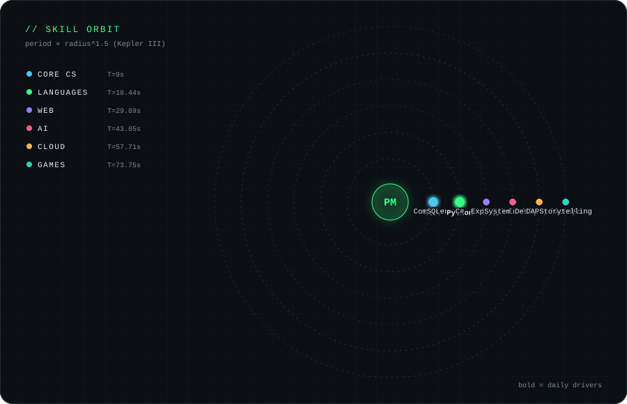
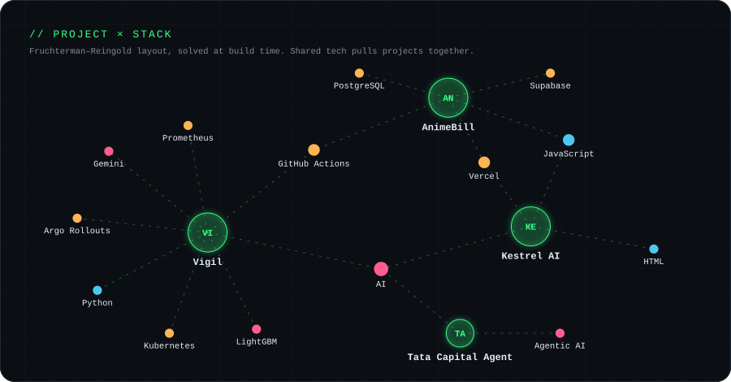
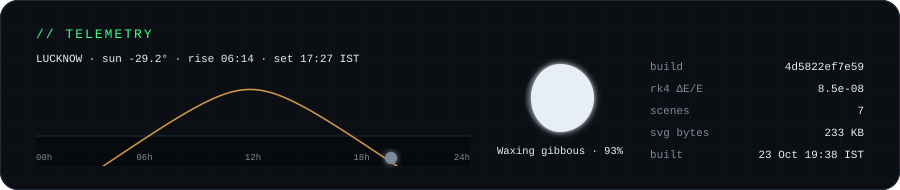
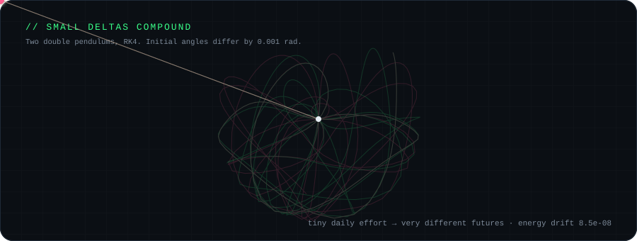

<div align="center">


<a href="https://iprsnmsra.vercel.app/">Portfolio</a> &nbsp;·&nbsp;
<a href="https://www.linkedin.com/in/iprsnmsra">LinkedIn</a> &nbsp;·&nbsp;
<a href="mailto:prasoonmishra9c@gmail.com">Email</a> &nbsp;·&nbsp;
<a href="https://leetcode.com/u/iprsnmsra/">LeetCode</a>







</div>

| Project | What it does | Live |
|:--|:--|:--|
| **[Vigil](https://github.com/iprsnmsra/vigil)** | Self-healing CI/CD platform. Canary rollback in 1.4 s, Gemini incident postmortems, LightGBM flaky-test quarantine (F1 0.9916). | — |
| **[Kestrel AI](https://github.com/iprsnmsra/KESTERAL-AI-Threat-Analyzer)** · [live](https://kestrel-ai-threat-analyzer.vercel.app/) | AI-powered threat analysis and deception platform. 3rd place at the HackSecure Hackathon. | — |
| **[AnimeBill](https://github.com/iprsnmsra/AnimeBill)** | Every receipt hides a unique anime character sketch. Supabase auth + Postgres, CI on every push. | — |

<div align="center">







</div>

<details>
<summary><b>How this README is built</b></summary>

<br/>

Nothing here is a screenshot or an embedded widget. `data/profile.toml` is compiled by [`forge/`](forge) (Python, standard library only) into the SVG scenes above:

- **Physics is simulated at build time.** Letters fall with real ballistic bounces, the pendulums use RK4 (energy drift is printed in the telemetry strip), skill orbit periods follow Kepler's third law.
- **The project graph is solved**, not drawn: Fruchterman–Reingold force layout over project × technology edges.
- **The sigil in the hero is a Lissajous curve derived from `sha256(profile.toml)`**, so it changes when the profile changes.
- **The sun and moon are computed** (NOAA solar-position algorithm, synodic moon phase) for Lucknow at build time.
- A [GitHub Action](.github/workflows/build.yml) rebuilds every 6 hours, pulls live repo stats, validates every SVG, and commits only when something changed.

```bash
python -m forge build     # regenerate everything
python -m forge verify    # lint SVGs + check the build is deterministic
python -m unittest        # physics and astronomy tests
```

</details>

<sub>profile hash `4d5822ef7e59`</sub>
